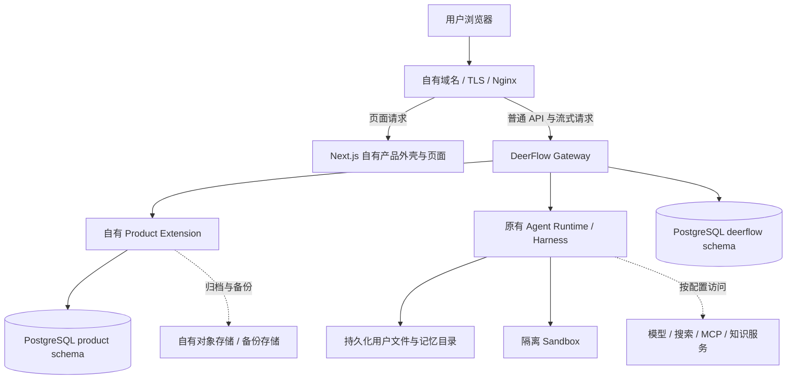

# DeerFlow 自有产品改造与上游兼容 PRD

| 项目         | 内容                                                                       |
| ------------ | -------------------------------------------------------------------------- |
| 文档版本     | 1.1，修订现有产品化方案                                                    |
| 编写日期     | 2026-09-21                                                                 |
| 状态         | 按 PRD 分阶段实施中；交付范围和未完成项以第 13 节为准，P0 验收尚未全部通过 |
| 适用仓库     | 当前 `shaohua-code/sh-deerflow2` 工作副本                                  |
| 审计基线     | `f8d6980dd43fe70fd831e9a747699b6fac5d813f`，本地 `main`                    |
| 本地版本标识 | 前后端声明为 `2.1.0`；不能据此认定与官方某一 release 完全相同              |
| 默认产品形态 | 自有品牌、单组织多用户、自主托管；对外客户优先独立部署                     |
| 后续选项     | 多组织协作、共享实例 SaaS、计费、独立前端仓库，按业务需要立项              |

## 文档导航

本文是全局产品目标、架构边界、数据治理和 DeerFlow 上游兼容策略的**整体 PRD**。配套的落地文档：

- [改造进度与后续计划](../改造进度与后续计划.md)：切换模型的首读入口，集中维护当前状态、验证缺口、后续任务与每轮更新规则；第 13.3 节保留详细实施历史。
- [前端项目结构说明](../项目结构.md#source-1)：页面路由、业务目录、聊天数据流和自有 UI 改造边界。
- [后端项目结构说明](../项目结构.md#source-2)：Gateway、Harness、扩展 API、持久化及产品后端边界。
- [首期 MVP 启动与上线 PRD](首期上线规划.md)：首发范围、验收标准、里程碑和试点发布闸门。
- [前端开发者产品化指南](../自有项目改造指南.md)：常用文件入口与实际改造指引。
- [上游补丁台账](../上游补丁台账.md)：记录自有改动及后续合并时的复核事项。
- [多产品 AI 底座方案](多产品平台方案.md)：用户已确认“自己的多个产品，统一管理底座”；规划应用身份、应用数据隔离与平台 API。该方案尚未实施，不代表共享实例多客户 SaaS 已立项或通过验收。
- [后期改造计划](../后期改造计划.md)：将上述方向登记为 MP00～MP04 待办，明确改造范围、依赖、实施顺序与验收标准；不替代当前首期收尾及发布闸门。

## 1. 决策摘要：应该怎样改造

**建议把 DeerFlow 作为可升级的 Agent 底座，在其上建设自有产品界面、业务扩展和数据管理能力。** 前期保留一个仓库和现有运行链路，把自有代码集中放在独立目录，以少量接入点连接原系统。

“变成自己的项目”分为五件事：

1. **产品自己定义**：自己的名称、域名、Logo、主题、首页、工作台、导航、帮助与管理后台。
2. **业务代码自己维护**：产品页、自有 API、业务表、审计、数据管理流程由自己维护；Agent 调度、流式协议、沙箱及基础持久化继续复用 DeerFlow。
3. **数据与账号自己掌控**：数据库、运行文件、记忆、配置、密钥、备份均在自己控制的环境中，能够导出、删除、恢复和迁移。
4. **版本自己发布**：自己构建镜像、管理发布清单和生产配置，明确产品版本与所基于的 DeerFlow 提交。
5. **上游有节奏地吸收**：固定版本基线，维护适配器和补丁台账，通过测试及迁移演练后升级。

**兼容目标是升级成本可控、风险可验证，不承诺任意上游版本零冲突或自动兼容。** HTTP/SSE 行为、数据库迁移、扩展接口及前端内部组件都可能变化。

### 1.1 方案选择

| 方案                                           | 优点                         | 代价                                   | 结论                    |
| ---------------------------------------------- | ---------------------------- | -------------------------------------- | ----------------------- |
| 在原目录零散修改页面、业务和数据库             | 首批修改快                   | 自有逻辑与上游混杂，升级冲突增加       | 仅适合短期原型          |
| 同仓库产品层 + 扩展包 + 少量核心接入补丁       | 复用成熟交互，差异可集中审计 | 仍需维护前端接缝和扩展兼容             | **首选**                |
| 全新前端 + 独立业务后端，DeerFlow 作为内部服务 | 产品与引擎发布边界清晰       | 重新对接流式恢复、文件、认证和管理接口 | UI 与业务明显分化后演进 |
| 全量重写或全仓重命名 DeerFlow                  | 内部命名统一                 | 丧失上游复用优势，大量无业务收益差异   | 不纳入本方案            |

### 1.2 默认范围与待决策项

目前未给定产品名、客户数量、行业业务、预算和数据地域要求，先采用以下设计假设，不视为已经确认的业务需求：

- 首版为一个组织使用的多用户系统；个人数据继续按现有 `user_id` 隔离。
- 主流程为登录、创建会话、执行 Agent、管理历史及文件，复用已有 Projects、Agents 和定时任务。
- 多个外部客户优先采用每客户独立实例、数据库、文件卷及密钥。共享实例多租户另行立项。
- 首版不增加支付、套餐结算、远程插件市场，不强制引入 Kubernetes、向量数据库或新队列。
- 正式设计前补充：产品名与视觉稿、内部使用还是对外销售、用户及并发规模、是否允许外部模型、部署地域、恢复目标、已有数据迁移范围。

**OIDC 开户与令牌保管状态（2026-10-09）：** 新 OIDC 用户始终以普通账号开通；旧 `admin_emails` 配置项仅为兼容而保留，开户逻辑忽略它。邮箱声明和默认值都不能授予管理员能力，管理员权限需由 IAM 明确授权。IAM Provider 可显式启用 AES-256-GCM 服务端 token vault，按本地 session 保存并在 logout 删除对应行；需配置后端密钥和 migration `0026_iam_oidc_token_vault`。Gateway 在线权限映射、上游 refresh rotation/远程撤销、真实 IAM 联调仍待完成。该 vault 不批量降级既有账号。

**IAM 模型用量回归复核（2026-10-11）：** 后端虚拟环境运行 `test_model_factory.py`、`test_iam_model_usage_callback.py`、`test_iam_model_usage.py` 和 `test_worker_iam_credentials.py`，110 项通过、1 项已有警告（37.47 秒）。测试仅使用 mock 和隔离夹具，未连接真实 IAM、模型提供方或开发数据库。结算 outbox、进程崩溃恢复和线上验收尚未完成，因此模型额度强制执行继续关闭。

## 2. 当前仓库事实与实际缺口

本节依据本地代码与配置模板，不表示已经检查或更改实际生产环境。官方仓库用于确认上游来源，不能替代当前副本的代码审计。[官方 DeerFlow 仓库](https://github.com/bytedance/deer-flow)

| 领域        | 已核实事实                                                              | 改造任务                                                              |
| ----------- | ----------------------------------------------------------------------- | --------------------------------------------------------------------- |
| Git 来源    | `origin` 已指向自有仓库；本地仅一次初始化提交，没有 `upstream`          | 保留 origin，追溯真实上游基线，见第 10 节                             |
| 前端        | 已有聊天、历史、产物、Agent、Projects、能力中心和设置                   | 新增品牌与产品外壳，保留复杂聊天状态逻辑 [S01]                        |
| 认证        | 已有本地登录、OIDC、Cookie 会话、CSRF 和 PAT                            | 配置复用，不重写密码与登录体系 [S02]                                  |
| 授权        | 已有 owner 检查、管理员边界、可插拔 RBAC；细粒度 authorization 默认关闭 | 启用并配置产品策略；关闭细粒度授权不等于没有登录或 owner 隔离 [S02]   |
| 运行时      | Gateway 内嵌 RunManager、Agent runtime、StreamBridge                    | 保留运行、取消、流式恢复及调度语义 [S03]                              |
| 数据库      | `database` 可统一配置应用数据、LangGraph checkpoint 和 Store            | PostgreSQL 生产部署；检查遗留 `checkpointer` 覆盖；独立业务迁移 [S04] |
| 默认模板    | SQLite、`run_events.backend: memory`、`agent_storage.backend: file`     | 不能只改数据库而忽略事件、Agent 和文件持久化 [S05]                    |
| 文件 / 项目 | 已有上传、产物、个人项目文档、回收站和清除流程                          | 复用现有 API，补跨资源文件中心与数据治理 [S02]                        |
| 用量        | 已有个人 Console 的运行、token 和成本估算                               | 复用个人统计；组织额度与结算是增量，估算不是财务账单 [S02]            |
| Python 扩展 | 当前接口支持八类贡献                                                    | 优先扩展自有 API 与服务；部分概览仍写五类，以接口为准 [S07]           |
| 租户        | 现有核心模型以用户归属为主，不是完整组织多租户                          | 首版单组织；共享 SaaS 须做全链路隔离                                  |
| 数据治理    | 资源删除不等于全账号擦除，也不是完整备份体系                            | 补编排、进度、重试、保留期和恢复验收                                  |

当前八类扩展贡献是：中间件、任务生命周期、系统模型调用观察、Agent 组装观察、上下文压缩观察、Gateway 管理动作观察、Gateway 服务、HTTP Router。[S07]

## 3. 用户角色与产品目标

| 角色           | 核心诉求                                   | 权限边界                            |
| -------------- | ------------------------------------------ | ----------------------------------- |
| 普通用户       | 使用助手，管理自己的会话、文件、记忆与集成 | 本人及明确授权的资源                |
| 产品管理员     | 管理功能、用户状态、共享模型与能力、审计   | 管理权限不自动等于读取全部会话正文  |
| 部署运维       | 配置密钥、发布、备份、恢复和升级           | 基础设施高权限操作留审计            |
| 未来组织管理员 | 管理本组织成员、资源和额度                 | P2 引入，不直接复用部署级超级管理员 |

小规模环境中管理员与运维可由同一人担任，但 API 权限与审计仍区分操作类型。新增业务角色不假设上游自动识别。

首版成功标准：

- 主要页面、登录、导航、帮助链接和 metadata 使用自有品牌，同时保留开源许可声明。
- 登录 → 上传 → Agent 执行 → 查看产物 → 刷新历史 → 取消 / 失败恢复主链路通过验收。
- 重建应用容器后，账号、完整历史、记忆、文件和 Agent 配置仍可读取。
- 用户 A 不能通过修改 URL、资源 ID、请求体、下载地址或流式重连读取用户 B 的数据。
- 完成一次实际备份恢复与一次候选上游升级演练，交付验证记录。
- 每项核心改动都有需求、维护人、补丁说明和回归测试。

## 4. 功能需求与页面规划

P0 为首版必需；P1 为稳定后增强；P2 按业务需求另行立项。

| 编号  | 优先级 | 需求                   | 验收重点                                                     |
| ----- | ------ | ---------------------- | ------------------------------------------------------------ |
| FR-01 | P0     | 品牌与产品配置         | 产品名称、资源和外链集中管理，不散落重复硬编码               |
| FR-02 | P0     | 自有首页、工作台、导航 | 登录进入自有工作台，保留会话深链接，刷新和返回正常           |
| FR-03 | P0     | 登录、用户和权限接管   | 复用现有身份，注册策略明确，后台校验权限                     |
| FR-04 | P0     | 会话与 Agent 复用      | 消息顺序、工具、子任务、澄清、取消和断线恢复正常             |
| FR-05 | P0     | 存储接管               | 数据库、文件、记忆、配置、密钥均有资产清单和恢复方式         |
| FR-06 | P0     | 文件与个人数据管理     | 文件检索、预览、下载；导出与删除任务有范围和可追踪状态       |
| FR-07 | P0     | 业务 API 与扩展骨架    | `/api/product/v1/*` 与原 API 共存，使用可信身份与 owner 检查 |
| FR-08 | P0     | 管理和基础审计         | 管理用户状态及功能，记录配置变更、导出、删除等关键操作       |
| FR-09 | P0     | 备份恢复与升级         | 在隔离环境恢复旧数据，完成候选升级及回退验证                 |
| FR-10 | P1     | 知识库产品页           | 选择一种已有集成或自有服务，验证检索权限、导入和引用溯源     |
| FR-11 | P1     | 用量与额度             | 复用已有统计，增加可靠归集；硬额度在服务端权威入口阻断       |
| FR-12 | P1     | 团队共享               | 定义分享、撤权和继承；不能默认把个人 Projects 当共享空间     |
| FR-13 | P2     | 共享实例多租户         | 通过第 8 节全链路隔离验收后开放多客户共用                    |
| FR-14 | P2     | 计费、高可用、独立服务 | 有规模与商业需求后建设                                       |

### 4.1 页面信息架构

| 页面                        | 建议路径                            | 内容与交互                                  |
| --------------------------- | ----------------------------------- | ------------------------------------------- |
| 首页                        | `/`                                 | 自有介绍和登录入口，也可直接跳工作台        |
| 登录 / 初始化               | 复用 `/login`、`/setup`、认证回调   | 替换视觉，保留 Cookie、CSRF、OIDC 语义      |
| 工作台                      | 新增 `/workspace/dashboard`         | 最近会话、执行中任务、常用 Agent、最近文件  |
| 会话                        | 保留 `/workspace/chats/[thread_id]` | 复用聊天内部逻辑，调整外壳和视觉            |
| Agent / Projects / 定时任务 | 复用各自已有路由                    | 按权限及后端能力展示                        |
| 文件中心                    | 新增 `/workspace/files`             | 复用现有资源，增加跨本人项目/会话的来源索引 |
| 数据与隐私                  | 新增 `/workspace/data`              | 导出申请、范围确认、删除进度及失败重试      |
| 能力中心                    | 保留 `/workspace/capabilities`      | 复用 Skills、MCP 与已有集成                 |
| 知识库                      | P1 新增 `/workspace/knowledge`      | 对接选定知识服务                            |
| 产品管理                    | 新增 `/workspace/admin`             | 产品配置、用户管理、审计与数据任务          |

每页覆盖加载、空数据、无权限、服务错误和部分失败状态。删除显示影响范围及运行中资源；导出只有包生成完成后才提供下载。用户界面使用产品语言，不展示无助于决策的模块路径、schema 等内部细节。

Next.js 的 `(product)` 是路由分组，不改变 URL。不能在已有 `app/workspace` 之外再建一份 `(product)/workspace` 并假设二者无冲突。首版在现有路由树新增页面，页面主体从产品目录导入。

## 5. 总体架构与代码边界



统一入口的 `/api/langgraph/*` 改写至 Gateway 原生 `/api/*`，其他 `/api/*` 直接转发，页面转发到 Next.js。Next.js 不是所有请求的必经后端代理。首版保持同源及原 SSE 协议。[S03]

### 5.1 建议代码布局

以下是目标代码边界。前端产品骨架、带 principal 的 bootstrap API、用户设置 API/独立迁移、偏好 UI、文件中心、独立审计与管理员配置 API、运行版本诊断及 PostgreSQL 部署样例已开始落地；工作台主导航目录现位于 `frontend/src/product/navigation.ts`，由 DeerFlow workspace renderer 消费。账号页也提供通过现有用户隔离 API 生成的前台 JSON 导出。后台持久任务已部分支持偏好导出/删除、会话历史/计划任务/自建 Agent/项目空间/个人记忆的单范围删除（项目资料仍保留在回收站），以及会话历史、项目元数据、计划任务定义、自建 Agent、记忆和受限文件的单范围部分导出；现已可把这七类受支持范围合成一个含覆盖清单的 ZIP，但它仍是部分导出。完整账号导出/删除编排和全业务操作审计仍待实施。文件中心通过产品扩展 API 聚合当前用户的线程上传、输出、会话工作区和项目文档元数据，并在 `fd_0007` 自有迁移中保存按 owner 隔离、可重建的快照；目录仍有扫描上限，支持名称/会话名/项目名检索，工作区文件只读，正文继续通过 Gateway 既有 owner 检查路由访问：

```text
frontend/src/product/                    # 自有前端源码
├── brand.ts                            # 品牌、站点信息、外链
├── features.ts                         # 产品开关，不承担后端授权
├── navigation.ts                       # 导航描述
├── theme/                              # 自有主题变量
├── components/                         # 产品外壳与组合组件
├── pages/                              # 工作台、文件、数据管理、后台
└── api/                                # 产品 DTO 与引擎调用适配器
frontend/src/app/                       # 原路由树，少量产品接入点
frontend/src/core/                      # 尽量复用原认证、API、聊天逻辑

product/backend-extension/              # 扩展开发源，独立 Python 包
├── pyproject.toml
├── flow_desk_product_extension/
│   ├── __init__.py                     # 扩展注册
│   ├── api.py                          # /api/product/v1
│   ├── settings.py                     # 用户设置仓储与迁移生命周期
│   ├── models.py                       # 私有 SQLAlchemy MetaData
│   └── migrations/                     # 自有迁移链和版本表
└── tests/                              # 扩展 API、隔离与迁移测试
product/deploy/                         # 部署覆盖配置与无密钥模板
contracts/product/                     # 自有 API、事件、资源关联契约
docs/上游补丁台账.md                # 后续建立核心补丁台账
docs/upgrades/                          # 后续存放升级与恢复演练记录
```

`backend/extensions/sources/<distribution>/` 是管理器生成的安装快照，不作为开发源目录。开发在 `product/backend-extension/`，发布经扩展管理流程生成可构建快照或使用已验证固定包版本，不直接长期编辑快照。[S07]

### 5.2 前端具体改法

1. 新增品牌配置，覆盖名称、Logo、favicon、metadata、主题、站点/帮助/协议链接和默认入口。
2. 首批接入 `app/layout.tsx`、首页、登录/初始化页、工作台 Header/导航、i18n、设置中的 About 和 `public` 品牌素材。
3. 导航按产品开关、用户权限、`/api/features` 后端能力共同决定；该接口只是能力发现，不是现成品牌配置系统。
4. 自有页面调用 `product/api`；聊天继续复用 `core/threads`、`core/api` 和 artifacts 渲染逻辑。适配层集中 DTO、错误映射和必要版本判断。
5. REST 复用带 Cookie/CSRF 的 fetcher；LangGraph 复用定制客户端，保留 `Last-Event-ID`、SSE `gap` 恢复及终态处理，不换成裸 SDK 后假定兼容。
6. 主题优先使用 CSS variables 和组合组件。按项目规范不手工修改生成的 `components/ui`、`components/ai-elements`，不让全局样式破坏聊天布局。
7. 不批量改内部 `deerflow.*` 包名、事件名、存储 key、资源 ID 和数据库表名。需要修改 key 时单独设计兼容读取与迁移。
8. 盘点 `public/demo` 和公开 showcase：生产构建明确保留、替换或排除。隐藏导航不能阻止公开静态资源被直接访问；私人会话不作为公开演示数据。
9. 品牌扫描区分用户可见文案、技术标识、许可声明和历史用户内容，不要求替换历史消息中的 DeerFlow 字样。

前端没有现成的安装即换肤插件接口，也没有可直接替代当前 `core` 的稳定独立前端 SDK。品牌接入点与路由外壳属于需要长期维护的小范围补丁。[S01]、[S08]

### 5.3 后端具体改法

- 自有扩展优先依赖 `deerflow-extension-api`，通过 Router、Service、观察能力接入，不把业务代码写入 Harness。
- Router 显式声明 `/api/product/v1`。宿主直接挂载，不自动增加该前缀；避免占用已有或免认证路径。[S07]
- 通过 `config.yaml -> plugins` 管理，构建时锁定依赖，变更后重建并重启 Gateway。真实配置及密钥不进 Git。
- 核心会话、run、checkpoint 继续经原服务/API 管理。缺少接口时补最小公共能力并登记补丁，不让业务服务随意写核心表。
- 新业务工具按现有 Tools / MCP / Skills 接入；八类扩展能力不等于可任意改写引擎全部行为。
- 必须调用的内部接口集中到 `adapters/`，记录依赖版本并做契约测试；适配层减少修改面，但不保证未来自动兼容。

**强制边界**：可选扩展的中间件、观察钩子、生命周期及服务启动异常会被隔离并可能放行。`required: true` 约束加载、贡献路由挂载和服务启动失败，会阻断 Gateway 启动；它不能自动令运行期异常阻断请求。权限、账号停用、额度预占必须在权威 API、授权或运行准入边界检查；钩子负责观察与核对。必需产品服务未就绪时，产品 API 和发布就绪检查应拒绝相关服务，不能只凭 Gateway 存活判定可用。[S07]

## 6. 数据自主方案

数据自主包括可定位、可控访问、可备份、可导出、可删除和可迁移。只换域名或只更换数据库连接串不满足该目标。

### 6.1 数据资产清单

| 数据类别                      | 当前机制                                           | 目标与改造要求                                                  |
| ----------------------------- | -------------------------------------------------- | --------------------------------------------------------------- |
| 用户、会话元数据、run、调度等 | 应用持久化层                                       | 自有 PostgreSQL `deerflow` schema，沿用上游模型与迁移           |
| LangGraph checkpoint / Store  | 通常跟随 `database`；旧 `checkpointer` 可覆盖      | 核查实际后端与 schema，备份包含其数据与迁移版本                 |
| 消息及执行事件历史            | memory / JSONL / db                                | 生产选 db；完整历史与 checkpoint 各有用途，不能只导出最近上下文 |
| Agent / 托管 Subagent 定义    | file / db                                          | 选 db；现有文件经迁移演练后导入                                 |
| 上传、工作区、产物            | 用户和线程目录                                     | 持久卷、owner 鉴权、记录实际绝对路径和校验值                    |
| Projects 文档与回收站         | 既有项目文档 API 和存储                            | 复用恢复、清除、保留期与重试能力，纳入导出删除                  |
| 长期记忆                      | 本地文件/Markdown，或所选外部后端                  | 不随 SQL 自动搬迁；外部服务一起纳入备份和删除                   |
| Skills / MCP / 共享能力       | public、自定义、集成技能包与扩展配置               | 自定义源码另行版本化，区分部署级定义与用户凭据                  |
| OAuth / PAT / 集成等凭据      | 各自身份及存储机制                                 | 受控密钥管理、掩码展示、轮换；不进普通导出包                    |
| 共享模型目录及解密材料        | 可在 `DEER_FLOW_HOME/managed-models/`，与 SQL 独立 | 目录及配套密钥一并安全备份，避免丢失解密能力                    |
| 配置与签名材料                | 根配置、环境变量、部分 home 内密钥                 | 盘点 JWT 签名、凭据加密与配置恢复方式，不只备份 YAML            |
| 自有业务、审计、数据任务      | 待新增                                             | `product` schema，自有迁移、权限与保留策略                      |
| 浏览器状态                    | 部分偏好同步，部分仅本地缓存/草稿                  | 区分可重建缓存与需同步的用户状态                                |
| traces、日志与支持包          | 本地或外部出口                                     | 独立留存、脱敏和权限，不默认无限保存                            |

文件典型位置是 `{DEER_FLOW_HOME}/users/{user_id}/threads/{thread_id}/user-data/{uploads,outputs,workspace}`，但记忆等路径可单独配置。清单必须记录实际解析路径、后端、归属、加密材料、备份与恢复负责人，不能只写“备份 `.deer-flow`”。[S04]、[S05]、[S06]、[S09]

### 6.2 数据库与实体边界

- 首版同一自有 PostgreSQL 实例内分 `deerflow` 与 `product` schema，连接权限和迁移所有权分开；后续可拆库。
- 上游应用 Alembic 管应用表，LangGraph checkpoint/Store 保留其自身迁移所有权；产品独立 metadata、迁移链及版本表，不挂入上游 Base。
- 产品表使用自有 `flowdesk_` 前缀，并在 operator-controlled 插件声明 `table_prefix: flowdesk_`，配合宿主 autogenerate 排除机制。独立版本表为 `flowdesk_alembic_version`，不混用宿主 `alembic_version`。PostgreSQL 迁移和表显式指定 `product` schema；SQLite 使用 SQLAlchemy schema map 映射到默认库。[S07]、[S12]
- 跨边界保存稳定资源 ID，尽量不建立依赖上游结构的强外键，通过校验及清理任务管理生命周期。
- 消息、checkpoint、事件仍以引擎为权威数据源；产品索引只是可重建投影，不另造第二套聊天记录。
- 给已有安装添加 `postgres_schema` 不会自动移动旧表。必须迁移与核对，不能用“新库启动成功”代替旧数据验证。

| 拟新增实体                                                      | 阶段                   | 用途                                                                                                                                                                                                                                                                                                                                                              |
| --------------------------------------------------------------- | ---------------------- | ----------------------------------------------------------------------------------------------------------------------------------------------------------------------------------------------------------------------------------------------------------------------------------------------------------------------------------------------------------------- |
| `product_settings`                                              | P0                     | 部署 ID、品牌、功能开关、配置版本，不存明文密钥                                                                                                                                                                                                                                                                                                                   |
| `product_user_profiles`                                         | 按 P0 需要             | 关联原 user_id 的业务资料，不复制密码或会话                                                                                                                                                                                                                                                                                                                       |
| `product_audit_events`                                          | P0                     | 操作者、动作、资源、结果、时间、request/run ID，默认不存消息正文                                                                                                                                                                                                                                                                                                  |
| `product_data_jobs`                                             | P0                     | 导出/删除任务、owner、范围、状态、重试、期限和结果；`fd_0004`–`fd_0006` 已接入 API/租约 worker、operator 开关、一人一个活动任务及每小时十次新请求限制；单范围导出支持偏好、会话、项目元数据、计划任务、自建 Agent、记忆与文件，并可合成为部分 ZIP；删除覆盖偏好、计划任务定义、自建 Agent、本人会话历史、项目空间及配置后端支持的本人记忆清空，尚非账号级全量擦除 |
| `flowdesk_file_catalog_state` / `flowdesk_file_catalog_entries` | P0 已落地（`fd_0007`） | 每位用户的当前快照、刷新租约、覆盖状态与最多 10,000 条文件元数据；不保存正文、宿主路径或授权凭据，可从 Gateway reader 重建                                                                                                                                                                                                                                        |
| `product_usage_ledger`                                          | P1                     | 来源事件、run/model、用量、价格版本、幂等键                                                                                                                                                                                                                                                                                                                       |
| `product_organizations` / `product_memberships`                 | P2                     | 组织、成员、角色，与引擎隔离策略一并设计                                                                                                                                                                                                                                                                                                                          |

这些表只由产品迁移链管理。P0 行归属使用服务端确定的部署 ID 与 user_id，不通过预加 tenant_id 就宣称实现多租户。

### 6.3 文件与知识库

首版保留运行时文件系统与沙箱路径。对象存储先用于备份、归档或封装后的成品文件，**不是一个配置开关就能替换全部工作区**。

若后续以对象存储为主文件库，需要上传暂存、物化工作区、同步与校验、产物上传、冲突处理、鉴权下载、取消与清理机制。Agent 仍需可执行的读写目录，不能直接把本地目录配置改成 S3 URL。

文件中心通过自有扩展 API 聚合上传、产物、会话工作区和项目文档元数据；`fd_0007` 起将 Gateway reader 的 owner-scoped 投影保存在产品自有数据库中，每个用户只保留一个活动快照，最多 10,000 条。目录最多扫描 5,000 个会话、5,000 个项目，每个会话工作区最多遍历 200 个目录；达到上限或来源不可用时反馈覆盖不完整。首次读取或快照达到 5 分钟有效期时重建；手动刷新仍遵守每用户 30 秒刷新间隔和数据库租约，并向界面说明被延后的请求。刷新失败时保留上一快照、标记陈旧，不把失败伪装为空目录。前端在快照上完成名称搜索和 50 条分页，避免翻页重复遍历磁盘。工作区跳过生成目录并拒绝符号链接/联接点，页面对工作区文件只提供只读打开；后台文件导出已经纳入有界工作区文件，但仍过滤敏感名称、跳过派生预览和回收站且不扫描正文密钥。索引只存文件元数据，不存正文、宿主路径或签名下载凭据；内容继续由 owner 检查后的 Gateway 路由传输。需要注意快照是有界、可能陈旧的可重建投影，不是完整文件清单或备份。

知识库不是首版必选基础设施。先确认个人文档检索、组织知识或业务查询场景，再选择一种服务路径；覆盖数据集权限、源文件、向量数据、引用与外部删除。

### 6.4 导出、删除与备份分别实现

**用户导出**：提供可移植 JSON / Markdown / 文件包，覆盖可见完整历史、文件、Agent 定义和可导出记忆，说明截点、失败资源和校验值。不包含凭据或其他用户内容。可读导出不等于能够恢复 LangGraph 的继续执行状态。

**用户删除**：冻结目标写入，停止/排空相关任务，再清理会话、checkpoint、事件、文件、记忆、Agent、Projects、调度、凭据及缓存。以持久化任务编排跨 DB/文件/外部服务步骤，记录部分失败并可重试；全部要求步骤完成后才显示成功。原线程删除存在 best-effort 清理，不能当作全账号擦除。已有项目回收站能力继续复用。

**运维备份**：覆盖数据库、运行目录、配置和解密材料，形成一致恢复点；不作为普通用户下载包。历史备份在约定保留期到期清除，恢复时重放删除清单，避免已删除数据重新上线。恢复演练默认停用 Scheduler、IM/Webhook 和外部写入，防止重放副作用。

## 7. API、身份与执行规则

### 7.1 产品 API 契约与当前实现

下表同时记录目标接口和当前实现范围。标记为“首版”不表示已经交付完整账号数据治理；尚未实现的能力不能仅因前端页面已有入口而视为可用。

| 接口                                         | 用途                     | 服务端约束                                                                                                                                                                                                                                                                                                                                                       |
| -------------------------------------------- | ------------------------ | ---------------------------------------------------------------------------------------------------------------------------------------------------------------------------------------------------------------------------------------------------------------------------------------------------------------------------------------------------------------- |
| `GET /api/product/v1/bootstrap`              | 产品配置、导航、有效功能 | 已实现首版：可信身份解析，只返回非敏感配置                                                                                                                                                                                                                                                                                                                       |
| `GET /api/product/v1/settings`               | 当前用户的产品偏好       | 已实现首版：owner 从可信 principal 派生，不接收客户端 user_id；JSON 单项不超过 64 KiB                                                                                                                                                                                                                                                                            |
| `PUT/DELETE /api/product/v1/settings/{key}`  | 保存或删除单项 JSON 偏好 | 已实现首版：校验 key 格式和 64 KiB 上限；每次操作限定在当前用户                                                                                                                                                                                                                                                                                                  |
| `GET /api/product/v1/files`                  | 本人文件列表             | 从产品数据库读取 owner-scoped 可重建快照；过期/显式刷新时由 Gateway reader 有界重建，返回截断、失败、陈旧和延迟刷新状态，内容继续走现有授权文件路由                                                                                                                                                                                                              |
| `DELETE /api/product/v1/files/catalog-entry` | 刷新本人已删除文件的缓存 | 仅按 principal 删除本人的快照元数据行并标记快照陈旧；实际文件删除必须先由 Gateway owner-check 路由完成                                                                                                                                                                                                                                                           |
| `POST /api/product/v1/data-exports`          | 创建导出                 | 已实现单一 scope 首版：preferences、threads、projects、scheduled_tasks、agents、memory、files 或组合 account；组合 scope 会把前七类生成 JSON 子包并打成含覆盖清单的 ZIP，下载端仍标记 partial；使用 Gateway principal owner、`Idempotency-Key` 和持久 worker；包含凭据、checkpoint 等完整账号导出仍未交付                                                        |
| `GET /api/product/v1/data-jobs[/{id}]`       | 导出/删除进度            | 已实现：owner-scoped 分页列表、`has_more`、详情、取消和下载；其他用户统一 404，产物 24 小时过期                                                                                                                                                                                                                                                                  |
| `POST /api/product/v1/data-deletions`        | 创建删除                 | 已实现偏好、计划任务定义、自建 Agent、本人会话历史、项目空间、个人记忆和受限文件七种窄范围删除；分别要求范围专属确认，Gateway owner capability 不可用时失败关闭；项目资料移入回收站，文件范围删除本人上传并将项目资料移入回收站，输出/工作区文件保留并报告部分完成，会话正文保留，记忆范围要求已配置 backend 覆写 `clear_memory`；全账号擦除与近期身份验证待接入 |
| `GET /api/product/v1/admin/audit-events`     | 审计查询                 | 已有首版：管理员 principal 校验、脱敏元数据、限制分页；事务内覆盖产品偏好/配置写入，账号启停由公开 observer 在宿主提交后 best-effort 记录；其他业务动作待接入                                                                                                                                                                                                    |
| `GET/PATCH /api/product/v1/admin/settings`   | 在线产品配置             | 已有首版：管理员校验、expected_version 冲突保护；仅改中英文品牌名和白名单展示开关                                                                                                                                                                                                                                                                                |
| `GET /api/product/v1/version`                | 产品与引擎兼容信息       | 已有首版：返回非敏感产品和已安装分发版本，缺包元数据返回 unknown                                                                                                                                                                                                                                                                                                 |

写操作沿用 CSRF 保护。错误、分页、数据任务及文件目录契约已整理在 `contracts/product/`；前端按用户在 sessionStorage 暂存未确认的数据任务幂等键，并要求显式同键重试恢复。用户管理优先复用已有认证管理接口，不额外实现一套账号库。

### 7.2 权限要求

1. 扩展用宿主 principal resolver 解析身份，不相信请求体传入的 user_id、is_admin、is_internal 或未来 organization_id。
2. 当前 principal 的角色来自系统角色，不是组织成员系统；列表及详情均需 owner/业务授权。
3. PAT、浏览器 Cookie、内部任务分别测试；管理员用户的 PAT 不能自动视为管理员浏览器会话。
4. 普通用户不可修改部署级模型、MCP、托管 Subagent 或安装 Python 扩展。部署共享定义与个人凭据在 UI/API 都区分。
5. 账号停用覆盖现有会话、PAT、排队调度与后续运行准入，不能只隐藏登录入口。
6. 扩展与 Gateway 同进程同权限，不是执行客户代码的安全沙箱；宿主给扩展的跨用户读取能力不得直接透传给普通用户。
7. 硬额度需在权威准入/执行边界预占核销，处理重试和取消；观察回调用于对账，不能单独承担强制授权或财务账本。

上线前特别检查历史 `user_id=NULL` 或未登记线程。现有兼容读取和 `migrate_user_isolation.py` 的默认归属不能替代人工确认；先 dry-run，将未知归属记录明确认领、隔离或保留只读，不直接归给共享默认用户。

## 8. 多租户边界与演进条件

首版支持单组织多用户，部署级共享模型、Skills、MCP、托管 Subagent 由可信管理员管理。多个客户先独立实例，复用同一镜像和部署自动化。

共享实例 SaaS 上线前，必须覆盖：

| 隔离对象  | 必须验证的行为                                                     |
| --------- | ------------------------------------------------------------------ |
| 身份      | 组织成员、角色、切换、退出/撤权；浏览器组织 ID 不是授权证据        |
| 原生资源  | threads、runs、Projects、Agent、调度的列表、详情、执行、取消、删除 |
| 运行态    | checkpoint、memory、缓存、SSE 重连、子任务、内部调用与回调         |
| 文件      | 目录、沙箱挂载、产物引用、导出包、签名下载与临时文件               |
| 配置/凭据 | 组织级与部署级模型、MCP、Skills、令牌及管理员能力                  |
| 后台作业  | 调度、IM/Webhook、导入导出、删除及用量身份传递                     |
| 生命周期  | 多组织成员、组织转移、成员撤权、缓存失效与全组织删除               |

不能只过滤产品 API，却让原生 `/api/threads`、`/api/langgraph` 绕过组织规则。上游扩展点不够时，需要最小核心补丁并维护测试，或继续实例隔离。

记忆绝对 `storage_path` 可能绕过默认用户目录，必须专项检查；在全部调用路径身份传递通过后启用适用的严格用户范围策略。`LocalSandboxProvider` 的路径映射不是宿主安全隔离，生产多用户使用隔离沙箱并限制网络和挂载。[S06]、[S10]

## 9. 配置、部署与运维

### 9.1 首版部署组合

- 自有域名/TLS入口，保留同源 Cookie、CSRF、流式代理；可信代理清理外部转发头。
- Frontend + 单 Gateway 进程 + PostgreSQL + 持久化目录 + 隔离沙箱；Scheduler 保持当前单实例模式。
- 数据库、Gateway、Provisioner、沙箱不作为公共入口暴露。
- 自己掌握模型、搜索、MCP、追踪等账户和配置；生产不使用开发认证旁路。
- 固定镜像和依赖，构建阶段安装扩展，生产启动不在线解析浮动依赖。

### 9.2 持久化配置示意

以下只是新增部署片段，不能覆盖完整配置，也不能自动迁移旧数据：

```yaml
database:
  backend: postgres
  postgres_url: $DATABASE_URL
  postgres_schema: deerflow

run_events:
  backend: db
  track_token_usage: true

agent_storage:
  backend: db

auth:
  local:
    allow_registration: false
```

当前解析器使用 `$DATABASE_URL`，不是 shell/Compose 的 `${DATABASE_URL}` 语法。完整模型、沙箱、认证和授权仍需配置。关闭公开注册不等于禁用登录；OIDC 邮箱限制也不会自动约束本地注册。[S04]、[S05]

显式设置 `DEER_FLOW_HOME` 并持久挂载，另盘点记忆等可独立配置路径。真实配置、`.env`、凭据和运行数据不进 Git。`extensions_config.json` 有运行时写入需求，应持久可写；`config.yaml` 的运维变更与只读生产挂载分开处理。

### 9.3 初始数据迁移

先区分新部署与已有数据。改连接串不会自动搬迁 SQLite、JSONL、Agent 文件、记忆和磁盘资源。

迁移流程：盘点、停写 → 一致性备份 → 恢复副本建立目标环境 → 按资产迁移 → 核对 owner/ID/数量/校验值 → 验证历史、记忆、Agent、调度 → 切流 → 旧环境保留只读。

Agent 定义可参考已有 `backend/scripts/migrate_agents_to_db.py` 先 dry-run。SQLite → PostgreSQL、JSONL → db 等完整迁移是否已有满足需求的工具，逐项确认；不以简单 SQL 导表代替验收。

### 9.4 后续多实例条件

多 Gateway worker/实例按现有要求验证 PostgreSQL、`run_ownership.heartbeat_enabled: true`、`run_events.backend: db` 及共享流式桥接（如 Redis）。数据库共享不能替代文件、记忆和配置共享；Redis 故障也不能假设无感降级。[S10]

Scheduler 多实例需显式启用 `scheduler.multi_instance` 并满足存储/租约条件，保留 queued / launching / running 的持久化和幂等语义。IM、Browser 等进程内状态另外审计；依赖单进程浏览器能力时不直接扩大 worker 数。

首版无需独立 Scheduler 或新队列。以后拆分属于新增架构工作，当前内嵌服务不能直接当作已有独立组件部署。

### 9.5 数据外发边界

自主托管不代表所有内容自动留在本机。模型可能接收提示词、历史、文件；搜索、MCP、IM、知识服务、远程记忆和 tracing 也可能外发数据。按启用功能列出发送内容、目的端、账户、留存和停用方式。需要完全受控时，同时采用私有模型/检索并限制出口，不作与实际配置不符的绝不外传承诺。

## 10. 上游兼容与版本治理

### 10.1 第一件事：建立可验证升级基线

当前 `origin` 已是 `https://github.com/shaohua-code/sh-deerflow2.git`，**不能把它重命名为官方 upstream**。本地非浅克隆但仅一次 `first commit`，尚不能证明与官方历史有共同祖先，`2.1.0` 也不能确定代码来源。

实施阶段可配置官方远程。以下仅为操作示例，本次未执行：

```bash
git remote add upstream https://github.com/bytedance/deer-flow.git
git fetch upstream --tags
```

如已存在 upstream，先核对地址。后续步骤：

1. 保留当前完整快照与历史，记录 SHA，不覆盖已有改动。
2. 在独立工作目录比对候选官方提交的依赖锁、源码、文档与来源记录，找到可验证基线。
3. 从确认的上游提交创建集成分支，审计当前快照差异，分成产品代码、适配代码、核心补丁，排除运行数据和凭据。
4. 把需要保留的差异作为清晰提交迁入新分支，验证功能和数据兼容；原历史保留，不靠强推覆盖修复。
5. 验证后选择新集成分支作为后续主线，并记录迁移过程。
6. 找不到可信来源时标记 `upstream_base: unverified`，从经过评估的官方版本逐项迁移现有能力；此时不能承诺常规自动 merge。

`git fetch` 不会恢复重新初始化丢失的历史，`--allow-unrelated-histories` 不作为常规升级流程。

### 10.2 分支与发布记录

- `main`：自有产品可发布主线。
- `codex/<feature>`：单项变更；是否增加 develop 按团队节奏决定。
- `codex/upgrade-deerflow-<target>`：候选升级集成与验收。
- 有共同祖先后合并选定 tag/SHA，不重写已经共享的生产历史；上游 main 只观察，不自动部署。

每个自有发行版保存机器可读清单：

| 字段                                  | 作用                     |
| ------------------------------------- | ------------------------ |
| 产品版本/提交                         | 自有发布身份             |
| 官方基线 SHA / 可选 tag               | 精确来源，不能只写版本号 |
| extension-api / 自有扩展版本及哈希    | 扩展依赖追溯             |
| 前后端及沙箱镜像 digest               | 构建部署可复现           |
| 宿主、产品、checkpoint/Store 迁移版本 | 分别判断数据兼容         |
| 配置版本 / uv与pnpm锁文件哈希         | 识别配置和依赖变化       |
| 回退目标与演练记录                    | 明确可恢复状态           |

产品版本与上游基线分开记录。如果修改仓库既有 release 版本，按 `RELEASING.md` 同步 backend、frontend、Helm 的四个值，不能只改前端。[S11]

### 10.3 兼容契约

| 契约      | 回归内容                                                 |
| --------- | -------------------------------------------------------- |
| HTTP/认证 | URL、DTO、错误、分页、Cookie、CSRF、OIDC、PAT            |
| SSE/历史  | 消息、工具、子任务、顺序、取消、cursor、gap、历史分页    |
| 数据/文件 | user/thread/run ID、checkpoint、事件、路径、产物与 owner |
| 扩展      | 注册接口、principal、生命周期、异常策略和服务就绪        |
| 配置      | 字段、默认值、环境变量、热更新与重启边界                 |
| 前端      | 路由、layout、providers、复用 hooks/组件、能力发现       |
| 后台      | 幂等键、租约、调度队列、取消、重启恢复与身份归属         |

本地 `deerflow-extension-api` 为 `0.2.1`，需关注 1.0 前接口变化。产品先支持发布清单中的一个精确引擎组合；上一版仅是经过测试的回退候选，不自动承诺任意 N/N-1 同时兼容。[S07]

### 10.4 核心补丁台账

每条记录包含：补丁 ID、需求 ID、文件、范围、负责人、无法用配置/扩展实现的原因、基线 SHA、自有提交、回归测试、上游关联、移除条件、最近升级验证结果。

优先让补丁集中在品牌/路由接缝与缺失的必要接口。通用修复适合贡献上游，上游接纳后移除重复补丁。产品目录稳定不代表调用的引擎接口稳定。

### 10.5 每次升级的完整流程

1. **选版**：记录目标 SHA、收益与变化，检查认证、迁移、流式、配置、扩展及依赖。
2. **分析**：对照台账处理冲突、移除旧补丁、更新适配器，不触碰生产数据。
3. **构建测试**：锁定依赖，构建前后端/扩展，完成适用的格式、类型、单元与权限测试。
4. **数据演练**：在隔离环境恢复受控备份，再升级，验证历史、文件、记忆、调度和配置。
5. **恢复演练**：实际恢复原版本与备份；仅能向前修复时明确记录。
6. **维护窗口**：停止新任务和调度，排空或按规则取消运行，阻止 IM/Webhook 等继续写入，生成一致恢复点。
7. **迁移发布**：受控单一执行者迁移，上线固定镜像并校验必需服务就绪，避免多个实例竞争迁移。
8. **放量验证**：先指定账号，再正常业务；未证明数据库双版本兼容，不让新旧版本同时写同一库。
9. **收尾**：检查鉴权、任务与数据一致性，解除维护，更新清单和补丁台账。

建议每月评估上游收益，重要修复单独评估；此处为流程建议，本次不创建自动监控或自动升级任务。

## 11. 迁移、备份与回退

### 11.1 迁移纪律

- 当前宿主启动会触发应用数据库迁移，升级必须核对目标真实链路；未知 revision 不能简单改版本标记跳过。
- 不修改已发布上游 migration，不按数字排序推断先后，应按 `down_revision` / head 分析。
- 产品独立迁移；DB、文件与外部服务不假装共享一个事务。产品迁移若在 Service.start 执行，需锁、失败检查与独立 readiness，不能被异常隔离后继续假装可用。
- 自有结构优先新增、回填、切换、观察后再删除，迁移重跑应收敛；破坏性变更有明确前置检查。
- SQLite/PostgreSQL、schema、checkpoint 和记忆格式改变分别演练。
- 旧 revision 恢复文档仅适用于它声明的特定版本，不照抄为通用 `stamp head` 或 `downgrade` 流程。[S12]

### 11.2 回退分级

| 变化                  | 回退策略                                       |
| --------------------- | ---------------------------------------------- |
| UI，无数据变化        | 接口验证后换回镜像                             |
| 兼容性新增字段/表     | 证明旧版本能读写新 schema 后才切旧镜像         |
| 不兼容数据库/文件格式 | 停写并恢复升级前整套快照，或向前修复           |
| 升级后已有新数据      | 明确恢复点后的损失窗口，制定导出/补偿/回放方案 |
| 已发生外部副作用      | 外部消息、写入等不随 DB 回退，需幂等和独立补偿 |

保留旧镜像不等于无损回退。本地记忆已有单向格式迁移，旁边的局部备份也不包含升级后新增事实；必须成对恢复代码、数据库、文件、配置和必要密钥。[S09]、[S12]

### 11.3 初始运维指标

以下是待规模、预算验证的目标，不是现有实测承诺：

- 普通业务 RPO ≤ 24 小时、RTO ≤ 4 小时；更低 RPO 再增加 WAL/PITR 与文件变更保护。
- 升级前一致性快照；常规备份覆盖 DB、文件、配置和解密材料。
- 初始保留 7 份每日及 4 份每周副本，独立故障域、加密、限制访问并到期清理。
- 每季度及高风险升级前恢复演练，记录时间、缺失项与校验结果。
- 没有跨介质原子快照时，首版维护窗口停写获取一致性，不能把不同时间的 DB 与文件备份当同一恢复点。

## 12. 非功能要求与验收

| 类别     | 首版要求                                                          |
| -------- | ----------------------------------------------------------------- |
| 可靠性   | 重启、断流、任务失败、短暂存储故障有明确状态，不报虚假成功        |
| 安全     | 身份/owner/管理权限在服务端检查，TLS，日志和导出无凭据            |
| 性能     | 约定环境普通列表 API p95 目标 ≤ 500ms，不含模型、外部服务、大文件 |
| 前端     | 满足现有资产预算，新增产品代码不拖入无关大依赖                    |
| 可观察性 | 请求、run、数据任务可关联；监控错误、排队、磁盘、连接与备份       |
| 可维护性 | 独立目录、明确契约与维护人，核心补丁全登记                        |
| 可移植性 | 空环境能用固定镜像、配置、备份恢复，不依赖开发者隐式文件          |

压测先固定机器、数据量、并发与场景；Agent 首 token 和完成耗时单独统计。

| 编号  | 验收场景  | 通过条件                                                        |
| ----- | --------- | --------------------------------------------------------------- |
| AC-01 | 品牌/路由 | 首页、认证、工作台、设置、404、深链接、中英文正确               |
| AC-02 | 登录/权限 | Cookie、CSRF、OIDC（如启用）、PAT、退出、停用、账户切换缓存隔离 |
| AC-03 | 核心聊天  | 创建、上传、工具、子任务、澄清、取消、产物、刷新历史正常        |
| AC-04 | 流式容错  | 断线恢复、gap、长历史分页、压缩后顺序及编辑重跑正常             |
| AC-05 | 数据隔离  | A 对 B 会话/文件/Agent/记忆/项目/调度/数据任务/SSE 全部拒绝     |
| AC-06 | 持久化    | 重建容器后历史、记忆、文件、Agent、配置一致                     |
| AC-07 | 导出      | 范围完整、校验通过、无凭据和他人数据、失败资源可追踪            |
| AC-08 | 删除      | 运行中、部分失败、重复请求、外部故障可恢复，清理后才成功        |
| AC-09 | 扩展失败  | 门禁异常不放行，必需服务缺失阻发布，审计缺失可发现              |
| AC-10 | 升级恢复  | 候选升级通过旧数据验证，并实际恢复旧环境                        |
| AC-11 | 调度      | 排队、租约、重启、取消不重复业务副作用，身份不丢失              |
| AC-12 | 构建发布  | 从锁文件和固定制品复现，清单完整，启动不重新解析依赖            |

实施阶段运行前端 `pnpm check`、适用单元/E2E、生产构建及涉及的 `pnpm perf:check`；后端执行默认测试、lint/format 与相关 DB/授权测试。现有许多前端 E2E 模拟后端，不能替代真实 PostgreSQL + Gateway 的集成验收。[S01]、[S13]

数据迁移、模型调用和完整产品验收需要独立的生产数据副本与部署环境；本地代码验证记录见第 13.3 节。

## 13. 实施路线与任务拆分

估算按 **2 名研发、0.5 名测试/运维，现有环境可运行、无复杂历史迁移**。这是规划量级，Phase 0 后重新评估。

| 阶段              | 参考工期     | 核心交付                                             | 退出条件                                       |
| ----------------- | ------------ | ---------------------------------------------------- | ---------------------------------------------- |
| Phase 0 基线校准  | 3–5 个工作日 | 来源追溯、差异分类、数据权限盘点、首版页面与回归基线 | 基线已验证或迁移路径明确，资产清单完成         |
| Phase 1 品牌接入  | 1–2 周       | 前端产品层、工作台、扩展骨架、bootstrap/version      | 品牌主链路可运行，原聊天无回归，扩展可重复构建 |
| Phase 2 数据管理  | 2–3 周       | PostgreSQL、文件索引、审计、导出删除、后台权限       | 重启、隔离、导出删除和旧数据迁移验收通过       |
| Phase 3 发布演练  | 1–2 周       | 自有部署、备份恢复、兼容矩阵、候选升级、真实联调     | P0 验收全通过，发布/恢复/升级记录齐全          |
| Phase 4 P1 增强   | 单独估算     | 知识库、团队共享、用量、按需额度                     | 业务场景、授权和数据来源明确                   |
| Phase 5 P2 商业化 | 单独立项     | 多租户、计费、多实例、独立业务服务                   | 隔离与容量验证后对外承诺                       |

P0 约 **5–8 周**；历史清洗、来源不明差异、大幅 UI 重做或严格合规要求会增加工作量。单人实施不能直接套用团队工期。

### 13.1 第一批研发任务

| 顺序 | 任务                 | 位置与交付                                                |
| ---- | -------------------- | --------------------------------------------------------- |
| T01  | 上游基线与差异审计   | Git 集成分支、`docs/upgrades/`；先于批量品牌修改          |
| T02  | 数据资产与权限盘点   | 部署清单、实际解析路径、owner 审计；不写入真实密钥        |
| T03  | 主链路回归基线       | frontend/backend tests；供后续改造比较                    |
| T04  | 品牌与工作台外壳     | `frontend/src/product`、layout/导航；先完成一条纵向主流程 |
| T05  | 产品扩展与独立迁移   | `product/backend-extension`；可信身份与bootstrap/version  |
| T06  | 持久化和初始迁移演练 | `product/deploy`、迁移工具；DB/事件/Agent/文件/记忆验证   |
| T07  | 数据管理闭环         | 产品页、API、任务和审计；可操作的导出删除与重试           |
| T08  | 升级与恢复演练       | 补丁台账、契约测试、发布清单；实际验证后发布              |

### 13.2 何时拆仓库

自有页面占主体、前后端需独立团队发布，或同一引擎服务多个产品时，再拆产品前端与扩展。先固定 HTTP/SSE/身份契约和发布清单，不把内部 hooks 复制到新仓库后仍承诺轻松升级。

### 13.3 当前实施进度

更新日期：2026-10-12。

**Central IAM 未知模型结果的保守核对（2026-10-12）：** 调用异常和进程关闭时缺少终态不能推断 Provider 未执行，因此不自动用零用量结算，也不自动释放额度；保留持久 reservation，等待 10 分钟到期后的 IAM 管理员核对。仅有“Provider 未调用”的明确证据允许释放，防止漏记用量或绕过额度。实现的用量、outbox、memory 授权与 Harness boundary 聚焦回归为 33/33，Ruff check/format 通过。Windows 隔离后端全量为 16,775 通过、419 失败、346 跳过、3 deselected；阻塞 I/O 为 114 通过、28 失败、1 跳过，失败归因仍进行中。真实 IAM/Provider E2E、数据库迁移与目标镜像验收未运行，quota enforcement 继续关闭。

**Central IAM Provider 路径静态审计（2026-10-12）：** 本次对仓内 `backend/app` 与 `backend/packages/harness/deerflow` 的内置生产源码搜索发现：共享工厂构造的模型（含自定义 Codex Responses `BaseChatModel`）走 LangChain callback 生命周期；Gateway 单次调用显式绑定用量 scope；唯一直接 `init_chat_model()` 生产入口是已有 Gateway hook 的 DeerMem。外部扩展动态加载的 Provider 未穷尽。IAM `request_id` 标识 LangChain invocation，因此 Codex 内部 HTTP retries 仍合并为单次预留/结算，Provider 对失败/重试请求是否计费尚待核实。本轮只读搜索和源码阅读，未运行测试或真实外部调用；quota enforcement 继续关闭。

**Central IAM DeerMem 后台模型用量接线（2026-10-12）：** DeerMem 的 timer/debounce updater 直接通过 `init_chat_model()` 创建模型，绕过 run-scoped usage callback。现在 Gateway 向 Harness memory manager 注入单次 callback factory；每次调用前重载活动本地用户和确切 OIDC vault session、绑定服务端模型档案，Harness 仅把 callback 放入该次 invocation，并在终态后清理/关闭。用量关闭时不创建 callback；启用时 admission 错误 fail closed；队列和扩展 observer 不接收凭证/capability。`test_memory_commit_authorization.py` 与 `test_iam_model_usage_callback.py` 隔离运行 20/20 通过，Harness boundary 1/1 通过，临时目录已删除。6 个变更 Python 文件 Ruff check/format 通过；完整测试、目标数据库、runtime 镜像和 live IAM/Provider 验收未运行；quota enforcement 继续关闭。
**设置弹窗未保存草稿保护（2026-10-12，P198）：** 工作台密度和管理员产品配置已能显示未保存状态，但切换设置栏目或关闭总设置弹窗会直接卸载页面并丢弃草稿。现新增设置页草稿登记契约，由两个页面上报脏状态、保存中状态和本地丢弃动作；桌面导航、窄屏选择器、关闭按钮、Esc 和遮罩关闭统一经过双语放弃确认，保存请求进行中阻止离开。确认后只丢弃当前页面本地草稿，再执行原切换或关闭动作，不伪装成取消已经发出的请求。核心接入点附中文注释并同步前端维护约束；未执行自动化测试或浏览器键盘/焦点验收。

**账号密码草稿保护（2026-10-12，P199）：** 本地账号在设置页填写当前密码、新密码或确认密码后，同样登记到设置弹窗的草稿保护；切换栏目和关闭设置前会触发 P198 的统一放弃确认，密码更新请求进行中禁止离开。三项密码输入在提交期间锁定，新一轮输入会清理旧成功或错误提示，未提交状态以双语辅助文案呈现；放弃只清空浏览器内密码字段和提示，不触发网络请求。SSO 账号不显示密码表单，因此不会登记该草稿。未执行自动化测试、浏览器密码管理器或键盘焦点验收。

**设置页语义与窄屏适配（2026-10-12，P200）：** 公共设置分组改用二级标题和普通内容容器，避免一个弹窗内生成多个 `main` landmark；无标题的操作区不再渲染空页头。外观主题卡补充选中状态，并将写死的 240px 预览侧栏改为可收缩比例列，语言选择器在窄屏占满可用宽度。账号信息网格允许邮箱和 SSO 名称安全换行，导出失败提示改用主题危险色。未执行自动化测试、读屏或浏览器多视口截图验收。

**子智能体编辑草稿保护（2026-10-12，P201）：** 新建或编辑子智能体时保存初始表单快照，逐字段判断是否有未保存更改；无差异时禁止重复保存，取消、关闭按钮、Esc 和点击遮罩会先显示统一双语放弃确认。提交期间所有输入、下拉、取消和关闭路径均锁定，避免旧保存响应覆盖用户随后输入；保存成功直接关闭，不再错误触发放弃确认。后台刷新不改变当前编辑器的比较基线，重新选择其他子智能体时由既有 key 创建新快照。未执行自动化测试、浏览器焦点或真实 Gateway 保存验收。

**渠道凭据编辑会话（2026-10-12，P202）：** 渠道运行配置弹窗只在打开时从最新服务端快照创建一次本地编辑会话，后台目录刷新不再覆盖正在输入的凭据。逐字段比较初始值后，无差异时禁用重复保存；有变化时显示双语未保存状态，取消、关闭、Esc 和遮罩先触发统一放弃确认。提交期间锁定输入和全部关闭路径，成功响应由父页面直接关闭并继续既有连接流程。关闭后卸载本地凭据状态，不把明文提升到设置页或持久存储。未执行自动化测试、浏览器密码管理器或真实渠道连接验收。

**自定义智能体设置恢复与草稿保护（2026-10-12，P203）：** 智能体设置弹窗保存挂载时的完整初始快照，无差异时禁止重复保存；取消、关闭、Esc 和遮罩退出需先确认放弃，提交期间锁定全部输入和关闭路径。模型目录读取失败时仍显示当前已保存模型并提供重试；保存其他字段时保留无法确认能力的思考与推理配置，避免把“目录未知”当作“不支持”而清空。子智能体目录首次失败时不再把既有绑定误标为缺失，缓存刷新失败仍保留目录并提供重试。所有状态使用中英文产品文案，核心保存边界补充中文注释。新增静态 DOM 契约覆盖无变化时禁用保存，但遵照阶段安排未执行自动化测试或真实 Gateway 保存验收。

**智能体卡片操作识别与删除锁定（2026-10-12，P204）：** 智能体目录每张卡片的对话、设置和删除操作保留原可见短文案，同时将展示名称写入双语可访问名称与悬停提示，读屏和自动化操作在多卡片页面可准确识别目标。删除请求进行中隐藏关闭按钮，并阻止取消、Esc、遮罩和外部 open-change 关闭确认框，直到服务端完成或失败；最终请求仍使用稳定智能体标识。相关现有单元与 E2E 选择器已同步到目标化名称，但遵照阶段安排未执行自动化测试或真实删除验收。

**智能体创建规范标识贯通（2026-10-12，P205）：** 名称可用性接口会返回服务端规范化标识，但创建页过去继续使用原始输入作为 bootstrap 运行上下文、保存后读取和后续路由依据，大小写输入可能让前后端在同一次流程中引用不同名称。现校验响应标识格式后，将 Gateway 返回值同步到输入、`agentName`、引导消息和运行 context；初始化失败重试也保留同一规范名称。服务端仍执行最终名称校验、owner 隔离和小写存储。遵照阶段安排未执行自动化测试或真实模型 bootstrap 验收。

**智能体创建未保存离开保护（2026-10-12，P206）：** 新建页在名称尚未提交或设计对话尚未保存时，顶部返回按钮和工作台内同窗口链接统一弹出双语放弃确认；取消后保留当前页面和临时上下文，确认后才执行目标路由。刷新、关闭标签页和跨站离开继续使用浏览器原生 `beforeunload` 边界；新标签、下载、组合键打开和当前页面锚点不拦截。`setup_agent` 已执行但详情暂时读取失败时视为已保存并允许离开，避免把读取故障误报为草稿丢失风险。遵照阶段安排未执行自动化测试或真实浏览器导航验收。

**智能体保存未执行反馈（2026-10-12，P207）：** 用户明确点击保存后，如果本次模型运行结束但没有产生 `setup_agent` 工具结果，创建页不再静默回到编辑状态；页面恢复保存入口并显示双语失败提示，明确告知本次没有落盘，用户可在保留当前设计上下文的情况下重试。只有工具结果存在时才进入保存后读取流程，避免用自然语言回复误判保存成功；中文返回文案同时从混合语言的“返回 Gallery”改为“返回智能体目录”。遵照阶段安排未执行自动化测试或真实模型保存验收。

**智能体会话详情加载恢复（2026-10-12，P208）：** 自定义智能体会话原先忽略详情查询的 `isLoading` 与 `error`，在 Gateway 返回 404、403 或连接失败时仍渲染可发送输入框，用户直到提交消息才发现不可用。详情 API 现在保留 HTTP 状态；聊天页在首次读取期间显示加载状态，404 显示智能体不存在或无权访问说明，其他失败说明 Gateway/权限检查方向并提供重试和返回目录操作。只要最近一次详情请求失败，即使缓存里存在旧数据也会暂停发送，避免旧缓存掩盖删除或权限变化。遵照阶段安排未执行自动化测试或真实 Gateway 权限验收。

**个人数据删除请求待处理保护（2026-10-12，P209）：** 个人数据任务是持久化后台任务，删除确认已经提交后，关掉嵌套确认框并不会撤销 Gateway 请求；原页面仍允许关闭按钮、Esc、遮罩和确认短语输入，容易让人误以为操作停止或修改已提交内容。现在请求返回前隐藏关闭按钮、忽略关闭事件、锁定确认输入并禁用取消；Gateway 接受后自动关闭并回到任务列表查看状态，失败后恢复可编辑与关闭。没有改变任务取消 API 或服务端删除语义。遵照阶段安排未执行自动化测试或真实删除请求验收。

**聊天模型重试提示本地化（2026-10-12，P210）：** LangGraph `llm_retry` 事件会携带模型服务错误信息，旧逻辑直接把原文显示为 toast，可能暴露供应商诊断内容且与界面语言不一致。现在每次收到重试事件都显示固定的双语状态提示，并在关键 hook 处添加中文注释；没有改变重试流程或传输内容。未执行自动化测试或真实模型重试验收。

**文件中心删除反馈闭环（2026-10-12，P211）：** 文件中心旧流程在用户确认后立即关闭弹窗，删除失败却把提示放在长列表顶部；窄屏或列表滚动后容易看不到，弹窗消失也会让用户误以为操作已完成。现在删除请求期间保留确认弹窗、隐藏关闭按钮并阻止取消、Esc 和遮罩关闭，按钮显示双语进行中状态；失败时在当前弹窗内展示安全文案并允许重试，成功后才关闭弹窗、移除列表行和失效本人目录缓存。同步 ref 阻止连续点击产生重复删除请求，原始 Gateway 异常仍只进入诊断日志。更新了既有 DOM 回归源码，但遵照阶段安排未执行自动化测试或真实文件删除验收。

**记忆操作弹窗请求锁定（2026-10-12，P212）：** 记忆清空、JSON 导入、事实保存和事实删除过去只禁用了底部按钮，提交期间仍可通过右上角关闭、Esc 或遮罩退出；事实编辑字段也能继续修改，旧请求成功后会直接清空后来输入。现在四类请求都在 pending 期间隐藏关闭按钮、阻止全部关闭路径并标记忙碌状态；事实保存同时锁定内容、分类和置信度字段，请求失败后恢复原草稿供重试。核心边界补充中文注释并更新既有 DOM 回归源码；遵照阶段安排未执行自动化测试、键盘焦点或真实记忆后端验收。

**管理员账号状态弹窗忙碌态（2026-10-12，P213）：** 账号启停请求原本通过 open-change 处理函数拒绝关闭，但提交期间右上角关闭按钮仍可见，Esc 和遮罩操作也没有明确阻止，用户会看到控件可用却没有结果。现在请求期间隐藏关闭按钮、阻止键盘和遮罩退出，并通过 `aria-busy` 公布忙碌状态；原有取消、确认按钮禁用和弹窗内错误恢复保持不变。更新了既有 DOM 回归源码；遵照阶段安排未执行自动化测试、读屏或真实账号启停验收。

**项目与定时任务删除请求锁定（2026-10-12，P214）：** 项目删除和定时任务删除虽然会禁用确认按钮，但请求期间仍可用右上角关闭、Esc 或遮罩退出，后台写请求仍会继续执行。现在两个确认弹窗统一在 pending 期间隐藏关闭按钮、锁定取消、阻止键盘和遮罩退出，并用 `aria-busy` 公布状态；项目删除按钮同时显示加载文案，失败后弹窗与原目标保持可见以便重试。关键接入点补充中文注释并更新既有 DOM 回归源码；遵照阶段安排未执行自动化测试、键盘焦点或真实 Gateway 删除验收。

**项目资料与回收站删除请求锁定（2026-10-12，P215）：** 项目资料移入回收站、单项永久删除和清空回收站同样存在 pending 期间可关闭确认框的问题。现在三条路径统一隐藏关闭按钮、禁用取消、阻止 Esc 与遮罩退出、公开忙碌状态并显示加载文案；永久删除 mutation 提升到回收站页面，让弹窗本身能够读取真实 pending 状态。失败仍保留目标和安全错误提示，成功后才关闭。关键边界补充中文注释并更新既有 DOM 回归源码；遵照阶段安排未执行自动化测试、键盘焦点或真实文件删除验收。

**项目资料流转弹窗请求锁定（2026-10-12，P216）：** 回收站资料恢复到其他项目、项目资料附加到会话、会话文件保存到项目三条流转请求过去只禁用了目标按钮，弹窗仍可关闭；保存名称还能在旧请求等待期间继续编辑。现在三类弹窗 pending 时统一隐藏关闭按钮、阻止 Esc/遮罩/取消并公开忙碌状态；保存名称和附加列表分页同时锁定，避免旧响应覆盖新草稿或在即将跳转时切换目标。成功、失败、owner 校验和路由行为保持原契约。关键边界补充中文注释并更新既有 DOM 回归源码；遵照阶段安排未执行自动化测试、键盘焦点或真实资料流转验收。

**能力中心 MCP 写入弹窗请求锁定（2026-10-12，P217）：** MCP 服务新增/编辑和删除过去只禁用了底部操作按钮；定义编辑器仍可修改，删除确认还能经关闭按钮、Esc 或遮罩退出，容易让管理员误以为已提交的 Gateway 写请求被取消。现在请求 pending 时保持弹窗打开、隐藏关闭按钮、阻止 Esc/遮罩/取消、公开忙碌状态，并锁定当前 JSON 定义。成功仍由原回调关闭并刷新配置，失败仍保留原目标以便重试；原子增删改 API、管理员权限和错误本地化契约均不变。已补充中文边界注释和既有 DOM 回归源码；遵照阶段安排未执行自动化测试、键盘焦点或真实 Gateway MCP 写入验收。

**能力中心技能启停目标反馈（2026-10-12，P218）：** 技能启停原先在请求期间会禁用整个列表，却仍显示旧的启用/停用状态，用户无法判断系统正在处理哪个技能。现在继续维持共享配置写入的全局互斥，并只在本次目标卡片显示旋转进度与“加载中”，对应开关同步暴露忙碌状态；其他卡片保持当前真实状态，不做提前成功的乐观展示。服务端技能名称、管理员权限、成功后的列表失效刷新和失败提示契约不变。已补充中文边界注释及 DOM 回归源码；遵照阶段安排未执行自动化测试、读屏或真实 Gateway 技能启停验收。

**能力中心飞书写入弹窗请求锁定（2026-10-12，P219）：** 飞书插件设置过去无法把内部安装、连接配置、授权提交和应用切换 mutation 状态传给外层能力中心弹窗，用户可在请求未结束时关闭设置并误判操作已取消。现在插件设置通过窄回调上报真实 Gateway mutation，外层在该阶段隐藏关闭按钮、阻止 Esc/遮罩并公开忙碌状态；mutation 完成后恢复关闭。仅等待用户访问验证链接、状态刷新和连接检查不锁定弹窗，避免交互流程变成无法退出。原有 generation 防竞态、授权重试、管理员权限和错误本地化契约不变。已补充中文边界注释及两层 DOM 回归源码；遵照阶段安排未执行自动化测试、键盘焦点或真实飞书授权验收。

**能力中心分层加载骨架（2026-10-12，P220）：** `/workspace/capabilities` 原先路由 `Suspense` 没有 fallback，Plugins 与 Skills 动态分包也没有 loading 组件，静态首屏等待查询参数水合或首次切换分包时会出现整页/内容区空白。现在路由层保留面包屑、标题区、搜索区、标签区和卡片网格骨架，动态分包层只替换内容区骨架；两层都公开本地化 `status`、`aria-busy` 与礼貌播报，骨架本身不进入读屏内容。业务查询、筛选 URL 和权限行为不变。已补充中文接入注释、源码指南及 DOM 回归源码；遵照阶段安排未执行自动化测试、读屏或真实慢网浏览器验收。

**个人数据导出目标反馈（2026-10-12，P221）：** 工作台偏好页创建任一导出任务时，原先八个范围按钮都会同时改成“正在提交”，用户无法确认实际选择。现在导出仍全局互斥，但只在 `mutation.variables` 对应的范围按钮显示旋转进度、提交文案和忙碌状态；其他按钮保持各自范围名称并禁用，避免误判为同时创建多个任务。删除任务确认框同步公开忙碌状态并显式阻止 Esc/遮罩退出，已有确认词锁定和关闭保护不变。Gateway owner 校验、任务范围、部分导出说明与后台轮询契约均未改变。已补充中文边界注释、产品前端说明及 DOM 回归源码；遵照阶段安排未执行自动化测试、读屏或真实 Gateway 数据任务验收。

**个人数据包迟到下载隔离（2026-10-12，P222）：** 数据任务制品下载在页面卸载或账号变化时已发送 abort，但旧实现未在 Blob 返回后复核信号和请求身份；适配器忽略中止、或响应恰好完成时，旧账号数据仍可能触发浏览器下载。现在使用同步 ref 防止重复读取，并在返回后检查中止状态与控制器身份；只有仍持有当前请求的页面才能创建 object URL、触发下载或更新错误/结束状态。下载交给浏览器后仍按原期限释放 object URL，点击异常也会安排释放。补充关闭页面与切换账号后迟到 Blob 的 DOM 回归源码及中文边界注释；遵照阶段安排未执行自动化测试或真实多账号下载验收。

**飞书授权失败与等待恢复（2026-10-12，P223）：** 连接前刷新状态现在显式抛出请求失败，且必须取得新状态，避免使用旧缓存继续启动授权。授权完成的 409 只按已被取代处理，清理本地流程并恢复连接入口；400 保留人工重试，自动检查的 504 保持等待。自动检查遵守返回的等待期限，结束时解除等待并说明尚未确认结果，不断言服务端授权过期。配置/授权链接区提供“重新开始连接”，在写请求和连接检查空闲时通过原 `beginFlow()` 切换 generation，阻止旧结果覆盖新流程。同步中英文文案、类型、维护指南与 DOM 回归源码，另纠正 P220 回归源码中与真实语言字典不一致的期望文本。Prettier 已执行；遵照阶段安排未运行自动化测试或真实飞书授权验收。

**数据删除范围预检（2026-10-12，P224）：** 后端新增已认证 `GET /api/product/v1/data-capabilities`，只公开七个删除范围的布尔支持状态；认证、运维开关和设置存储边界与数据任务一致，旧 Gateway 缺少能力时失败关闭，响应不包含宿主路径和异常原因。前端使用带账号 ID 的查询键隔离能力缓存；只有当前读取成功且范围明确支持时才开放删除确认，查询失败可重试，静态演示或登出时给出本地化说明。确认框打开期间若能力正在重载、失败或已撤回，保留草稿并暂停提交。导出入口不依赖该查询，POST 的当前能力、权限和 owner 最终检查仍保留。已新增扩展 API、前端结构校验、路由与 DOM 回归源码及中文契约；Prettier/Ruff 静态格式检查已执行，自动化测试与浏览器联调依照阶段安排尚未执行。

**产品数据管理契约文档（2026-10-12，P225）：** 新增 `contracts/product/` 中文契约说明，记录公开任务六状态、scope 与 account 语义、部分结果与制品有效期、文件和任务分页差异、稳定错误码安全回退及已知幂等缺口；区分接口行为、升级兼容规则和未完成的端到端恢复要求。该文档按现有 Python/TypeScript 源码整理，未引入生成式代码或自动同步验证；生产接口、跨语言一致性、PostgreSQL/多 Gateway 及浏览器行为仍需后续验证。

**工作台密度偏好保存状态（2026-10-12，P197）：** 密度偏好保存请求进行中仍可继续切换，旧请求成功后会清掉新的本地选择；保存失败后继续编辑也会保留上一轮错误。语言类型虽已声明未保存状态，中英文实现和页面均未使用。现保存期间锁定密度选择器，新选择开始时清理旧 mutation 状态，并以双语文字提示当前存在未保存更改；保存成功只在界面值与服务端值一致时显示。补充中文代码注释与维护约束；未执行自动化测试或浏览器交互验收。

**账号状态更新错误恢复（2026-10-12，P196）：** 账号启停失败后，错误原先渲染在确认弹窗背后的设置页，视觉上会被模态遮罩隔开；直接点击取消也只关闭弹窗，没有清理 mutation，旧错误可能污染后续操作。现将冲突和通用失败提示放入当前确认弹窗，通过统一的打开/关闭函数在取消、关闭和选择新账号时清理旧状态；请求进行中仍禁止关闭。补充中文代码注释，Gateway 状态刷新与 409 保护不变；未执行自动化测试或浏览器错误流程验收。

**账号管理操作目标与危险态（2026-10-12，P195）：** 管理页的移动卡片和桌面表格会同时出现多个相同的“停用账号”或“重新启用”按钮，辅助技术只读按钮名称时无法确认目标；最终停用确认也使用普通主按钮视觉。现为两种布局的账号操作补充包含目标邮箱的中英文可访问名称，保留简洁的可见文字；停用确认使用破坏性按钮样式，重新启用仍使用普通主操作。Gateway 的禁止自停用和最后一个管理员保护不变；未执行自动化测试或浏览器读屏验收。

**产品配置草稿状态反馈（2026-10-12，P194）：** 管理员产品配置原先在没有差异时仍可重复保存，保存成功后再次编辑也会继续显示旧的“已保存”，容易让管理员误判当前草稿已经生效；保存请求进行中还可继续修改字段，旧请求成功后可能清掉这批新输入。现逐字段比较产品名和全部入口开关：无实际差异时禁用保存，存在差异时显示双语“未保存”状态；新编辑会清除上一轮成功或失败提示，提交期间锁定配置字段。提交仍携带并显示开始编辑时的版本号，以保留 409 冲突保护并避免后台刷新后的版本标签误导。补充面向前端维护者的中文状态边界注释与升级约束；未执行自动化测试或浏览器验收。

**本机启动与连接失败排查（2026-10-12，P193）：** 实际检查发现浏览器打不开工作台时本机 3000 端口没有监听；通过仓库现有前端脚本启动后，Next.js 16.3.3 显示 Ready。中文快速启动文档新增 3000/8001 分层检查步骤，指导用户先检查进程监听和启动日志，不改永久电脑配置。浏览器自动化策略拒绝本地页面访问，因此未完成截图或交互验收；未运行测试。

**自建智能体删除目标识别（2026-10-12，P192）：** 删除确认原先只称“该智能体”，未展示将被删除的具体对象。现按当前语言在确认文案中显示 Agent 展示名；后端请求继续使用稳定 slug，删除范围仍包含定义、`SOUL.md` 和关联记忆文件。未执行自动化测试或浏览器验收。
**自建智能体删除范围说明（2026-10-12，P191）：** Gateway 删除接口会清除自建智能体配置、`SOUL.md` 和关联记忆文件；原确认框只提示不可撤销，未交代关联数据范围。现补齐中英文删除确认文案，并将该范围加入前端维护约束；不改变后端删除行为。未执行自动化测试或浏览器确认流程。
**智能体卡片图标按钮可访问名称（2026-10-12，P190）：** 设置与删除图标操作原先只提供 `title`，部分辅助技术对其名称支持不稳定。现为两个按钮增加跟随当前语言的显式 `aria-label`，保留原有 `title` 悬停提示，不改操作或权限逻辑。未执行自动化测试或浏览器读屏核验。
**智能体目录窄屏布局（2026-10-12，P189）：** 智能体目录页头原先在所有视口都把标题、说明和新建按钮放在同一行，窄屏下容易挤压按钮文案，列表内容也固定保留 24px 内边距。现改为窄屏纵向排列、主按钮独占一行并使用 16px 列表边距，桌面断点恢复横向页头和原有列表间距；补充中文代码注释与前端走查规则。未执行自动化测试或浏览器截图，需在后续全站验收中复核窄屏实际效果。
**智能体名称校验错误提示安全化（2026-10-12，P188）：** 新建智能体名称校验曾把非网络错误响应的 Gateway `detail` 原文放入页面，可能暴露内部异常或显示未本地化内容。现保留“功能未启用”和“服务不可达”的明确分类，其余请求失败统一使用现有双语安全提示，并清理不再使用的详情文案；接口权限与校验规则不变。静态核对源码与文案引用，`git diff --check` 通过；未执行自动化测试或浏览器流程。

**智能体保存后详情读取恢复（2026-10-12，P187）：** `setup_agent` 工具已执行后，工作台原先若连续读取不到新智能体，只显示“刷新页面”toast，并把保存状态留在不可再次操作的完成态；刷新会丢失当前创建对话。现明确区分“正在读取已保存智能体”与“读取失败”，在当前页面提供只读重试和返回目录入口，不会重新发送保存命令；运行结束却没有 `setup_agent` 结果时也不再误报保存请求成功。状态边界附中文注释，双语错误提示改为页面内恢复说明。新建智能体 5 项 DOM 回归已通过，测试源码按用户要求在验证后删除，因此当前仓库没有保留这组页面回归测试；全量 TypeScript、相关 Prettier 和 `git diff --check` 通过；真实 Gateway/模型链路仍需登录后联调。

**智能体创建对话草稿恢复（2026-10-11，P186）：** 创建流程的自由对话输入原来在表单提交时立即清空，并用 `void` 丢弃异步发送结果；Gateway/模型发送失败会导致草稿丢失和未处理拒绝。现在通过输入组件已有的 Provider 管理草稿，将发送 Promise 原样返回给组件：失败时保留原文、由线程发送层展示本地化错误，重试发送成功后再清空。使用真实输入组件的 DOM 回归先复现失败，再验证原文保留和成功清空；新建智能体页面 3 项 DOM 测试、全量 TypeScript、受影响文件 Prettier 检查通过。登录后真实模型/Gateway 故障流程尚待浏览器联调。

**新建智能体初始化失败恢复（2026-10-11，P185）：** 名称校验成功后，初始化对话若因 Gateway 或模型连接失败而拒绝，原页面会停在尚未创建智能体的对话步骤，并留下未处理的 Promise 拒绝。现返回保留原名称的重试步骤，显示双语产品错误；重试重新校验名称并更换临时会话 ID，避免复用结果不确定的旧初始化请求；原始异常不进入界面。名称校验期间锁定输入，避免正在验证时改名导致旧结果被当成新名称。DOM 回归先复现失败，再验证错误恢复、新会话重试与校验期间不重复请求，共 2 项通过；全量 TypeScript、相关 Prettier 与 `git diff --check` 通过。本机 `eslint-config-next` 与项目 Next 16 不匹配，标准 ESLint 配置尚不能加载；真实 Gateway 初始化、模型连接及登录后浏览器流程仍待联调。

**文件中心错误态走查（2026-10-11，P184）：** 文件目录首次加载失败时原会同时渲染可重试错误卡片和没有文字的黄色覆盖提示；仅一类来源失败时，提示末尾还会留下“·”，首次失败还会误提示“当前目录可能未包含最近的文件变更”。现将整次读取错误与目录部分覆盖告警分开渲染，告警只拼接实际存在的原因；只有成功取得过目录快照后，刷新失败才提示目录可能过期，零条快照同样算已取得；空目录判断继续把失败视为未知，避免误报“没有文件”。新增两项 DOM 回归并补充首次失败/缓存刷新失败的对照断言，文件中心 14 项 DOM 测试和改动文件 Prettier 检查通过；README 与产品前端指南已同步。真实已登录浏览器的各视口截图和全站 UI 验收仍待完成。

**Windows BoxLite 基准测试边界（2026-10-11，P183）：** 默认非 live 后端套件继续推进到 1,811 项通过、31 项跳过、3 项取消选择后，因基准测试在 NTFS 上断言 POSIX 执行位而停止；生产 workaround 未改，测试在 Windows 验证触发重试，在 POSIX 平台仍验证 shim 的执行位。基准测试定向 10 项与 Ruff 检查通过。此轮仍使用 `--maxfail=1`，其余后端测试尚未完成。

**后端默认测试阶段排障（2026-10-11，P179–P182）：** 修复 Agent 审计测试直接传入普通 `object()` 与认证装饰器不兼容的问题，改用明确的单测认证桩；Agent 审计与路由权限定向 26 项通过。Windows 上 Lark CLI 读取 `whoami` 时，中文用户名可能触发子进程解码异常并使沙箱挂载列表为空；读取改为替换无法解码的姓名字符，仍从 CSV 第二列严格取得 SID，兼容 `stdout/stderr=None`，相关挂载与身份失败边界 5 项通过。`/auth/me` 旧测试清单缺少 13 项新增权限，个人偏好 API 另因正式权限全集缺少 `preferences:read/write` 而对已登录用户返回 403；现补齐这两项并将授权测试预期统一到明确的 32 项权限清单，认证、偏好与授权定向 64 项通过，相关 Python 文件 Ruff 检查与格式检查通过。后端默认非 live 套件使用 `--maxfail=1`，修复前先后停于第 811、1,022、1,342 项；这些数字不是全套通过结论，仍需继续复跑。

**分层指南预算修复（2026-10-11，P178）：** 后端默认非 live 测试在先通过 731 项、跳过 19 项、取消选择 3 项后，因 `backend/app/gateway/AGENTS.md` 超过 48 KiB 硬预算而停止；同轮检查还发现后端及前端根指南超过各自 32 KiB 硬预算。将详细产品数据、中央 IAM、前端文件与能力界面约束分别移至 [Gateway 产品数据边界](../../backend/docs/产品数据边界.md)、[中央 IAM 边界](../../backend/docs/中央IAM边界.md)、[前端产品数据与能力界面边界](../../frontend/docs/产品数据与能力界面边界.md)，原指南保留入口与关键原则。三个指南目前分别为 43,581/49,152、31,367/32,768、31,121/32,768 字节，均低于硬预算；指南约束测试 12 项通过，`git diff --check` 通过。后续默认后端测试进展见 P179–P183，仍不能据此声称后端全套通过。

**自有产品扩展离线回归（2026-10-11，P177）：** 使用当前仓库与已安装的 `deerflow-extension-api 0.2.16`，在新的仓库内临时测试目录运行 `product/backend-extension/tests` 全套：71 项通过、1 项跳过、1 条 Starlette/httpx 弃用警告。API、后台数据任务、SQLite 迁移和文件目录均包含在此次套件中。跳过项是需要显式 opt-in、只允许连接 `localhost/deerflow_test` 的 PostgreSQL 迁移测试；未提供隔离测试库，因此不能把此结果当作生产 PostgreSQL、真实多 Gateway 或数据恢复验收。

**自有扩展与部署文档校对（2026-10-11，P176）：** 自有项目指南已按当前 Gateway 行为更新停用账号后的活动 Agent 中止说明；产品扩展文档补齐项目空间与受限文件删除的部分完成边界，并区分本地可选扩展示例与生产 `required: true`。实施进度标题改用稳定锚点，首期启动和运维文档不再链接到旧日期标题。根级自有扩展私有导入边界与上游升级 Skill 契约定向测试 35 项通过；文档与契约测试不能替代生产 PostgreSQL、真实多实例和备份恢复验收。

**公开入口与认证页视口走查（2026-10-11，P175）：** 实际浏览器检查登录页桌面 1440px、窄屏 375px 和 320px，以及公开首页桌面和 375px 视口；未见遮挡或横向溢出。移动端首页隐藏顶部登录链接是现有设计选择，主入口仍可抵达认证页，暂不改动。登录/注册共用的密码输入字段增加可访问的中英文显示/隐藏按钮，仅切换输入显示类型，不改认证请求；实际浏览器验证中文与英文名称、按钮状态和窄屏布局。认证/首页现有定向测试 5 项、前端 TypeScript、Prettier 与 diff 检查通过。当前安装的 eslint-config-next 与 Next 主版本不匹配，ESLint 在读取配置阶段失败，未完成 lint；未登录的工作台内部页面、真实账号流程和全站 UI 验收仍待完成。

**项目资料附件暂存按账号隔离（2026-10-11，P174）：** 项目资料页附加到会话后的待发送附件原以 thread ID 作为唯一 sessionStorage 键。现将键升级为认证用户 ID 与 thread ID 共同分区；项目页只在附加成功后以当前 owner 暂存，输入框仅按同一 owner 恢复。账号/会话切换时立即隐藏旧作用域附件，写入前核对当前键，避免旧 ref 污染新账号。无法证明归属的旧键保留但不读取、迁移或删除，用户可从项目资料页重新附加。项目附加与输入框定向 41 项测试、前端 TypeScript 检查通过；真实多账号浏览器验收仍待完成。

**产物侧栏的浏览器存储归属（2026-10-11，P173）：** `ArtifactsProvider` 原先以 pathname 为唯一 sessionStorage 键；不同账号访问相同的新对话 URL 时，旧账号的产物文件路径可能被恢复。现将键升级为包含认证用户 ID 与路径的 v2，并用水合状态门禁阻止账号/路径切换期间旧渲染帧写入新键。无法证明 owner 的 v1 键保留但不自动读取、迁移或删除。定向 DOM 回归验证旧路径不会跨账号显示或写入新账号键、切回原账号可恢复自己的状态；相关产物详情/列表合计 26 项测试和前端 TypeScript 检查通过。真实多账号浏览器验收及其他 sessionStorage 路径仍待审计。

**工作台查询缓存按账号重建（2026-10-11，P172）：** 原通用 QueryClient 为模块级单例，自建智能体目录等部分旧查询键不含账号 ID；同页切换身份时可能短暂显示上一账号的缓存。现让每个 Provider 实例独立持有缓存，并在自有工作台组合边界按认证用户 ID 重挂载整棵工作台子树。账号切换回归验证旧查询结果和未提交表单立即卸载、新账号请求未完成前只显示加载态；定向前端 23 项测试、TypeScript 通过。服务端 owner 校验仍须保持，其他浏览器本地存储与非 Query 状态需继续逐项审计；真实已登录账号切换仍待浏览器验收。

**智能体能力探测失败的总览入口（2026-10-11，P171）：** 当 Gateway 功能探测失败而浏览器保留上次“关闭”的值时，工作台首页不再把智能体入口误藏起来；入口提示可进入智能体页重试。探测尚未完成或已经失败时不读取自建智能体目录、不显示频次面板；产品展示开关明确关闭时仍隐藏入口。智能体页与侧栏保持相同的失败/关闭区分。首页、能力 hook 与路由页面定向 DOM 回归共 21 项通过，前端 TypeScript 和 Prettier 检查通过；当前安装的 `eslint-config-next` 与项目 Next 16 版本不匹配，定向 ESLint 在读取配置时即失败，已登录后的真实浏览器交互仍待验收。

**上游源码树比较流程可复现（2026-10-11）：** 新增只读 `scripts/compare_upstream_trees.py`，分别读取自有仓库与隔离官方克隆中指定提交的 Git tree，按路径、文件模式、对象类型和对象 ID 分类，并向标准输出生成 Markdown 差异清单；脚本不检出文件、访问网络或修改 remote。它兼容本机 Git 2.21，从完整对象 ID 长度识别 SHA-1/SHA-256。解析、分类、对象格式及升级 Skill 契约测试共 18 项通过，Ruff 通过；当前仓库 `HEAD` 与自身的烟测识别 SHA-1，差异数为零。尚未在本轮取得官方隔离克隆，因此历史报告中的 94 个共有路径差异、57 个官方独有路径和 3 个本地独有路径仍需逐项归属；工具结果不能代替当前未提交改动审查或上游升级演练。

**上传/删除错误详情脱敏（2026-10-10）：** Gateway 上传路由现将意外异常、服务内部抛出的 5xx 以及上传服务启动/收尾阶段的未处理异常统一转换为通用 500 文案；文件删除异常同样不再把文件名、宿主路径或异常正文写入 HTTP 响应。浏览器 API 对所有 5xx 不解析或展示 Gateway `detail`，保留状态码，由聊天提交流程使用当前语言的安全上传提示；4xx 文件限制和参数校验信息维持可操作反馈。上传路由全文件测试 48 项通过、2 项跳过；前端上传 API 测试 16 项通过。默认 pytest 临时目录和 Windows asyncio socketpair 在沙箱内受限，使用授权的隔离临时目录/测试执行权限完成回归；全后端离线套件和最终 UI 复查仍未完成。

**流式请求异常提示本地化（2026-10-10）：** 会话流式错误回调及提交请求失败统一显示本地化提示，不再把 LangGraph SDK/Gateway 异常正文原样放进 toast；纯文本发送消费失败 Promise，历史刷新、乐观消息清理和失败恢复不变。上传失败保留专用提示；Agent 已写入会话的回复内容不由该请求提示规则改写。Rstest 定向 3 个文件 31 项通过，包括流式错误、提交失败和私有异常正文脱敏；相关前端文件 Prettier 检查通过。真实 Gateway 错误路径和最终 UI 走查仍未验证。

**完整后端离线测试与指导文件预算复核（2026-10-10，P141）：** Gateway 路由索引已按职责合并，`backend/app/gateway/AGENTS.md` 从 95,848 字节缩减到 48,227 字节，低于 49,152 字节仓库硬上限；Gateway 指南和 auth 权限定向回归合计 18 项通过，1 项需要 Git CLI 的检查按条件排除；已更新 `/auth/me` mock 对 `authz_attributes` 的兼容并单项通过。默认后端离线套件用隔离临时目录完整运行 49 分 39 秒，结果为 16,691 通过、306 失败、308 跳过、3 项 deselected。失败同时包含可修复的旧预算断言、mock fixture 与新增参数不匹配、Windows 权限位/路径限制、网络策略拒绝访问等情况；其中预算断言与 mock fixture 已修复，其他失败未逐项归因或修复，所以全套仍不通过，不能把失败整体归结为 Windows 环境。`backend/tests/test_uploads_router.py` 独立回归另有 48 项通过、2 项跳过。Gateway/真实数据和最终 UI 复核仍未完成。

**前端检查工具兼容与隔离构建排除（2026-10-10，P142）：** `eslint.config.js` 现从解析到的 `eslint-config-next` 目录查找 PNPM 隔离依赖，避免要求包管理器将插件提升到前端根目录；`.next-codex-*` 临时构建产物统一从 Git、TypeScript 与 ESLint 排除，保留现有预览文件且不纳入源码检查。全量 ESLint API 扫描覆盖 759 个文件，当前报告 52 项错误：50 项 `prefer-nullish-coalescing` 和 2 项 streamdown 类型规则；此前修复的 7 处 `no-floating-promises` 已不再出现。相关 3 个 DOM 测试文件 lint 通过、回归 6 项通过，产品功能回归 31 项通过。TS 检查现在不再纳入隔离构建目录，但仍有 935 项诊断，主要因本机 `node_modules` 中 TanStack、Playwright、Rstest 等声明/依赖链接无法正确解析；`pnpm check` 会让 Corepack 访问 npm 镜像获取包管理器，而网络策略拒绝该请求。没有安装依赖、改 lockfile 或触碰其他项目；因此尚不能宣称前端全量检查通过。

**版本同步器重复字段失败关闭回归（2026-10-10，P143）：** 为 `scripts/version_bump.py` 增加后置 Chart `version` 字段重复时的回归用例，断言预检失败后 backend、frontend 和 Chart 三个版本源字节完全不变，继续约束升级/发布版本同步的“先全量预检、后写入”边界。使用仓库虚拟环境并把 pytest 临时目录放入已忽略的前端隔离构建目录后，`tests/test_version_bump.py` 6 项通过；Windows 默认临时目录因 `WinError 5` 被拒，默认路径下测试体未执行。版本脚本安全与单测通过不代表已完成上游代码升级或生产发布演练。

**公开入口桌面与窄屏视觉复核（2026-10-10）：** 浏览器实际检查 Flow Desk 首页与登录页：桌面首页首屏层级、CTA 和预览卡片清楚；375px 下首页品牌、主入口和卡片纵向排布正常，无横向溢出；登录页桌面/窄屏表单完整可见，语言切换、保持登录说明和 Gateway 离线重试提示可读。Gateway 未启动，未检查登录成功后的真实数据页面、管理员权限态或写入流程；此项只完成公开入口的视觉核对，不能作为全站 UI 验收。

**登录页异步布局稳定（2026-10-10，P151）：** Gateway 初始化状态决定是否开放注册；登录页现在为异步注册入口保留一行高度，避免请求返回后将“返回首页”向下推移，并删除初始已为 checking 的 effect 重复设态。没有改变注册策略或认证端点。登录页 DOM 回归 2 项通过，前端全量 TypeScript 检查退出码为 0，受影响页面 Prettier 检查通过。真实浏览器复核约 1036px 桌面和 375px 窄屏，卡片完整可见、无横向溢出，占位高度为 20px。Next 16 定向 ESLint 在为这两处加上范围限定并说明原因后通过，0 错误、0 警告；全量 lint 未在此代码变更后重跑。浏览器偏好只在 hydration effect 中同步，以避免服务端与浏览器首屏不一致；OAuth 启动 API 使用整页导航以接收回调 Cookie，不能机械改成渲染期读取或客户端路由跳转。

**子智能体编辑草稿初始化（2026-10-11，P152）：** 管理设置中的编辑器现在按编辑对象标识挂载，并在初始化时创建表单草稿；关闭编辑器后会卸载草稿，重新创建时不会遗留上次输入。移除了用 effect 同步表单状态的路径，避免 lint 规则所指出的级联渲染，也避免后台数据刷新覆盖正在编辑的字段。新增关闭后重新打开创建表单的 DOM 回归；子智能体设置页测试 10 项通过，Next 16 定向 ESLint 0 错误/警告，前端全量 TypeScript、相关文件 Prettier 和 `git diff --check` 通过。P149 全量扫描基线为 162 项错误和 3 项警告；本轮复扫后记录在 P153。登录后真实工作台、全站 UI、PostgreSQL、多 Gateway、备份恢复和上游升级演练仍未完成。

**Next 16 全量 ESLint 基线复核（2026-10-11，P153）：** 使用隔离的 Next 16.3.3 ESLint 配置对前端 759 个文件重新扫描，当前有 123 项错误、2 项警告；相较 P149 的 162 项错误、3 项警告，整体减少 39 项错误和 1 项警告。错误仍集中于 React hooks 的 ref 访问和 effect 设态，`src/core/threads/hooks.ts` 单文件有 41 项；全量 lint 仍未通过，不能只按错误总数推断所有功能页面已合格。此扫描未保存生成物到仓库；下一步应分模块审查高密度文件并以行为回归验证每组修改。浏览器登录后主流程、生产 PostgreSQL、多 Gateway、备份恢复和真实上游升级仍待验收。

**Agent 功能开关浏览器缓存订阅（2026-10-11，P155）：** `useAgentsApiEnabled` 使用 `useSyncExternalStore` 读取最近一次 `/api/features` 答案，服务端快照保持 `undefined`，浏览器完成 hydration 后读取 localStorage，并通过 storage 事件响应其他标签页变化。在线 Gateway 答案仍优先，确定答案继续落入本地缓存；没有历史值时仍 fail open。新增浏览器 hook 回归覆盖离线 sticky 回退、跨标签更新与 live answer 优先；Agent 缓存/hook 测试 8 项通过，全量 TypeScript、定向 Next 16 ESLint、Prettier 和 `git diff --check` 通过。全量 Next 16 ESLint 覆盖 760 个文件，结果 119 错误、2 警告；较 P154 再减少 2 项 effect 设态错误，但门禁仍未通过。其余前端核心 hooks、登录后真实工作台、全站 UI、PostgreSQL、多 Gateway、备份恢复和上游升级仍待完成。

**输入框斜杠技能候选高亮同步（2026-10-11，P156）：** 技能建议查询或候选数量改变时，选择状态现在以查询键关联并在渲染阶段安全重置，避免 effect 造成一帧旧候选仍被高亮；键盘事件继续通过同一状态更新器移动高亮。新增回归覆盖先用方向键移动、再缩窄查询后唯一匹配项应立即选中的流程。输入框技能草稿测试 3 项通过，全量 TypeScript 和 Prettier 通过；Next 16 全量扫描覆盖 760 个文件，现为 118 错误、2 警告（P155 为 119/2），`react-hooks/set-state-in-effect` 从 46 降至 45。整体 lint 仍未通过；输入框中清空会话引用、切换草稿和清空后续建议的其他 effect 状态与本次高亮问题分开，需逐项按数据归属和恢复行为验证。

**Gateway 离线提示文案校正（2026-10-11，P157）：** 真实浏览器验证登录页在 Gateway 连接被拒绝后会显示离线提示和“重试”入口；原中文与英文却把连接失败描述为响应超时，无法准确指导自托管部署排障。现改为通用“暂时无法连接/当前不可用”并指引检查服务状态，登录页与首次设置页共用。中英文登录 DOM 回归 2 项通过，Next 16 定向 ESLint、Prettier 通过；实际浏览器观察确认 Gateway 未运行时提示及重试按钮可见。此环境未启动 Gateway，未验证成功登录及工作台主流程。

**个人数据任务失败原因本地化（2026-10-11，P158）：** 任务列表继续只显示产品文案，不透传后端异常；新增稳定 `error_code` 到用户操作提示的白名单映射，覆盖临时存储/worker 中断、范围不可用、导出超限、版本不支持、数据格式与制品完整性问题。未知代码回退通用文案，新增 DOM 回归验证超限提示及私有错误码不显示。产品偏好数据任务 DOM 测试 34 项、全量 TypeScript、定向 Next 16 ESLint 和 Prettier 通过。上游调整任务错误码时需同步扩展白名单和中英文说明；失败任务不会提供不可用制品，删除操作仍需通过原有确认流程重新提交。

**数据任务错误码白名单原型键防护（2026-10-11，P159）：** 错误码来自后端响应，普通对象索引会让 `constructor`、`toString`、`__proto__` 等原型键越过显式白名单并返回非分类值。映射现在要求键为对象自有属性，未知值统一落到 `unknown`；新增纯逻辑回归覆盖原型键、任意内部字符串、空值及已知码。此修复只收紧展示层枚举解析，不改变 Gateway 数据任务契约。

**公开首页与登录页视觉复核（2026-10-11，P160）：** 在本地 Next 16.3.3 预览中检查首页和登录页；登录页默认桌面与 375×812 窄屏下表单、服务不可用提示、重试和返回首页均可见，首页在 375×812 与 1440×900 下主标题、工作空间入口和产品预览保持在视口宽度内；中英文切换能更新导航、标题与页面说明。本轮没有发现需要立即修复的 P0/P1 布局或操作问题。`/workspace` 因未登录跳转至 `/login`，Gateway 8001 未运行，故未验证认证成功、登录后工作台、权限数据或真实业务状态；这不是全站 UI 验收结论。

**上游升级 Skill 安全契约测试（2026-10-11，P161）：** 根级纯静态测试核对升级 Skill 仍保留官方稳定 Release 来源、origin 与脏工作区保护、无新版本时不改代码、无共同祖先时禁止无关历史合并、迁移冲突注意事项、中文升级记录格式、服务器不操作及未验证项标记。根 `AGENTS.md` 现指向该契约测试，避免后续维护遗漏。测试从仓库根目录按 UTF-8 读取 Skill，不运行升级、不访问网络或创建临时数据；真实上游升级、数据库恢复和候选发布仍需独立演练。

**Flow Desk Extension API 版本同步测试（2026-10-11，P162）：** 现有根级扩展边界回归新增静态 AST/TOML 校验，确保公开包 `pyproject.toml` 版本与运行时 `API_VERSION` 一致，且 Flow Desk 依赖最低版本和 `@extension(api=...)` 标记同步到同一契约版本；同时保留 `<0.3` 这类兼容上界，避免把扩展标记改成新版却仍安装旧 API。该测试已由后端默认依赖 CI 的扩展边界步骤执行；实际宿主启动、旧版本升级和 PostgreSQL 迁移仍需各自验证。

**自有首页文案集中与静态预览语义修正（2026-10-11，P163）：** 首页主视觉、信任说明和界面预览卡片的中英文文案统一由 `product/copy.ts` 按 locale 提供，页面组合组件只读取产品文案键，避免品牌改写时遗漏 JSX 中的字符串。静态预览原有“01 / 03”没有对应的轮播交互，现已删除该误导性页数。新增中英文 DOM 回归覆盖预览内容及页数提示缺席；保持首页布局、品牌来源和工作空间路由不变。

**个人数据导出失败后的安全重提（2026-10-11，P164）：** 偏好设置的失败任务记录仅在 `temporary_storage_error`、`worker_lease_exhausted` 或明确的范围不可用错误时显示“重新提交导出”，点击后创建同一范围的新导出任务，保留原失败历史。大小限制、数据完整性、未知错误及所有删除失败均不显示重试入口，避免不安全的删除重放或对不可恢复错误制造重复请求。错误码映射单测和产品设置 DOM 回归共 39 项通过，前端全量 TypeScript 检查通过；真实 Gateway 存储故障恢复仍需部署环境验证。

**修复 Next ESLint 配置的 ESM 子路径导入（2026-10-11，P165）：** `eslint-config-next/core-web-vitals` 使用 Node 的 ESM 加载时不会自动补全 `.js` 扩展名，现改为显式导入 `.js` 并为仓库已有的版本对齐测试增加配置回归。当前工作区锁文件要求 Next 与 ESLint 配置均为 16.3.3，但实际 `node_modules` 中 `eslint-config-next` 是 15.5.12；追加扩展名后 lint 能越过模块查找，但因旧包导出 CommonJS 旧版规则而在 flat-config 展开时报错。不能据此确认 lint 通过；重新按锁文件安装项目依赖后再验证完整门禁。

**文件中心账号切换清除旧目录（2026-10-11，P166）：** 文件中心把用户文件元数据保存在组件本地状态，原实现没有订阅认证用户变化；同一工作区内切换登录身份时，页面可能继续显示先前账号的文件快照。现在按认证用户 ID 为内容组件设 React key，身份变化会先卸载旧状态、再请求新账号目录。新增 DOM 回归验证旧文件在新请求完成前已消失、新账号目录随后加载；文件中心 12 项测试通过。Gateway 的 owner 检查仍是数据访问安全边界，页面卸载用于避免浏览器显示残留，不替代服务端授权。

**账号设置敏感状态随身份重建（2026-10-11，P167）：** 账号设置页在原账号下保留密码输入或进行中的 JSON 导出时，若工作区认证身份直接切换，组件本地表单和导出进度不会自行清空。现将账号设置内容按 user ID 作为挂载边界；身份改变会卸载旧密码表单并触发已有导出 AbortController 清理逻辑。新增测试确认旧账号导出被中止、密码输入已清空且页面显示新账号；账号设置 DOM 回归 4 项通过。导出实际访问仍由 Gateway owner 权限校验。

**个人数据删除确认绑定账号身份（2026-10-11，P168）：** 个人数据设置页在原实现中将待删除范围、删除确认词、页面偏好草稿和下载状态保存在组件本地；账号变化时虽然后台查询已按 user ID 分区，打开的删除确认仍可能留在新身份页面。现按认证用户 ID 重建页面内容，身份切换会立即丢弃确认词与待提交范围，避免旧账号的确认意图跨账号生效。新增文件删除对话框切换账号回归；个人数据设置页 DOM 测试 37 项通过。

**个人数据制品下载随页面身份取消（2026-10-11，P169）：** 已完成导出的短期制品原本没有接收 AbortSignal；用户切换账号或关闭设置后，浏览器请求仍可能在后台完成并触发下载。API 现在接受可选 signal，数据页卸载时中止当前下载，捕获到取消时不显示失败提示或继续生成链接，同时下载期间禁用其他制品按钮，避免单一进度状态与并发下载不一致。产品任务 API 与设置页 DOM 回归共 43 项通过；Gateway 的 owner 检查和过期校验仍是最终权限边界。

**管理员草稿和账号操作确认绑定操作者（2026-10-11，P170）：** 管理设置页面本地保存未提交品牌/开关草稿，以及启用/停用账号的目标对象；若同一工作区在两个管理员身份间切换，原实现会把旧管理员的草稿与待确认目标保留给新管理员。现以管理员 user ID 重建页面内容，切换后关闭旧对话框并丢弃未提交配置。新增身份切换回归验证停用账号接口未被误调用；管理员设置页 DOM 回归 8 项通过。接口权限仍由 Gateway 每次请求检查。

**设置导航跟随访问权限和调用入口（2026-10-11，P154）：** 将设置正文的活动页状态移动到可按 `defaultSection` 和管理员可见性重建的子面板；管理员权限撤销时立即卸载管理页并回到调用方的可访问默认页，不再等待 effect 修正；受限的 administration 默认入口回退到 account。调用方在对话框打开时切换目标页也会重建面板。导航 DOM 回归 4 项通过，全量 TypeScript、Next 16 定向 ESLint（0 错误/警告）、Prettier 和 diff 检查通过。再次扫描 759 个前端文件后，全量 ESLint 为 121 错误、2 警告；`react-hooks/set-state-in-effect` 由 50 降到 48，错误集中在尚未重构的核心流式数据 hook 等区域。整体 lint、登录后工作台、全站视觉复核、PostgreSQL、多 Gateway、备份恢复和上游升级仍待完成。

**前端类型检查与关键页面复核（2026-10-10，P150）：** 本轮在当前仓库依赖环境直接运行全量 TypeScript 检查，退出码为 0；先前记录的 935 项诊断没有在本轮复现。产品详情、文件中心、管理员设置和偏好设置的 5 个定向测试文件共 77 项全部通过。Next 16.3.3 隔离依赖执行的全量 ESLint 仍覆盖 759 个文件并报告 162 项错误、3 项警告，其中自有 src/product 目录为 0 项、应用和组件目录 160 项、测试目录 2 项，因此整体 lint 仍未通过。浏览器实际检查首页与登录页：375、768、1024、1440px 首页以及 375px 登录页没有横向溢出；约 1036px 桌面首页和登录页版式可见，前端代理的登录初始化状态与 Gateway 健康检查均返回 200。为继续视觉审查，已启动仓库前端开发服务，直接入口为 localhost:3000；Gateway 的 8001 端口可用，但 Nginx 的 2026 端口未监听。未输入账号凭据，所以登录后的真实工作台、管理员数据态和写操作仍未验收；PostgreSQL、备份恢复及真实上游升级演练仍属于发布前待办。

**上游逐文件源码树核对与迁移冲突（2026-10-09）：** 已在隔离审计克隆中比对本地首个提交与官方 DeerFlow `v2.1.0`：2,813 个文件完全相同、94 个共有路径模式或 blob 不同、57 个官方独有、3 个本地独有；完整列表见[源码差异报告](../upgrades/2026年10月09日逐文件源码差异.md)。已发现官方 `0025_repair_run_change_seq` 与产品 `0025_user_active` 共享迁移序号，不能原样复制或重编号；现已添加自有后继迁移 `fd_0027_repair_run_change_seq`，幂等恢复 `runs.change_seq`、`run_change_clock` 和索引，并保留已有 `0025`、`0026` revision ID。0023、0025、0026 和 fd_0027 迁移链/数据库回归共 8 项通过，包含旧 stamp + 缺失 schema 的 SQLite 恢复及仓储读写验证。完整默认离线测试基线因默认 pytest 临时目录 `WinError 5` 且运行约 20 分钟仅到 21% 已中止，不能视为通过；本轮改用全新临时目录避免该权限问题。PostgreSQL 版本迁移仍待隔离实例验证。

**后端阻塞 I/O 测试结果（2026-10-10）：** `tests/blocking_io` 全量结果为 122 项通过、20 项失败、1 项跳过。失败包括 Windows 临时路径导致的 `WinError 206`、Unix 权限位断言在 Windows 下不匹配、耗时敏感用例超时，以及本机未安装的 Lark CLI；这些失败不覆盖本次数据库迁移路径。使用更短 basetemp 复跑 12 个路径相关用例时，因运行时间异常而中止，未取得完整结果，因此路径限制仍待在合适的 Linux/短路径环境复验。新增迁移文件和相关测试的 Ruff lint/格式检查通过；迁移专属 8 项测试结果以本次记录为准。默认后端全量离线 suite 未在本次代码改动后完成。

**聊天欢迎与输入操作双语无障碍名称（2026-10-09）：** 浏览器走查发现中文新对话页的欢迎徽标显示英文 “AI workspace”，发送按钮的无障碍名称继承基础 UI 组件英文默认值 “Submit”。现将欢迎徽标和输入按钮的空闲、发送中、生成中停止及无权停止状态接入双语文案；停止权限与操作流程不变，运行中按钮继续服从 `runs:cancel`。定向 DOM 回归覆盖中英文欢迎徽标及发送/停止按钮状态，验证结果记入 P134。

**智能体目录首次加载错误（2026-10-09，P135）：** 真实浏览器走查发现 Gateway 不可用时智能体页面把请求失败误显示为空目录。现在区分空成功与加载错误：首次读取失败时显示双语说明和重试，保留的缓存条目在后台刷新失败时继续可见；页面不展示 Gateway 原始异常，也不误导用户认为智能体已删除。DOM 回归和真实浏览器中文错误态核验通过；完整登录数据态仍需 Gateway 联调。

**本人文件范围后台删除（2026-10-09，P136）：** 个人数据设置新增文件删除确认任务。Gateway 公开 owner deleter 契约升至 0.2.16；worker 先收集当前用户的有界文件目录，再让 Gateway 按文件类型重新校验 owner，永久删除上传文件、将项目资料移入可恢复回收站，并清理对应的本人文件目录缓存。生成输出与会话工作区没有安全的批量删除能力，因此保留并报告 partial；目录被截断、读取不完整或单项失败也不能显示为完全删除。新增中英文范围说明和 API/worker/Gateway owner/audit 回归；完整测试及升级基线验证结果记入补丁台账 P136。

**工作台主导航配置归入产品层（2026-10-09，P137）：** 新增 `frontend/src/product/navigation.ts` 集中维护自有导航路由、图标、feature key 与活跃路由规则，DeerFlow 的 workspace 导航组件只负责把目录映射为现有双语标签、侧栏按钮和 Gateway 能力提示。功能开关仍只控制展示；Agent API 能力不足时保留有解释的不可用入口。已有 URL 与侧栏权限语义保持不变，新增纯逻辑测试覆盖目录、筛选及活跃路由。后续在隔离的静态演示预览中核验了桌面首页、工作总览、能力中心、定时任务和一个演示对话；Gateway 未运行，因此本轮只验证只读展示，不覆盖真实账号数据与写操作。

**产品扩展与发布闸门回归复核（2026-10-09）：** 使用现有 `backend/.venv` 执行产品扩展全套离线测试，71 项通过、1 项跳过；跳过项为需要 PostgreSQL 的集成测试。根目录发布清单契约测试 9 项通过，覆盖清单缺项、无效上游标签、镜像 digest 与未通过恢复/升级证据的拒绝行为。本机没有配置专用测试库地址，且当前执行环境无法启动 Docker CLI，因此未运行 PostgreSQL 冒烟、真实 Gateway 联调或恢复演练；没有安装依赖或改动机器设置。上线门槛仍要求补齐真实 PostgreSQL、备份恢复和升级证据。

**工作台中文术语一致性（2026-10-09）：** UI 走查发现工作总览与文件中心把“Agent”与“智能体”混用；自有产品中文文案统一使用“智能体”，英文文案及上游运行时 Agent ID、API 与路由不变。此为展示层收口，升级后检查 `copy.ts` 新增文案是否遵守同一术语约定；相关 DOM 回归和前端检查结果记入 P133。

**登录与初始化界面统一（2026-09-29）：** 新增自有 `AuthShell`，为登录和管理员初始化/首次登录改密复用桌面品牌介绍侧栏与窄屏表单布局；去掉闪烁网格动画，保留现有 Gateway 认证端点、SSO/注册开关、初始化状态判断和安全重定向。两页的输入增加浏览器自动填充提示，认证错误使用可访问的 alert 播报，品牌介绍文案补充中英文。新增认证外壳双语 DOM 测试 2 项通过；前端全量 `pnpm check` 与本次文件 Prettier 检查通过。本地浏览器已确认中英文文案和认证控件均能呈现，但未做桌面/移动截图逐屏验收；全站最终 UI 走查仍待项目改造收尾。

**设置、项目与能力中心 UI 走查（2026-09-29）：** 实际浏览器可访问树发现设置弹窗的桌面分区按钮没有稳定名称，现为每个入口补 `aria-label`，并通过 `aria-current="page"` 标识当前页面；项目详情 breadcrumb 原先把中文页面显示成 `Projects`，现连接到已有项目翻译。能力中心截图与可访问树发现多数公共内置技能仍展示英文 ID 和长描述，产品展示层已为当前公共技能提供中文卡片名称/摘要，并用展示名称标识启用开关；DeerFlow 运行时 Skill ID 和完整描述保持原样。目录与运行时 ID 不一定一致的测试现改为读取 `SKILL.md` frontmatter。飞书集成状态读取失败时，卡片改为清晰说明并提供只重试状态读取的按钮。工作区、项目、设置和文件中心均已在登录后的本地页面走查；文件中心在数据返回后显示正常的空态和线程分页。`settings-dialog`、`workspace-header`、`skill-presentation`、`plugin-gallery` 定向 DOM/单测及前端全量 `pnpm check` 的执行结果见本次验证记录；全项目逐页、窄屏和真实 API E2E 尚未完成。

**已完成基础版：** `frontend/src/product/` 品牌、双语文案、首页、工作台总览、产品功能显隐和产品 API DTO；根路由、登录/初始化页、主题、导航、About 页面及 Artifact Viewer 已接入自有产品身份。About 页面现在还区分显示前端构建版本、产品扩展分发版本及 DeerFlow Harness 版本。新增的 `product/backend-extension/` 提供独立 `/api/product/v1/bootstrap`，使用公开 extension API 解析用户身份并失败关闭；扩展目前未安装或启用。`product/deploy/` 添加 PostgreSQL Compose 覆盖与配置片段。新增前端开发指南和升级补丁台账。文件中心已接入 `/workspace/files`，复用 Gateway 用户线程上传、未归属项目的线程输出清单、项目文档架与项目线程文件 API，涵盖项目文档及 Gateway 当前项目线程文件视图返回的上传/输出文件，并保留截断提示和来源失败状态；管理员可启用该入口。账号页提供当前登录用户可读数据的前台 JSON 导出，逐条记录失败资源，并反馈资源收集、历史、文件和打包阶段进度；导出可取消，线程清单、历史分页和附件请求传递 AbortSignal，离开页面时停止任务。最近一轮 UI 走查将设置弹窗改为窄屏单行页面选择器，管理员权限在弹窗打开期间变化时会切回可访问页面，避免空白正文；动态页加载状态改为中英文案，并把审计事件动作码翻译为双语文案；审计窄屏使用带列表语义的卡片，桌面保留表格。相关页面 DOM 测试覆盖已知动作、未知动作回退和两种布局结构；不改变上游设置模块、审计 API 与角色过滤规则。

**本地验证：** 前端定向 ESLint、TypeScript 全量检查、Prettier 检查通过；Artifact Viewer 单测 26 项通过；产品扩展 6 项 SQLite API/迁移测试通过，其中覆盖旧 fd_0001 数据升级、版本冲突、未实现功能拒绝启用、审计脱敏和管理员权限；扩展 Ruff 检查/格式检查和 PostgreSQL Compose 合并配置检查通过。产品 bootstrap 已接入 Workspace Header、侧栏导航与工作台总览；产品偏好、审计和品牌配置均使用自有表及迁移链。前端产品 DTO、功能默认、版本响应、认证请求、递归 JSON、审计和管理配置相关测试 15 项通过；本轮账号导出、线程输出清单、静态演示 fallback、文件来源合并与上传 API 相关测试 31 项通过，TypeScript、ESLint、Prettier 检查通过；Gateway 输出文件 API 权限/截断测试 2 项通过，Ruff 检查通过。运行完整 `test_uploads_router.py` 时，44 项通过、2 项跳过，另有一项既有最长文件名上传用例在 Windows 临时目录因目标路径超过系统常规路径长度失败；未更改系统长路径配置。定向验证不替代生产数据恢复、完整登录聊天 E2E、PostgreSQL Gateway 联调或上游升级演练。

**账号管理运行中任务中止与结果提示（2026-09-28）：** 管理员停用账号时，Gateway 除撤销会话/PAT 并暂停计划任务外，还会让 `RunManager` 只中止该账号的活动 Agent runs，跳过其他用户和 checkpoint 等线程操作；多 Gateway 部署通过 RunManager 已有租约取消路径转发。PATCH 响应新增本机已停止、跨节点待处理、未确认停止计数，管理员页同步提供双语状态/告警。新增测试覆盖 owner 隔离、pending/running run、排除线程操作、正常取消及未知结果提示；后端定向测试通过。账号启停审计仍是独立 best-effort observer，PostgreSQL 和浏览器环境验收仍待完成。

**账号启停审计接入与验证（2026-09-28）：** 新增 extension-api `AdminActionEvent` / `AdminActionObserver` 公共契约、Gateway observer 注册与 best-effort 通知，以及产品扩展写入自有 `flowdesk_audit_events` 表的实现。事件只含操作者与目标账号 ID、稳定动作/资源码、结果、时间及可选 request ID，不带邮箱、凭据、个人资料或内容；扩展缺失或失败会记录诊断，不会回滚已完成的账号状态事务。Gateway 扩展契约、通知和账号路由定向测试 71 项通过，产品扩展 API 测试 8 项通过，Ruff 检查和格式检查通过；管理页审计 DOM 测试 2 项通过。真实 PostgreSQL、启用产品扩展后的浏览器验收仍待部署环境完成。

**持久化数据任务基础与验证（初始切片，2026-09-28）：** 产品扩展新增 `fd_0004` 和 `flowdesk_data_jobs`，持久化 owner、scope、幂等键、状态、进度、重试次数、可取消标志和 worker 租约；SQLite 测试覆盖 owner 隔离、重复提交、租约过期回收、旧 token 栅栏、失败退避、取消、并发单次领取及旧 revision 升级保留设置数据。此段记录后续 API/worker 接入前的状态；后续“个人偏好数据任务首个可执行切片”说明当前实现。

**个人偏好数据任务首个可执行切片（2026-09-28）：** 新增 owner-scoped 导出/删除创建、任务分页/详情、取消与制品下载 API，并在 Gateway `ExtensionRuntimeDeps` 中显式授予 Flow Desk 私有持久目录。后台 worker 通过既有租约/栅栏机制跨实例领取任务；导出只封装当前用户 `flowdesk_user_settings`，最大 10 MiB、SHA-256 校验、24 小时过期并清理制品；删除只清理本人的偏好行，且与完成状态和审计事件处于同一数据库事务。删除必须再次输入 `DELETE PREFERENCES`。运营配置未显式设置 `plugins[].config.data_jobs.enabled: true` 时 API 返回 404；`fd_0005` 的局部唯一索引保证每个 owner 最多一个活动任务，`fd_0006` 把每个 owner 的新任务限制为每小时十个，同一幂等请求的重放不计额度，超限返回带 `Retry-After` 的 429。扩展测试 21 项、extension API/Gateway 服务与装配测试 256 项通过，Ruff、Prettier 和 diff 检查通过。此能力不包含 threads/messages/checkpoints/files/agents/projects/memory/credentials 或审计留存，完整 `data_privacy` 功能仍关闭；PostgreSQL 多 Gateway 和目标卷权限尚未验证。

**个人偏好任务前端闭环（2026-09-28）：**

将后台偏好导出/删除接入自有“工作台显示”设置页，展示任务历史、状态与阶段进度，活动任务允许取消，完成导出允许在 24 小时内下载；删除要求用户精确输入 `DELETE PREFERENCES`。页面和中英文案明确区分“Flow Desk 偏好任务”与账号完整导出/删除；按 Gateway principal 隔离查询缓存，并只在任务活动期间每两秒轮询。新增 DTO/API 21 项、组件 DOM 3 项测试通过，前端 TypeScript、定向 ESLint 和 Prettier 检查通过。管理员说明同步澄清文件中心已支持现有 Gateway 文件接口，但持久化跨存储索引和 `data_privacy` 全账号能力仍未交付。完整账号任务、PostgreSQL 多 Gateway、文件卷权限及浏览器视觉验收仍待完成。

**计划任务定义删除闭环（2026-10-05）：** 扩展公开契约新增可选 `OwnerDataDeleter`，Gateway 每次转入现有仓储的 owner 校验删除事务；仅开放计划任务定义删除，排队 occurrence 随定义取消，launching/running 任务定义保留并形成部分结果。运行历史和生成会话内容不删除，后台取消不承诺回滚已完成删除。偏好与计划任务分别使用独立确认短语，旧 Gateway 缺少新 capability 时 API 返回 503。前端设置页加入中英文入口、部分完成数量和范围说明；验证结果见上游补丁台账 P074。完整账号擦除仍未实现。

**设置弹窗窄屏导航与权限回退（2026-09-28）：** 手机布局从多行双列菜单改成单行选择器，把空间留给设置正文；管理员在弹窗打开时失去管理角色，选择器与正文自动退回账号页，避免停留在不可见页面。新增两个 DOM 回归测试通过，TypeScript、定向 ESLint 和 Prettier 检查通过。浏览器安全策略拒绝本地预览访问，因此本次未做截图验收；完整页面视觉走查仍待可用的安全预览环境。

**账户导出取消与离页清理（2026-09-28）：** 账号页新增中英双语取消操作；AbortSignal 传递到线程清单、历史分页与附件下载，关闭设置或切换页面时自动终止，已发出的其他清单请求结束后会停止后续步骤。新增浏览器 DOM 和导出器单测覆盖用户取消、卸载清理、分页停止与附件请求取消；定向 Rstest 16 项通过，TypeScript、ESLint、Prettier 通过。完整账号级后台导出/删除仍未交付。

**Owner-scoped Gateway 数据读取能力（2026-09-28）：** 在公开 extension-api 新增 `OwnerDataReader`，Gateway 仅提供分页线程摘要和复用可见历史过滤后的消息页；每次调用强制要求明确 owner ID，线程 owner 不匹配、缺失或为 legacy unowned 时不返回历史，线程任意 metadata 不出现在摘要中。Extension services 现在在 thread store、RunManager 和 heartbeat 就绪后启动，避免后台任务在 Gateway 冷启动窗口读取尚未初始化的数据。该能力现已由 Flow Desk 线程历史导出使用；它仍不支持删除、checkpoint 或完整账号导出；后端隔离/分页与扩展契约定向测试通过，PostgreSQL 联调未做。

**快速启动与初始化配置补齐（2026-09-29）：** 新增中文[本地快速启动指南](../快速启动.md)，说明工具前置条件、模型密钥配置、依赖安装、`make dev`、可选 Docker 和自有扩展启用步骤。检查发现 `make config` 文档承诺生成 `extensions_config.json`，实际脚本此前遗漏；现已让 `scripts/configure.py` 从示例模板补齐该文件，并新增完整配置集合与已有主配置保护测试。页面品牌图形已统一为与 `frontend/src/app/icon.svg` 相同的 F＋绿点标志，覆盖首页、登录/初始化页与工作区导航，移除旧的语言相关文字占位图标，并在组件内说明此接入约束。已尝试运行配置初始化回归测试，但 pytest 在创建 `tmp_path` 和仓库 cache 时遇到 `WinError 5`，两项测试体未能运行；未安装依赖或更改电脑设置。

**初始化页中英文和可访问标签（2026-09-29）：** 首个管理员创建页与首次登录改密页的硬编码英文改为 locale 文案，密码字段补齐明确关联的表单标签；新增 DOM 回归覆盖中文首位管理员、英文首位管理员与中文首次改密三种状态，并验证中英文密码不匹配提示。测试显式设置与服务端 locale 一致的 `locale` Cookie，避免挂载时浏览器语言检测覆盖测试所需的初始语言。定向 Rstest 3 项、相关 Prettier 检查和全量前端 `pnpm check` 均通过；测试文件最终修改后重新运行的 ESLint 与全局 `tsc --noEmit` 也通过。

**线程历史部分导出（2026-09-28）：** `POST /api/product/v1/data-exports` 允许单独选择 `threads`；worker 只通过 Gateway `OwnerDataReader` 读取服务端任务 owner 的线程摘要与可见消息，线程目录和历史均使用有界分页，每页续租并检查取消状态，总包限制 10 MiB、最多 5,000 个线程。导出 JSON 与任务结果都声明 `completeness: partial`，并注明无事务快照及 checkpoint、文件、Agent、项目、记忆、凭据和偏好的排除范围；删除 API 仍只接受 `preferences`。设置页、中英文案和 DTO 校验同步支持线程导出及部分结果说明，`data_privacy` 仍关闭。新增 worker 分页/owner/reader 缺失测试与 API 范围测试，并扩展前端 API/组件测试；PostgreSQL 多实例、超大消息与浏览器实际视觉验收仍需后续验证。

**项目元数据部分导出（2026-09-29）：** `POST /api/product/v1/data-exports` 新增互斥的 `projects` 范围。公开 extension-api 提供 owner-scoped `OwnerProjectPage`，Gateway 从项目仓储按明确 owner ID 有界分页，只投影项目名称、说明、展示配置、状态和时间戳，并在扩展边界再次校验归属。worker 只调用此 Gateway reader，不读项目文件、checkpoint 或宿主私有表；项目包最多 5,000 条、10 MiB，始终标记 `partial`，并说明不含文档内容/文件且分页不是事务快照。项目仓储增加稳定的 owner-scoped `limit/offset` 列表接口；删除 API 仍只接受 `preferences`，完整 `data_privacy` 继续关闭。设置页、双语文案和 API 校验同步新增项目导出入口与部分导出提示。前端 `pnpm check`、7 项偏好页 DOM 测试、11 项 Gateway reader/extension API surface 测试、9 项产品 worker/API 测试、9 项 ProjectRepository 测试、内存 SQLite 分页/owner 隔离检查及 Ruff 检查通过；浏览器全页面视觉验收和 PostgreSQL 多实例仍待完成。

**工作台侧栏可访问名称本地化（2026-09-29）：** UI 可访问树检查发现共用 SidebarTrigger 把 “Toggle Sidebar” 暴露给所有语言。通过 WorkspaceHeader 的本地化接入参数覆盖生成基础组件的默认 `aria-label`，并按侧栏状态显示“展开侧边栏/收起侧边栏”及对应英文 title；没有修改生成的 Shadcn 组件。新增 DOM 回归验证中文收起态和英文展开态各 1 项通过，前端全量 `pnpm check` 通过，最终文件 Prettier 检查通过。浏览器路由在随后检查期间发生切换，完整逐页截图验收仍待完成。

**计划任务定义部分导出（2026-09-29）：** 后台个人数据任务新增互斥的 `scheduled_tasks` 范围。公开 extension-api 增加 `OwnerScheduledTaskPage` 和 owner-scoped reader 契约，Gateway 仅从计划任务仓储按 owner 有界分页，并再次核对归属；投影字段仅含计划定义、提示词、助手、频率、时区、状态及时间戳。产品 worker 将任务定义写入最多 5,000 条、10 MiB 的 JSON 包，任务和包均标记为 `partial`，并明确排除执行历史、运行 ID、运行时错误、租约、凭据和 checkpoint；分页不是事务快照。设置页和 API DTO 增加计划任务导出入口及部分覆盖说明。删除任务仍仅处理偏好，完整 `data_privacy` 继续关闭。Gateway reader、扩展契约及计划任务仓储测试 36 项通过；产品 worker/API 10 项、前端导出 API 3 项和设置页 DOM 9 项通过。前端全量 `pnpm check`、相关 Prettier 检查和 12 个 Python 文件的 Ruff 检查/格式检查全部通过。PostgreSQL 多 Gateway 与浏览器完整页面视觉验收仍待完成。

**工作台与表单可访问性走查（2026-09-29）：** 可访问树复查发现除头部按钮外，生成的 SidebarRail 仍显示英文 “Toggle Sidebar”。新增产品侧栏适配器，同时包裹 SidebarTrigger 和 SidebarRail，并从桌面侧栏 state 或移动抽屉 openMobile 状态计算中英文按钮名称；所有工作台页面的直接触发器均切换至此适配层，未修改生成的 `components/ui/sidebar.tsx`。首页智能体卡片现在同时要求产品入口开关与 Gateway `agents` API 能力启用。实际截图发现侧栏内容容器出现横向滚动条，通过工作台层设置 `overflow-x-hidden` 修复，长项目名和会话名仍由各行截断显示。定时任务创建/编辑字段原先只有 placeholder，现补齐中英文可访问名称；调度方式、间隔单位与时区下拉框也有明确 locale 名称。工作台首页与侧栏 DOM 测试 7 项、调度选择器 DOM 测试 6 项全部通过（其中新增双语名称测试 2 项）；全量 `pnpm check`、Prettier 检查及 `git diff --check` 通过。已在运行中的工作台确认横向滚动条消失，并在可访问树确认各控件名称。Playwright 用例复用了当前带认证的 3000 端口并被登录页拦截，因此此项浏览器自动化未完成；没有关闭认证或改变本机环境。完整逐页、移动窄屏和端到端视觉验收仍需后续进行。

**数据任务审计闭环与双语展示（2026-09-29）：** 产品扩展为数据任务最终失败、worker 确认取消、排队任务即时取消和已授权导出下载请求补充产品审计事件；业务状态和终态审计在同一事务提交。异步终态沿用任务创建 request ID，审计不写入异常正文、文件内容或凭据。管理员页为数据任务的请求、完成、失败、取消和下载请求动作增加中英文文案，并显示 `data_job` 资源和失败/取消结果。产品扩展全量测试 27 项、管理员审计 DOM 测试 4 项（含中文语言 Cookie 恢复）、前端全量 `pnpm check`、定向 Prettier、Ruff 与格式检查通过；下载 owner 检查和各终态路径均有回归覆盖。PostgreSQL 与客户端完整接收导出的集成验证仍待部署环境完成。

**自建 Agent 部分导出（2026-09-29）：** 后台数据任务新增 agents 单范围部分导出。公开 extension-api 升至 0.2.6，增加 OwnerAgentPage 和 OwnerDataReader.list_agents；Gateway 通过同步仓储的 owner-only 分页能力读取当前用户 Agent。FileAgentStore 只扫描用户目录、排除会合并部署级 legacy 定义的普通列表；SQL 后端严格按 user_id 分页。Gateway 和 worker 都使用字段 allowlist，只导出 Agent 设置与 SOUL，排除 GitHub 部署绑定、凭据、技能正文、记忆内容与 checkpoint。设置页增加入口、部分范围说明、任务标签和中英文案；worker 最多导出 5,000 项和 10 MiB，结果固定为 partial。Gateway reader/AgentStore/契约/装配回归 111 项、产品扩展全量测试 28 项、前端定向 API 与设置页 DOM 测试 33 项通过；全量 pnpm check、相关 Prettier、Ruff 和 git diff --check 通过。PostgreSQL 多 Gateway 验证与项目最终全页面视觉走查仍待完成。

**个人记忆部分导出（2026-09-29）：** 后台数据任务新增 `memory` 单范围导出；公开 extension-api 升至 0.2.7，Gateway `OwnerDataReader` 要求显式 owner ID，并在线程池调用 memory manager 的 `get_memory(user_id=...)`。Gateway reader 与产品 worker 双层投影记忆正文和事实字段，排除 backend 私有元数据、storage revision、内部 scope 标识、凭据和 checkpoint；最多 5,000 条事实、总包 10 MiB，JSON 与任务结果均标为 `partial`。设置页增加中英文入口与后端范围差异提示：本地 DeerMem 默认返回共享摘要和 `__default__` bucket，其他后端范围依其 owner-scoped 实现。Gateway reader 测试 11 项、产品扩展全量测试 29 项、前端定向测试 16 项和全量 `pnpm check` 均通过；Ruff check/format、Prettier、版本锁核对及 `git diff --check` 通过。文件全量导出、账号数据删除、PostgreSQL 多 Gateway 和全页面最终 UI 走查仍未完成。

**后台文件部分导出（2026-09-29）：** 数据任务新增互斥的 `files` 范围。公开 extension-api 增加 `OwnerFile`/`OwnerFiles` 与 `OwnerDataReader.read_files(user_id, max_files, max_total_bytes)`，extension-api 与 harness 精确依赖升至 0.2.8；Gateway reader 只枚举当前 owner 的平铺线程 uploads/outputs 与项目资料架 active 原件，并在读取前重新确认线程/文档归属，拒绝符号链接和越权/非普通文件，不向扩展暴露宿主路径。worker 仅二次接受来源/文件名/长度白名单，打包 base64 内容及 SHA-256；最多 5,000 个文件、7 MiB 原始字节、10 MiB JSON，超限/变化/读取失败都保留 partial 覆盖说明。排除 workspace、项目转换预览、回收站、checkpoint、凭据和其他宿主目录；删除仍只支持 Flow Desk 偏好，`data_privacy` 继续关闭。Gateway reader 19 项、产品数据任务/API 13 项、前端 DTO/API/设置页 37 项定向测试通过；产品扩展全量测试 30 项、全量前端 `pnpm check`、Ruff check/format、Prettier 与 `git diff --check` 均通过。生产 PostgreSQL、多 Gateway 及跨实例文件卷读写仍待部署验证。

**Windows 上传路径兼容（2026-09-30）：** 后端回归在 Windows 临时目录中暴露了完整路径超出默认 Win32 路径长度的问题：文件名虽然符合 255 字节组件限制，实际写入仍会失败。上传 Gateway 现在根据当前 uploads 目录、最长临时 `.part` 名称和 UTF-16 路径长度动态计算文件名预算；文件名按 UTF-8 边界截短、尽可能保留扩展名，重复上传产生的 `_N` 后缀也受同一预算约束，响应保留用户提交的原始文件名。未要求修改操作系统长路径配置。上传管理器、Gateway 路径预算和上传路由测试共 80 项通过、6 项跳过，Ruff check/format 通过；完整后端测试套件仍未通过验收，扩展管理测试需要当前环境未安装的 `uv`，本轮只确认了上传相关范围。

**中英文产品首页与浏览器面板回归（2026-09-30）：** 静态检查确认 `/` 由自有 `ProductLandingPage` 接管；中英文首页 DOM 回归锁定 Flow Desk 品牌、对应语言主标题、工作空间入口及 DeerFlow/MIT 来源声明。源码检查还发现浏览器面板的 URL、前进/后退、实时控制、关闭和空状态仍硬编码英文，且图标按钮没有可访问名称；现已增加 `browserView` 双语词条、区域/网址栏名称和图标按钮 `aria-label`，不更改浏览器流协议。全量前端 Rstest 首轮 214 个测试文件中 1,698 项通过，5 项旧断言仍期待 DeerFlow 品牌或旧面板数量；更新预期后受影响旧测试 7 项、首页品牌测试 2 项、浏览器面板中英文 DOM 测试 2 项全部通过。全量 ESLint、TypeScript，以及本轮文件 Prettier 检查通过。浏览器策略拒绝访问本地 `localhost:3000`，按策略停止预览服务；截图级桌面/窄屏视觉验收尚未完成，修正预期后的完整 214 文件单测套件尚未重跑。

**个人数据任务页信息层级优化（2026-09-30）：** 原先各类数据导出限制常驻纵向堆叠，压缩了可见操作区；现在继续显示关键部分导出警告，把各范围说明放入原生可折叠详情，并将操作按钮排为桌面双列、窄屏单列。中英文折叠名称和键盘操作均由 DOM 回归覆盖；偏好页 DOM 测试 16 项通过，前端全量 Rstest 216 个文件、1,708 项全部通过，全量 ESLint、TypeScript 与本次文件 Prettier 检查通过。数据范围与后端契约没有扩大；最终截图级全站 UI 走查和生产数据恢复演练仍待完成。
**PostgreSQL 隔离恢复流程准备（2026-09-30）：** 现有 Compose 为服务指定全局固定容器名，因此单改 project name 不足以并行演练。新增产品侧 `docker-compose.isolated-recovery.yaml`，要求恢复栈显式提供唯一容器前缀，同时沿用 Compose project 隔离命名卷/网络并保留 loopback 入口；运维手册补入一致性备份、SHA-256 校验、只恢复到新数据目录和独立 PostgreSQL 空卷的命令，以及 4 GB 试运行机不并行拉起双栈的限制。新增 Compose 静态回归测试 2 项通过；本机 Docker CLI 启动被系统拒绝访问，因此实际 Compose 合并渲染、目标服务器启动和恢复演练仍未验证，不能据此通过 P0 恢复验收。
**未完成的 P0：** 原仓库只有 `first commit` 且没有上游祖先；已完成本地初始提交与官方 v2.1.0 的逐文件 tree/blob 比较，但各差异路径的来源归属及同步策略仍未完成。官方 run-change 修复已作为自有 `fd_0027_repair_run_change_seq` 后继迁移加入，SQLite 旧库缺失 schema 回归已通过，PostgreSQL 副本验证仍待完成。Gateway 现提供 session-only 管理员账号管理，停用会撤销会话/PAT、暂停排队任务并请求中止该 owner 的运行中 Agent runs；跨 Gateway 请求仍需 worker heartbeat 确认，未确认结果会显示给管理员并写入 Gateway 日志。账号启停审计通过公开扩展 observer 写入产品审计表，但投递与宿主账号事务不具原子性；扩展缺失或写入失败仅通过 Gateway 诊断发现。产品设置与数据任务的创建、成功、最终失败、取消请求/结果及导出下载请求已写入产品审计表；Gateway 现在还审计会话创建、分支、元数据更新、项目归属变更/删除，以及会话上传文件的创建/删除，项目资料、项目、计划任务、记忆和自定义 Agent 的主要变更也有稳定动作码。审计尚未覆盖全部业务 API、运行时自动记忆变更和所有失败路径，不能宣称全业务审计闭环。产品数据任务已支持偏好导出/删除、七类 owner-scoped 单范围部分导出及一个组合 ZIP scope；每个 owner 一项活动任务，每小时十个新建任务，制品 24 小时过期。组合包包含覆盖清单并逐范围记录结果，但始终标记为 `partial`。线程、项目、计划任务、Agent、记忆与文件包均标记 `partial`；记忆范围随配置后端变化，非记忆包不含记忆内容；文件范围包括 Gateway 可读取的线程上传/输出、受目录上限保护的会话工作区文件（每线程最多 200 个目录、总计最多 20,000 个目录）与项目资料架原件；跳过生成目录、链接和敏感名称路径，不扫描文件正文中的密钥，并要求分享前复核；仍不含派生预览和回收站文档。各范围都不包含可恢复 checkpoints、credentials 或审计留存；Agent 包排除部署共享定义与 GitHub 安装/仓库绑定；计划任务包也不含执行历史、运行 ID、运行错误和租约状态。因此完整账号导出/擦除及 `data_privacy` 仍不可用。文件中心当前可检索用户的线程上传/输出、会话工作区文件及项目文档元数据，但暂时不是跨存储对象的持久化索引；工作区文件只读展示，后台文件导出纳入经过 owner 重验和敏感路径过滤的有界工作区文件，但正文不做密钥扫描且导出不是可恢复备份；在线产品配置首版仅覆盖品牌和 UI 展示开关；PostgreSQL 样例尚未迁移旧 SQLite 数据。当前管理能力尚未形成完整的数据导出、删除、备份与管理闭环。安装扩展后还须在 operator-controlled `plugins:` 记录声明 `table_prefix: flowdesk_`，并实测 PostgreSQL 启动迁移和恢复。AC-01 至 AC-12 不能据此标记通过。

上游来源核对补充：已按官方发布信息将 DeerFlow `v2.1.0` (`345f08be00c8a9495079b732a39b46aa9af1584e`) 设为候选参考，并核对主要破坏性变更的本地实现与测试。2026-10-09 的根 tree 哈希比较确认本地初始源码和官方 v2.1.0 源码树不同；逐文件差异及产品补丁归属仍未完成，且当前单提交仓库无共同祖先。见[候选基线记录](../upgrades/2026年09月27日上游候选基线核对.md)。

**设置页基础可访问性补齐（2026-10-02）：** 账户页的当前密码、新密码和确认密码现在有显式的本地化可访问名称，并分别使用浏览器当前/新密码自动填充语义；外观页语言选择和记忆页搜索框补齐本地化名称，未更改认证 API 或记忆查询行为。账户设置页 DOM 测试 3 项通过，全量 ESLint 与 TypeScript 检查通过，四个关联文件的 Prettier 检查通过。Rstest、ESLint、TypeScript 和 Prettier 均通过仓库现有二进制运行；pnpm 11 的安装预检因依赖构建脚本审批策略退出，未更改该策略。全站截图级 UI 验收仍未完成。

**工作台表单的本地化可访问名称补齐（2026-10-02）：** Agent 设置中的模型、采样温度、最大输出、思考/推理方式和子 Agent 权限控件现在有字段级可访问名称；项目新建、聊天搜索、线程重命名、新 Agent 名称输入、消息编辑草稿和 Artifact 文件选择也使用对应本地化文案。新增两组中英文词条并同步 locale 类型；不更改数据/API 行为，不修改上游生成的 UI 原语。四个受影响 DOM 测试文件 17 项通过，加入 locale 结构测试后 5 个文件共 18 项通过；前端全量 Rstest 216 个测试文件、1,713 项通过；全量 ESLint、TypeScript 和本次相关 Prettier 检查均通过。全站逐屏、窄屏截图级 UI 走查仍未完成。

**文件中心删除确认体验（2026-10-02）：** 文件中心原来依赖浏览器原生 `window.confirm`，与产品品牌样式不一致，且在无原生确认框的环境中点击会抛错。现改用现有 Dialog 原语和双语产品文案，清楚展示文件名及不可撤销/可恢复说明；用户确认后才调用删除 API，取消、Esc 或关闭弹窗不会删除。新增 DOM 回归覆盖取消不写入和确认后仅删除所选文件 2 项；定向 Rstest、ESLint、TypeScript 与 Prettier 均通过。全站截图级 UI 走查仍待完成。

**首页与登录页响应式实览（2026-10-02）：** 在隔离的本地前端预览中，按默认桌面尺寸和 390×844 窄屏实览首页、登录页。两个页面的主要内容、按钮和卡片均保持在视口内；登录错误提示在窄屏能正常换行，且不挤压主要表单操作。实览发现登录页空密码框显示圆点，看起来像已填入密码；现将中文邮箱/密码占位提示改为明确输入指引，并为英文密码框改用“Enter your password”。新增双语登录页 DOM 回归 2 项通过，后端未启动时页面会明确显示网关不可用提示；真实认证与已登录工作台页面仍需连 Gateway 后走查。

**工作台与文件中心窄屏走查（2026-10-02）：** 用仓库自带只读静态演示核对工作台、对话列表和文件中心的 390×844 布局。演示会话标题按可用宽度截断，文件中心空态、搜索和分页按钮保持在视口内。文件中心分页中原先的“13 / 25”实际表示当前页对话数与每页上限，视觉上容易被误认为页码；现改为明确的当前页对话数，并在 DOM 回归中验证“1 个对话”。文件中心 DOM 测试 2 项通过；该静态演示不启用 Gateway、不修改持久数据，真实文件读取和已登录会话仍待联调。

**子智能体删除确认产品化（2026-10-02）：** 管理员设置删除托管子智能体时改用双语产品 Dialog，弹窗展示具体子智能体名称，并说明删除后 Custom Agent 的既有名称引用可能在同名重建后重新生效；只有点击删除才发送请求，取消不会写入，提交期间不能重复触发或关闭弹窗。新增 `deleteTitle` 双语词条并同步 locale 类型；新增 DOM 测试 3 项覆盖确认后提交、取消不提交和中文标题。定向 Rstest、ESLint、TypeScript 检查通过，前端指南补充危险操作确认规范。全站视觉验收仍未完成。

**Artifact 未保存修改确认体验（2026-10-02）：** 编辑器内的放弃修改、切换文件和关闭产物面板原先调用 `window.confirm`；在没有原生确认实现的环境里操作会抛错，且提示样式脱离产品界面。三处应用内操作现共用双语 Dialog；取消保持草稿，确认后才丢弃或关闭，页面刷新/离开时仍由 ArtifactsProvider 的 `beforeunload` 同步保护。新增 DOM 回归 4 项覆盖弹窗、取消、确认关闭及切换文件；Artifact 文件详情页定向 Rstest 7 项全部通过，子智能体删除 DOM 测试 3 项及受影响文件 ESLint/TypeScript/Prettier 检查也通过。未改变文件保存 API 或草稿持久化行为。新弹窗尚未完成真实浏览器截图核对；全站 UI 走查仍未完成。

**Flow Desk 扩展回归接入 CI（2026-10-02）：** 新增 `cd backend && make test-product-extension`，使用 DeerFlow 锁定的开发依赖测试产品扩展独立 API/迁移；扩展源码仍通过 `PYTHONPATH` 加入测试进程，不进入 DeerFlow 包或主 ORM。后端单测工作流的默认依赖安装作业现在运行 35 项检查：原有 30 项扩展测试、4 项 PostgreSQL 安全门测试，以及未显式启用时安全跳过的 1 项真实数据库用例。当前 Windows 会话成功收集全部 35 项、验证公开 extension-api 与扩展均可导入；完整运行结果为 10 项通过、24 项因系统默认临时目录权限在 fixture 创建阶段失败、1 项按设计跳过。失败没有进入业务断言，不能据此声称本机全套通过。CI 的 Linux 执行结果待实际工作流运行，PostgreSQL 扩展迁移与恢复演练仍未验证。

**PostgreSQL 16 扩展迁移冒烟测试（2026-10-02）：** 新增独立 GitHub Actions 作业，使用与产品部署一致的 PostgreSQL 16 临时服务执行 Flow Desk 专属迁移检查：两次启动、`product` schema 表创建、`fd_0006` 版本及用户设置读写。目标默认拒绝运行，必须显式设置 `FLOWDESK_TEST_POSTGRES=1`；测试代码还会拒绝非 loopback 地址和非 `deerflow_test` 数据库，不会清理或覆盖其它 schema。隔离门禁单测 4 项通过，未启用时实际数据库用例安全跳过 1 项；本机没有启动 PostgreSQL，因此真实迁移断言只会由新增 CI 作业验证，当前不得视为已通过。

**Flow Desk 首页与登录初始化页窄屏走查（2026-10-02）：** 在本地 Next.js 浏览器中核对公开首页与登录页桌面布局，并以 390×844 视口检查首页、登录页和初始化页的窄屏状态；品牌、主要入口、表单和滚动布局可见，Gateway 未启动时初始化页能清楚提示服务不可用并提供重试/返回登录，不会显示空白页。前端 HTTP 路由返回 200。当前只启动了前端，因本地 Gateway 未运行，未验证工作台认证后的页面、真实表单提交或后端联调；浏览器自动化对首次编译路由有超时，等待编译完成后读取到最新页面状态。完整全站逐页和真实 Gateway 浏览器验收仍未完成。

**账号数据导出覆盖率提示修正（2026-10-02）：** 账号 JSON 导出此前只在某个 API 读取失败时标记为部分导出；所有当前接口都成功时却写入 `complete_for_available_sources` 并显示普通成功文案，可能让“当前 API 无失败”被理解成“账号数据全部覆盖”。现在导出始终标记 `partial`，即使失败清单为空也在包内说明其只包含当前账号 API 暴露的数据；页面提示明确列出密钥、可继续执行的 checkpoint 和失败清单资源均不包含，且该 JSON 不是完整账号导出或可恢复备份。调整的导出器、账户页与双语 locale 定向测试共 8 项通过，TypeScript、ESLint 和 Prettier 检查通过；`git diff --check` 无空白错误（PRD 保留 Windows CRLF 行尾）。

**Artifact HTML 预览空白修复（2026-10-03）：** 本地 UI 走查发现聊天产物中的 HTML 页面在受限 iframe 中显示空白；旧实现通过 `blob:` URL 加载，而当前沙箱组合在浏览器中的兼容性不稳定。现在改用 `srcDoc`，保留不授予 `allow-same-origin` 的隔离策略、资源基准 URL 和滚动恢复脚本；新增 DOM 回归确认文档内容、基准 URL 和 sandbox 属性。定向测试 1 项通过（同文件其他用例由名称过滤跳过），Prettier 与 `git diff --check` 通过。真实 Gateway 未启动，浏览器中的静态演示路由没有对应线程数据，因此本次修复以 DOM 回归验证，实际产物端到端截图仍需在 Gateway 可用时复核；全站 UI 验收及完整项目检查仍待整体改造收尾。

**统一 SQLite 到 PostgreSQL 数据行迁移工具（2026-10-04）：** 新增 `product/deploy/migrate_sqlite_to_postgres.py`，默认只读预检，来源通过 SQLite `mode=ro` 和一致读取事务打开；需要 `--apply` 与精确目标数据库名才执行。它将已初始化目标的应用表、Flow Desk `flowdesk_*` 表和 checkpoint 表按外键依赖顺序分批写入一个目标事务，排除 core/产品/LangGraph 迁移账本，检查缺表、列映射、必填新列、外键循环及 core/product 两个目标 schema 为空，逐表校验行数并在导入后重置 PostgreSQL 自增序列。迁移测试 11 项通过，涵盖账本排除、行数与父表顺序、产品 schema 路由、来源只读、目标非空拒绝、不兼容映射拒绝和中途失败回滚。工具不迁移文件、记忆、配置/密钥、JSONL/内存事件或独立 checkpointer 文件，且尚未对真实 PostgreSQL 与完整 DeerFlow 数据副本执行；因此只代表工具逻辑具备测试覆盖，仍需授权副本联调与恢复验收。

**文件中心搜索范围说明（2026-10-03）：** 走查确认文件中心的对话文件按 25 个会话分页加载，而项目资料单独读取；此前搜索框与无结果文案没有说明分页范围，容易被理解为全局检索。现以中英文说明“当前会话页 + 已加载项目文件”的实际范围，并在无匹配时提示继续翻页；没有虚称已实现跨会话持久索引。文件中心 DOM 回归 3 项通过，关联文件 ESLint、TypeScript、Prettier 检查通过。前端路由返回 200；浏览器自动化在隔离预览标签超时，本次未据此声称完成截图验收。跨所有会话的索引/全局搜索仍属于后续文件索引接入工作，全站 UI 验收和完整项目检查仍待整体改造收尾。

**文件中心升级为全工作空间元数据检索（2026-10-03）：** extension-api 升至 0.2.9，新增 `OwnerFilePage`、`OwnerDataReader.list_files` 和扩展公开权限检查 helper；产品端提供 `/api/product/v1/files`。文件中心改为单一服务端分页查询，搜索当前用户全部已扫描会话上传/输出、项目文档名称，以及关联会话/项目名称，读取结果仍由 Gateway 原有文件路由做二次所有权校验；产品目录接口同时要求 Gateway 已授予 `threads:read` 与 `projects:read`。扫描上限为 5000 个会话、5000 个项目和 10000 个文件；达到上限、读取失败或项目源不可用都会带出不完整状态。旧 Gateway 尚未提供 `list_files` reader 能力时，产品扩展将文件目录报告为不可用，不会影响其他页面和扩展启动。Gateway reader/契约/权限 helper、产品 API/旧宿主降级和版本声明、前端 DOM 定向测试共 12 项通过；前端文件中心 DOM 测试 3 项通过。该实现按请求读取元数据，不复制文件内容，也未实现持久索引、正文搜索或大规模异步重建；全站 UI 验收和完整项目检查仍待整体改造收尾。

**个人数据任务历史分页（2026-10-03）：** 设置页此前只读取最新 20 项，没有展示分页控件，也无法判断后端是否还有更早任务。`GET /data-jobs` 现在以一条额外记录确定 `has_more`；前端按 owner 与 offset 分区缓存、提供中英文上一页/下一页，并在浏览历史页时并行检查最新页的活动任务，活动状态未知时禁用新建/删除且展示可重试提示。新增的后端分页边界测试 1 项、前端偏好页/DTO/API 回归共 39 项通过；TypeScript（关闭增量写入）、ESLint、Prettier、Ruff 与 `git diff --check` 通过。扩展 `test_api.py` 全文件中 8 项通过，另 3 项因 Windows 临时目录不可写在 `tmp_path` fixture 阶段失败，与断言无关；完整项目检查和全站截图验收仍待改造收尾。

**工作区密度偏好覆盖聊天路由（2026-10-03）：** 代码走查发现紧凑密度只挂在部分页面使用的 `WorkspaceContainer`，主聊天和 Agent 详情路由不经过该组件，因此保存成功后这些最常用页面仍保持舒适布局。现将 owner-scoped 密度边界移至公共 `/workspace` 布局，并使用 `display: contents` 保持原有 Sidebar/聊天布局盒结构；未设置或遇到未知值仍采用舒适模式。新增 DOM 回归验证紧凑值与默认回退；定向测试 2 项、TypeScript、ESLint、Prettier 和 `git diff --check` 通过。真实浏览器截图与完整全站视觉走查仍待整体改造收尾。

**个人密度设置的未保存状态提示（2026-10-03）：** 继续检查偏好页交互时发现，保存成功后如果用户马上选择另一种密度，页面仍保留旧的“已保存”提示，而且初始值相同也能重复写入。现在只有选择与 Gateway 当前设置不同才允许保存；成功文案只在当前选择同步到服务端后显示。新增 DOM 回归覆盖默认值禁用、保存成功及随后修改清除成功提示；偏好页 DOM 套件 18 项、TypeScript、ESLint、Prettier 和 `git diff --check` 通过。全站截图走查和完整项目检查仍待整体改造收尾。

**会话与项目资料删除审计扩展（2026-10-03）：** 在已有账号启停、偏好和数据任务审计基础上，Gateway 现对会话删除、会话上传文件删除、项目文档移入回收站/恢复/单项永久清除及清空回收站写入统一的 Flow Desk 审计表；清空回收站出现文件清理错误时记失败事件，上传文件名和请求正文不进入审计，操作者与 request ID 均由 Gateway 取得。为避免 Windows 临时路径权限阻断存储验证，产品扩展审计落库测试改用内存 SQLite，并同时覆盖账号管理和上传删除两种事件。Gateway 回归 6 项、扩展内存数据库审计 1 项、管理审计页双语 DOM 4 项通过；定向 Ruff、TypeScript、ESLint、Prettier 通过。全项目检查和全站视觉走查仍按阶段留待改造收尾。

**项目资料操作审计（2026-10-03）：** 项目新建、编辑、归档、恢复及删除现在也进入统一的 Flow Desk 审计流；操作码由 Gateway 根据成功完成的仓储操作生成，仅记录项目 ID，不记录名称、说明或展示配置。管理审计页补齐中英文项目动作和资源标签。项目/资料路由审计回归 7 项、管理页双语 DOM 4 项、定向 Ruff、TypeScript、ESLint 与 Prettier 检查通过。线程和其它业务 API 的审计、完整账号数据导出/擦除仍未完成，不能将本批审计覆盖描述为完整审计闭环。

**计划任务配置操作审计（2026-10-03）：** Gateway 现在记录计划任务创建、编辑、暂停、恢复、成功接受的手动触发及删除；事件只含 task ID 和固定动作码，不含任务标题、提示词或调度负载。计划任务冲突/触发失败仍保留原有 HTTP 错误，不会被记录成成功；审计扩展失败继续 fail-open。管理页增加中英文动作与资源名，README 和自有项目指南同步说明。计划任务及此前资料操作路由回归 8 项、管理审计页双语 DOM 4 项、Ruff、TypeScript、ESLint、Prettier 检查通过；现有计划任务路由行为套件 45 项通过，另 1 项因 Windows 临时目录权限在 fixture 初始化时无法运行；全项目检查和全站视觉走查仍待整体改造收尾。

**管理员审计分页边界修正（2026-10-03）：** 管理审计 API 额外读取一条哨兵记录并返回 `has_more`，使恰好整页的记录集不会误导管理员打开空白页；前端验证新字段并兼容尚未提供该字段的旧 Gateway。扩展 API、前端 DTO、审计管理页交互测试与文档已补充；本批验证结果以补丁台账 P056 为准。全项目检查和全站视觉走查仍待整体改造收尾。

**记忆管理操作纳入审计（2026-10-03）：** 记忆设置页主动导出、导入、清空和事实新增/编辑/删除现会通过 Gateway 产品审计观察器记录。事件只含稳定动作码和适用的随机事实 ID，不含记忆正文或导入请求体；冲突和失败不记录为成功，自动学习产生的后台更新不在这组 HTTP 管理审计范围内。Gateway 路由 2 项、管理审计双语 DOM 与分页测试 5 项、TypeScript、ESLint、Prettier、Ruff 检查/格式通过；全项目检查与逐页视觉验收仍待后续完成。

**工作台标签页跟随产品品牌配置（2026-10-03）：** 工作台新增轻量客户端标题同步组件，复用 `useProductBrandName` 和共享 QueryClient；管理员更新 bootstrap 缓存后，中文/英文产品名会立即同步到浏览器标签，Gateway 不可用时使用源码品牌回退。认证登录页、公开首页及服务器首屏 metadata 仍使用静态品牌，公共品牌读取与动态 SEO metadata 尚未接入。该项中英切换、缓存更新和失败回退测试及静态检查以补丁台账 P058 为准。

**自定义 Agent 与用户资料审计（2026-10-03）：** Gateway 现对自定义 Agent 创建、实际更新、删除及 `USER.md` 更新投递稳定产品审计事件；只记录操作者、固定动作码、适用的 Agent slug 和追踪 ID，不记录 SOUL、描述、模型设置或用户资料正文。无变化更新和未完成操作不记为成功。管理审计页动作及资源标签新增中英文映射。新增后端审计用例 1 项和前端管理审计 DOM 用例 5 项通过，TypeScript、ESLint、Prettier、Ruff 和 diff 检查通过；后端同文件其余 8 项被 Windows 默认临时目录权限阻断，完整项目检查与全站视觉验收仍未完成。

**公开页面运行时品牌接入（2026-10-03）：** 为匿名访问新增版本化 `/api/product/v1/public-brand`，服务器端严格只投影中英文产品名并在在线存储出错时退回部署名称；Gateway 只将精确接口路径列入匿名 allowlist。根品牌 provider 让公开首页、登录/初始化页和认证工作台可应用配置，管理员保存后在当前标签页即时同步；请求不带 Cookie，静态演示不访问 Gateway，接口失败时保留源码默认名。桌面/移动长度约束避免长名称挤压认证和首页布局，Next.js metadata 仍使用源码默认值。AuthMiddleware 66 项、扩展 API 2 项、前端相关测试 30 项和 TypeScript 已通过；其余静态检查结果及 ESLint 插件缺失限制见 P060。全站 UI 走查和完整项目检查仍未完成。

**线程文件上传操作审计（2026-10-03）：** 成功写入并完成 finalize 的线程文件上传现投递固定 `upload.create` 审计动作；事件只包含服务端操作者、线程 ID 和追踪 ID，不包含文件名、路径或正文。若请求没有成功写入任何文件，或上传在 finalize 前失败，不记录成功事件。管理审计页新增中英文动作文案；Gateway 审计路由回归全套 9 项、Ruff check/format 检查通过，前端定向验证见补丁台账 P061。全项目检查、完整数据治理闭环与全站 UI 验收仍未完成。

**会话管理操作审计（2026-10-03）：** Gateway 对会话创建、分支、元数据更新和项目移动新增稳定审计动作；已有删除与文件操作审计保持不变。只记录线程 ID 与动作码，不记录会话标题、元数据、目标项目 ID 或消息 ID；幂等命中的创建不重复记录，分支事件在独占操作 reservation 释放后投递。管理员页补齐中英动作映射。Gateway 操作审计用例 14 项、管理员页 DOM 5 项、TypeScript、Ruff check/format、Prettier 与 diff 检查通过。全业务审计、完整账号数据导出/删除和全站 UI 验收仍未完成。

**文件中心纳入只读会话工作区（2026-10-04）：** 全局文件目录新增当前用户会话工作区的有界元数据扫描，文件名保留相对目录结构，打开时使用现有 Gateway owner 检查 artifact 路由；扫描跳过 workspace-change scanner 已排除的生成目录，拒绝符号链接与 Windows 联接点，并对每个工作区设置 200 个目录上限，触发限制会反馈结果不完整。前端以中英文标签标记工作区文件并隐藏删除操作。后台数据导出依然排除工作区内容，避免把元数据目录能力误认为可安全打包的用户文件备份。Gateway reader、前端 DTO/文件中心回归和文档/上游补丁台账同步后验证结果记录于 P063；完整全站 UI 验收与全项目检查仍待整体改造收尾。

**后台文件导出纳入有界会话工作区（2026-10-04）：** 文件部分导出现在包含线程上传/输出、当前 owner 的会话工作区文件和项目资料架原件；Gateway 每次读取重验线程归属，继续拒绝符号链接和 Windows 联接点、排除生成目录及疑似凭据名称路径。工作区扫描限制为每个会话 200 个目录、单次任务总计 20,000 个目录；worker 再次校验相对 POSIX 路径并拒绝盘符冒号，包仍受 5,000 文件、7 MiB 原始字节和 10 MiB JSON 上限约束且始终标记为部分导出。前端中英说明列出扫描限制，明确正文不做密钥扫描并提示分享前复核；完整账号导出/删除和 `data_privacy` 仍未开放。Gateway reader 16 项、产品 worker 10 项、个人数据设置页 DOM 18 项通过；TypeScript、Ruff check/format、locale Prettier 和 `git diff --check` 通过。生产 PostgreSQL、多 Gateway 和恢复演练仍待验证；全项目检查及全站 UI 走查尚未完成。

**前台账号导出补齐工作区文件（2026-10-04）：** 浏览器 JSON 导出现在额外通过一次有界请求读取 owner-scoped `/api/product/v1/files` 目录，将符合条件的会话工作区文件并入原有线程上传/输出与项目资料文件；Gateway 单次 catalog 最多返回 10,000 条元数据，工作区最多扫描每线程 200 个、总计 20,000 个目录，并通过 `truncated` / `failed_count` 报告覆盖缺口；内容仍通过 Gateway 的 owner-checked artifact URL 逐项下载。客户端再次拒绝绝对/盘符/反斜杠/目录穿越名称并过滤疑似凭据路径，传递取消信号；目录接口不可用或扫描/读取失败时写入部分覆盖记录，不伪装成完整账号导出。导出不会读取部署凭据存储或 LangGraph checkpoint；普通用户文件正文不扫描密钥，也未覆盖全部 Agent 输出，100 MiB 附件预算不变。数据导出单测 5 项、TypeScript、相关 Prettier 与 diff 检查通过；完整账号导出/删除仍未实现。

**文件中心本地分页避免重复扫描（2026-10-04）：** 文件中心进入页面或手动重试时一次请求最多 10,000 条有界 owner-scoped 文件元数据；搜索和每页 50 条的分页在浏览器本地执行，不再因翻页或改搜索条件反复扫描 Gateway 的线程/项目/工作区目录。删除成功后仍显式刷新目录，保留服务端分页 API 供其他消费者使用。目录扫描上限、截断提示、来源失败提示和 owner-check 下载路由未改变。文件中心 DOM 回归 5 项全部通过，覆盖本地搜索、第二页读取与刷新行为；完整 TypeScript/静态检查和全项目 UI 走查仍待本轮后续验证。

**Flow Desk Gateway 扩展部署前置条件（2026-10-04）：** PostgreSQL 部署说明现明确自有扩展需要在受控构建环境通过扩展管理器安装、锁定依赖并将部署快照加入镜像；Gateway 运行配置必须启用该可信插件、设置 `required: true` 和 `table_prefix: flowdesk_`，管理员 UI 与后台数据任务开关仍由运维分别决定。不会把开发机的完整配置或密钥复制到服务器。扩展 loader 的 required 失败关闭语义已有源代码及单元测试覆盖；本次没有重建镜像或访问目标服务器，因此部署验证仍待实际执行。

**个人访问令牌操作进入产品审计（2026-10-04）：** PAT 创建和撤销现在在 Gateway 仓储操作成功后通知可选的 Flow Desk 审计 observer；事件只包含当前操作者、固定动作码、令牌 ID 与追踪字段，不包含展示名称、scope、摘要或一次性明文密钥。不存在或不属于当前用户的撤销继续返回 404，且不会记成成功。管理员审计页增加中英文操作/资源名称。新增 Gateway 回归 2 项验证创建、撤销和无效撤销边界；包含后续密码变更覆盖的完整审计路由套件 23 项、管理审计 DOM 5 项、TypeScript、受影响文件 ESLint/Prettier 和 Ruff check/format 均通过。该项补齐一类敏感凭据生命周期审计，不代表登录失败、OIDC 绑定或全业务操作均已审计；完整数据治理和全站 UI 检查仍未完成。

**密码变更操作进入产品审计（2026-10-04）：** 当前密码校验及用户仓储更新成功后，Gateway 记录 `auth.password.change` 与账号 ID；请求中的新密码、摘要、可选邮箱和其它正文均不进入事件。PAT、auth-disabled 和 OAuth 账号仍按原有规则被拒绝；错误当前密码、冲突邮箱和其它未完成更新不会产生成功审计。Flow Desk 管理审计增加中英文密码变更标签。成功与错误密码边界测试 2 项、Gateway 审计路由完整套件 23 项、session-cookie/PAT 拒绝契约定向测试 3 项、管理审计 DOM 5 项通过；Ruff check/format、全量 TypeScript、受影响文件 ESLint/Prettier 和 `git diff --check` 通过。全业务审计、数据治理与全站 UI 验收仍未完成。

**本地注册与首个管理员初始化纳入审计（2026-10-04）：** Gateway 在账号持久化成功后记录 `auth.account.register` 或 `auth.admin.initialize`；匿名入口显式使用刚创建账号的服务端 ID 作为操作者和资源 ID，不记录邮箱、密码、会话令牌或请求正文。扩展通知仍为可选 best-effort；注册被关闭、邮箱冲突和其它创建失败不记成功事件。管理审计页补齐中英文动作标签。新增审计主体覆盖、注册成功/失败和管理员初始化测试 4 项通过；Gateway 审计路由套件 23 项及 session-cookie/PAT 拒绝契约 3 项、管理审计 DOM 5 项通过；Ruff check/format、前端全量 pnpm check、受影响文件 Prettier 与 git diff --check 均通过。失败登录和已有 OIDC 身份的重复登录/绑定仍不在本批审计范围。

**OIDC 自动账号开通纳入审计（2026-10-04）：** OIDC 回调只有在公共 provisioning helper 明确返回 `created=true` 后，才投递 `auth.oidc.provision`，事件只含新账号 ID 和追踪 ID；已存在账号的 SSO 登录不记成账号创建。provider、subject、邮箱、code、令牌均不进入审计事件。回调测试验证新建分支有事件、已有账号分支无事件；Gateway 审计路由套件 23 项、认证 session/PAT 契约 3 项、管理审计 DOM 5 项通过，Ruff check/format、前端全量 pnpm check、受影响文件 Prettier 与 git diff --check 均通过。失败登录和已有账号的 OIDC 登录/绑定审计仍未完成。

**发布清单结构校验（2026-10-04）：** 新增标准库脚本 `scripts/verify_release_manifest.py` 与未填写的 JSON 模板，检查产品 commit、官方 DeerFlow tag/commit、容器镜像 digest、配置版本与模板哈希、Gateway/Flow Desk 迁移 revision、备份恢复状态、升级兼容及各项验证证据；升级兼容和隔离备份恢复必须显式通过。加入 Makefile 命令和部署手册，空白模板应失败，真实发布需另存填写后的记录。工具只检查字段与格式，不连接外部服务，也不能证明证据真实；当前没有生成或伪造任何生产发布记录。定向测试和代码格式检查结果见本补丁台账 P073；实际镜像、升级和恢复证据仍待目标环境取得。

**自建 Agent 定义删除任务（2026-10-05）：** 为已有个人数据 worker 增加窄范围 `agents` 删除，不开放完整账号删除。公开 extension-api 添加可选 `OwnerDataDeleter.delete_agent` 并升至 0.2.11；Gateway 只用 owner reader 的 `list_owned` 结果构造清单，再显式传 owner 调用 `AgentStore.delete`，复用普通 Agent 删除的 memory debounce 前后取消逻辑。删除只包含本人自建定义及随定义保存的 SOUL/记忆，部署级共享 Agent 与无定义的纯记忆目录保留；worker 校验名称、逐项删除、复查剩余清单并报告部分失败。旧 Gateway capability 不足时返回 503，前端增加 `DELETE CUSTOM AGENTS` 独立确认、中英文范围说明与部分结果数量。Gateway deleter/公开 surface 测试 15 项、扩展 API/worker 测试 16 项、前端 API/设置页测试 25 项通过；前端 `pnpm check`、Ruff check/format 检查通过，4 个受影响前端文件已格式化。扩展 API 包锁文件尚未通过 uv 校验；完整账号级导出/擦除、跨存储恢复演练与最终全站 UI 验收仍未完成。

**已有账号 OIDC 登录纳入产品审计（2026-10-05）：** OIDC provisioning helper 明确返回 `created=false` 且账号有效时，Gateway 记录 `auth.oidc.login`；新建账号仍只记录 `auth.oidc.provision`，未知创建状态不记录。两条事件仅含服务端账号 ID、固定动作码和追踪 ID，不包含 provider subject、邮箱、授权码、令牌或身份声明；会话签发和重定向语义不变。管理审计页新增中英文登录文案。回调回归同时验证新建与既有账号分支及隐私字段排除；Gateway 操作审计套件 23 项、前端审计/locale 定向测试 6 项通过，Ruff check/format 和前端全量 `pnpm check` 通过。失败登录、身份绑定与完整认证审计仍未完成。

**会话删除清除独立事件流（2026-10-05）：** 原会话删除清理工作区、检查点和 `thread_meta`，但遗漏单独配置的 `run_event_store`，导致删除后的消息/执行事件仍留存。本次在持有现有 durable `delete` reservation 时调用 `delete_by_thread`；若事件存储失败则返回不含存储细节的 500，并在删除 `thread_meta` 前停止，让用户可以重试。新增回归覆盖事件正文确实消失、其他会话事件保留，以及失败时元数据保留/错误正文不外泄；4 项 Gateway 定向测试、Ruff check 和格式检查通过。当时的 checkpoint 清理仍为 best-effort，后续已由本节“会话删除对 checkpoint 与元数据失败关闭”补丁收紧；文件、检查点、事件和元数据依旧不构成跨存储原子事务，不能据此宣称完整账号擦除。

**会话删除清理运行历史和用量（2026-10-05）：** 会话删除现也清理持久化 run rows，包括 token usage 与运行元数据；SQL 仓储在单事务中校验 owner 并批量删除，只处理 `operation_kind=run`，保留正在持有的 delete reservation。旧 RunStore 实现继续通过有界逐页默认方法兼容，不要求扩展存储实现支持新游标参数，并在删除后重复读取页面时检查 `run_id` 是否推进；用户范围内允许清理 legacy null-owner 行，发现其它非空 owner 时失败关闭。Gateway 在 run/event 任一清理失败时返回通用 500，并保留 `thread_meta` 供重试。相关后端回归套件 411 项通过，Ruff check/format 检查通过；全账号擦除、跨存储原子一致性、生产 PostgreSQL/多 Gateway 与恢复验证仍未完成。

**会话删除对 checkpoint 与元数据失败关闭（2026-10-05）：** 复查发现 Gateway 原先吞掉 saver 删除异常和 `thread_meta` 仓储异常，可能在检查点仍存在时返回成功。现在配置了 checkpointer 就必须提供并成功完成 `adelete_thread`；失败返回通用 500，并停止后续事件/run 清理；`thread_meta` 改为最后一个严格持久化步骤，失败也返回通用 500，不再报告成功。新增 checkpoint 清理失败保留 thread 元数据、metadata 清理失败不报成功的回归；删除路由套件 131 项通过，运行仓储/owner/审计/事件套件 280 项通过，合计 411 项；Ruff check/format 和 `git diff --check` 通过。串行多存储清理仍非原子事务，跨存储重试/恢复演练与完整账号擦除未完成。

**本人会话历史清除任务（2026-10-05）：** 在持久数据任务中增加 `threads` 删除范围，并将公开 `deerflow-extension-api` 契约升级到 0.2.12。worker 先从 owner reader 分页收集本人线程，再逐个调用 Gateway `delete_thread` capability；Gateway 重查 owner，在 goal lock 和 durable delete reservation 内复用会话删除顺序，清理该会话目录中的上传文件、生成产物与工作区数据，以及 checkpoint、事件、运行用量及线程元数据。活动会话、失败操作和分页剩余项以 partial 结果展示，用户可再次提交；确认短语为 `DELETE THREAD HISTORY`。Gateway 不具备该 capability 时 API 失败关闭。会话清除涉及独立存储，不能保证跨存储原子回滚；它不是全账号擦除，记忆、项目资料、凭据等其他范围仍未涵盖。前端数据 API/设置页 DOM 测试 27 项通过；后端定向套件及 extension-api 版本元数据校验详情见补丁台账 P080。

**文档仓库品牌与 UI E2E 稳定性（2026-10-05）：** Nextra 的反馈/编辑链接改为读取 `FLOW_DESK_DOCS_REPOSITORY_BASE`，默认指向自有 Git 仓库并允许通过部署环境覆盖；升级时需要保留该配置，不能回退到 DeerFlow 官方或 Nextra 默认仓库。Playwright 在测试进程内为回环地址补充代理绕过，将隔离构建目录与端口传给 Next WebServer；`.next-codex-e2e-*` 同时被 Git、Tailwind 和 ESLint 忽略，避免生成文件进入提交、CSS 扫描或应用 lint。修复/稳定品牌断言、飞书授权 mock、流式消息持久化等待和侧聊滚动动画采样。`pnpm check` 通过；Chromium 完整 UI E2E 为 237/237 通过（4 workers，2.9 分钟）。在发现 ESLint 扫描隔离构建产物后补充规则并重新通过静态检查。升级复核及文件清单见上游补丁台账 P081。

**本人记忆后台清理任务（2026-10-05）：** 为个人数据 worker 增加 `memory` 删除范围，公开 extension-api 升至 0.2.13。Gateway 只在已配置 memory manager 覆写 `clear_memory` 时报告 capability 可用，并以任务 owner ID 调用管理器，不读取宿主记忆表、目录或其他用户数据；不支持的 backend 在创建任务时失败关闭。UI 使用独立 `DELETE MY MEMORY` 确认，明确 Agent 定义、会话、项目、文件和凭据不属于此范围。清空开始后属于不可逆操作：worker 即使收到晚到取消请求，也完成任务并保留真实结果。此次能力只覆盖记忆后端，不代表完整账号擦除；`data_privacy` 继续关闭。Gateway owner-deleter 测试 12 项、产品数据任务 API/worker 测试 20 项、前端 API/设置页测试 28 项通过；Ruff check/format、Prettier、ESLint、TypeScript 与 git diff --check 通过。标准 pnpm check 因依赖目录检查尝试在无交互终端启动安装而中止，因此直接运行本地 ESLint 与 TypeScript 二进制完成同等静态检查。全项目测试与全站 UI 走查仍待完成。

**本人项目空间删除任务（2026-10-05）：** 在个人数据 worker 增加 `projects` 单范围删除，并将公开 extension-api 升至 0.2.14。Gateway 仅在项目仓储明确支持 owner 参数时开放能力，实际调用 `ProjectRepository.delete(project_id, user_id=owner)`；该仓储事务删除项目定义、解除会话关联，并把活动项目资料移入回收站。worker 先收集完整的 owner 项目 ID 清单，再逐个删除并复查剩余项目，以报告部分失败；前端使用独立 `DELETE MY PROJECTS` 确认并说明会话正文保留、项目资料仍可在回收站管理。项目元数据删除不可恢复，但这不是永久文件擦除或完整账号清除，`data_privacy` 继续关闭。Gateway owner-deleter 14 项、项目仓储/路由删除回归 4 项、产品 API/worker 22 项、前端 API/设置页 29 项通过；Ruff check/format、Prettier、全量 ESLint/TypeScript 与 `git diff --check` 通过。extension-api 定向 surface/metadata 检查发现本机 Python 环境安装包仍为 0.2.1，而仓库契约版本为 0.2.14；为遵守不更改电脑配置的约定，没有同步虚拟环境。`uv lock --check` 未运行。完整账号擦除、跨存储恢复演练、全项目检查及全站 UI 验收仍未完成。

**受支持数据范围组合导出（2026-10-05）：** 后台导出 API 增加仅用于导出的 `account` scope，将偏好、会话、项目、计划任务、自建 Agent、当前记忆 backend 和受限文件七类既有 owner-scoped 导出汇入单个 ZIP；复用原导出器的范围校验、分页、10 MiB 子包限制和覆盖说明，通过中间适配器暂存单类制品，最后只提交一次外层任务。清单逐范围记录包含、能力不可用、范围大小限制、SHA-256 与部分覆盖；bundle 额外限制原始合计 64 MiB。任务始终显示为 partial，排除凭据、部署配置、LangGraph checkpoint 和运行续接状态；它不是完整账号备份，删除 API 与 `data_privacy` 未开放。产品数据 API/worker 25 项、前端 API/设置页 31 项通过；TypeScript、受影响文件 ESLint/Prettier、Ruff check/format 与 git diff --check 通过。取消行为已在 SQLite worker 测试中覆盖；标准 `pnpm check`、真实 Gateway/PostgreSQL 大包和跨实例取消竞态、全项目检查和全站 UI 验收仍待完成。

**Skill 管理操作审计（2026-10-07）：** Gateway 对 Skill 安装、缓存刷新、自定义内容编辑/删除/回滚、启用和停用补充稳定 `skill.*` 动作码。事件只带固定资源类型 `skill` 且 `resource_id` 为空；写入或配置更新成功后才发事件，安全扫描拒绝、目标不存在和持久化失败均不会记成成功。管理页已有中英文动作和资源映射。Gateway 审计路由 28 项、Skill 路由 29 项、前端 DOM/locale 6 项、全量 TypeScript、受影响文件 ESLint/Prettier、Ruff check/format 与 `git diff --check` 通过。此补丁只覆盖已有 Skill 管理操作的审计，不代表全业务审计覆盖；标准 `pnpm check`、全项目测试与全站 UI 验收仍待完成。

**匿名访问语言切换与前端检查（2026-10-09）：** 公开首页、登录/初始化页、文档和博客导航增加中文/English 切换入口；公开服务端页面写入 locale Cookie 后重载当前路由，认证页更新现有 `I18nProvider`，保留已填写的表单状态，并同步文档语言属性。补充双语按钮可访问名称、首页和认证外壳 DOM 回归，并在 320px 首页、390px 登录页检查窄屏布局；本轮 DOM 测试、全量 TypeScript、受影响 ESLint 与 Prettier 检查通过。前端 `tsconfig.json` 清理了仓库外旧预览目录的生成类型引用，该引用导致 TypeScript 解析缺失的 Next.js 内部模块。登录页当前仍无法连到本地 Gateway（8001），因此只验证了服务不可用提示，未验证真实认证；全项目测试、真实后端联调和全站逐页 UI 验收仍待完成。

**关于页中英文文案（2026-10-09）：** 关于设置页按当前语言显示产品名称、产品简介和支持说明；中英文都保留 DeerFlow 来源链接、MIT 许可和上游版权说明。旧有 `about.md` 说明同步为中文。版本插值、来源/许可和双语回归通过；完整工作区浏览器验收仍受 Gateway 未启动影响。

**自托管会话分享链接（2026-10-09）：** 修复 localhost 下把会话地址复制到 `deer-flow-v2.vercel.app` 的上游残留行为。分享链接现在始终使用当前 Flow Desk 实例 origin，并拒绝外站路径；本地地址与部署域名回归通过。

**会话运行摘要纳入受支持数据导出（2026-10-09）：** 线程范围的后台导出现在在可见消息之外，按当前 owner 分页导出安全运行摘要和 token 用量。公开 extension-api 增加可选 `OwnerDataReader.list_thread_runs` / `OwnerRunPage` 并升至 0.2.15；Gateway 先复核线程归属，再将相同 owner 显式传给 RunStore，拒绝返回 owner 不匹配的整页数据，并只输出状态、时间、Agent 标识和 token 计数。请求参数、错误正文、任意 metadata、stop reason、checkpoint 与 worker lease 均排除。worker 最多导出 50,000 条运行记录并计入原 JSON 字节预算，以 UTC 规范化比较 `(created_at, run_id)` 游标；缺少该可选 reader 能力时会在覆盖说明中提示运行摘要未覆盖。个人数据页中英文范围说明已明确导出内容与排除字段。Ruff check、Ruff format check、9 个 Python 文件的 AST 解析、UTC 游标归一化单测和前端 Prettier 检查通过；3 个 Gateway reader/extension-api 契约 pytest 定向用例和个人数据页 DOM 测试 27 项通过。产品 worker 导出回归在 `tmp_path` fixture 初始化阶段遇到 Windows `WinError 5`，测试体未执行。本机安装的 extension API 仍为 0.2.1，因此仓库 package metadata 与 lock 的运行时校验、`uv lock --check` 和真实 Gateway/PostgreSQL 联调未确认。全项目测试与完整 UI 验收仍待完成。

**工作台首页最近文件摘要（2026-10-09）：** 首页补充最近更新的 5 个文件，通过现有文件目录 API 获取元数据，按登录用户 ID 分区缓存；产品 `files` 开关关闭时不展示，不连接 Gateway 的静态演示不读取个人文件。文件链接直接使用 Gateway 返回的 owner-check artifact URL；列表覆盖加载、读取失败可重试、无文件、扫描不完整等状态，文案中英文同步。首页 DOM 回归 7 项、受影响 ESLint 和 Prettier 检查通过。全项目 TypeScript 检查未通过，当前安装依赖的类型解析缺少 `@tanstack/react-query` 的 `QueryClient` 导出和 matcher `.not` 类型，并报告多个 Playwright/Rstest 配置类型错误；错误跨多个既有测试/配置文件，本轮未更改本机依赖。浏览器预览 `127.0.0.1:3000` 拒绝连接，未完成桌面或窄屏截图验收；真实登录 Gateway 联调、全项目检查和完整 UI 走查仍待后续。

**工作台执行状态与常用 Agent 摘要（2026-10-09）：** 首页新增执行中会话列表，直接复用 owner-aware 线程搜索 API 的 `status=busy` 过滤，限制 5 条并在前台每 10 秒刷新；每个链接沿用会话自身的 Agent 路由。Agent 目录只在产品开关和 Gateway `agents_api` 能力同时启用、用户已登录且不是静态演示时读取。常用 Agent 从当前用户最近 50 个会话的 `metadata.agent_name` 统计并排序，自建 Agent 仍须出现在 Gateway 可用目录中；默认 `lead_agent` 始终提供快捷入口。最近会话查询也改为独立的账号分区产品 key，避免工作台因共享通用 query key 在切换账号时短暂显示旧会话摘要。首页 DOM 测试 10 项、受影响 ESLint 与 Prettier 检查通过；全项目 TypeScript 检查未在本项重跑，完整检查和浏览器截图待后续统一验收。

**工作台快捷入口响应式布局（2026-10-09）：** 首页依据产品开关及 Gateway Agent 能力决定实际入口数量，再选择 1–4 列网格断点，避免 4 项入口在桌面出现孤立的第二行，也避免 3 项入口被固定四列压窄；所有入口关闭时不渲染空白的总览区域。DOM 回归 11 项、受影响 ESLint 与 Prettier 检查通过。当前 shell 无法启动 git，因此未能运行 `git diff --check`；浏览器视口截图与全项目检查仍未完成。

**文件中心来源与时间信息补齐（2026-10-09）：** 文件列表现为会话上传、Agent 产物、会话工作区和项目资料展示不同的来源标签，并在后端提供修改时间时显示当前语言的相对更新时间。新标签页打开链接的无障碍名称会包含文件名和打开行为，帮助读屏用户辨认目标；Gateway owner-check URL、工作区只读和现有删除范围保持不变。文件中心页面及数据目录 DOM/单测 14 项、受影响 ESLint 与 Prettier 通过。全量 TypeScript 检查仍受本机已安装 Playwright、Rstest、TanStack Query 类型声明错误影响，并因沙箱只读不能写入 `tsconfig.tsbuildinfo`；没有更改依赖或电脑配置。预览当前拒绝连接，桌面/窄屏截图检查待 Gateway 和前端恢复后继续。

**文件目录持久化快照与删除失效（2026-10-09）：** 扩展迁移 `fd_0007` 新增按 owner 隔离的文件目录状态和元数据表，每位用户只保留当前快照，最多缓存 10,000 项，不保存正文、宿主路径或授权凭据。首次读取、5 分钟 TTL 到期或显式刷新时由 Gateway `OwnerDataReader.list_files` 重建；每位用户的刷新间隔至少 30 秒，并用数据库租约和 token fencing 防止多个 Gateway 重复扫描或旧结果覆盖新快照。刷新失败时保留上一快照并标记陈旧，延后请求通过 additive `catalog_refresh_deferred` 提示。文件删除仍由 Gateway 原 owner-check 路由执行，成功后产品 API 只移除该用户快照中的缓存行并标记待重建。后端 owner/隔离/迁移/路由回归 7 项、前端产品 API/文件中心/导出测试 35 项、Ruff、Prettier、ESLint 与 Python AST 检查通过；Alembic revision 链 head 确认为 `fd_0007`。PostgreSQL 实例迁移、全项目 TypeScript、Gateway 登录环境和真实浏览器截图仍待独立验收。

**工作台最近文件刷新失败提示（2026-10-09）：** 最近文件请求在后台刷新失败但仍有上次成功数据时，首页继续展示缓存列表，同时提示数据可能未更新并提供重试入口；重试期间禁用重复请求。新增 DOM 回归覆盖旧列表保留、错误提示和重试恢复，工作台首页测试 12 项通过，受影响文件 ESLint 与 Prettier 通过。未完成真实浏览器截图验收。

**个人数据操作区分组与窄屏布局（2026-10-09）：** 设置页将 8 个导出范围与 6 个本人数据删除范围拆成有标题的独立区域，删除区使用危险操作视觉提示并补充确认说明；按钮支持长文案换行，在 420px 以上改为双列，原有范围、任务保护、确认短语和 Gateway owner 校验保持不变。设置页 DOM 测试 28 项通过，受影响文件 Prettier、ESLint 和 git diff --check 通过。未完成真实浏览器截图验收。

**公开首页窄屏导航整理（2026-10-09）：** 在 375px 实际浏览器视口观察到品牌名称被顶部重复的工作空间入口挤压。`sm` 以下隐藏顶部快捷按钮，保留品牌与语言切换，并继续在首页首屏正文显示唯一主入口；较宽视口仍显示顶部入口。新增首页 DOM 与 Playwright 可见性回归，并在产品前端指南中记录断点约束。首页 DOM 测试 3 项、首页 Playwright 6 项和工作台移动端 Playwright 3 项通过；隔离 Next 生产构建和 375px 实际浏览器核验通过，全前端 ESLint/TypeScript 和改动文件 Prettier 检查通过。隔离产物目录已加入 Git/ESLint 忽略；构建自动追加的临时 tsconfig 类型路径已恢复为原有配置。

**Playwright 本地启动等待（2026-10-09）：** 本机 Windows 的 Next 生产构建在原 120 秒限制内不能启动 webServer，导致浏览器未能开始运行。将 `playwright.config.ts` 的启动等待提高至 300 秒，并在前端维护指南说明本地启动和预先启动服务两种方式。使用默认 webServer 流程完成隔离构建与首页 6 项 Playwright 回归，4.3 分钟全部通过；全前端 ESLint/TypeScript 与改动文件 Prettier 复查通过；服务退出，Next 自动写入的隔离 tsconfig 路径已撤销。
**个人数据任务错误状态辨识（2026-10-09）：** 数据任务列表 API 现保留 HTTP 状态码；只有端点返回 404 时，前端才显示“功能未开放”的运维说明。网络故障和 503 继续显示读取错误及重试入口，避免把网关离线或 worker 未就绪误判成配置未启用。新增 API/页面回归覆盖 404 和网络错误；API 与个人数据页测试合计 34 项通过，全量 TypeScript、受影响 ESLint/Prettier 与 git diff --check 通过。
**工作台刷新失败时保留已加载内容（2026-10-09，P095）：** 最近对话、运行任务和常用 Agent 使用 TanStack Query 缓存。后台刷新失败时继续展示上一次成功结果，并在卡片内提示刷新失败、提供重试；首次读取失败仍显示错误状态。变更仅调整前端状态呈现，不改按用户隔离的查询键或 Gateway 权限。DOM 回归和静态检查结果以本次验证为准；未完成真实浏览器截图验收。
**定时任务列表加载与筛选状态（2026-10-09，P096）：** 首次读取失败时提供重试入口，后台刷新失败时继续展示上次成功的数据并提示状态；读取成功但没有任务、或当前筛选无匹配结果时显示各自说明，并可清除筛选。错误文案按中英文 locale 管理，不显示原始服务端异常。筛选按钮通过 aria-pressed 暴露当前选择；新增页面 DOM 回归覆盖首次失败恢复、缓存保留和筛选清除；完整验证记录见上游补丁台账，尚未完成浏览器截图核验。

**文件中心刷新期间保留已加载目录（2026-10-09，P097）：** 手动刷新时继续展示已有文件行，并在刷新期间禁用重复操作；刷新失败时保留旧目录、显示本地化错误提示与重试入口，避免直接暴露服务端异常。新增 DOM 回归覆盖刷新中的行保留、失败提示及重试恢复；浏览器截图尚未核验。

**记忆设置页读取失败状态（2026-10-09，P098）：** 首次读取失败时展示本地化错误和重试入口；后台刷新失败时保留已加载的记忆事实与摘要，并提示正在使用上次成功加载的数据。错误详情不直接呈现。新增 DOM 回归覆盖首次失败重试和缓存数据保留；浏览器截图尚未核验。

**子智能体目录读取失败状态（2026-10-09，P099）：** 首次读取失败时显示本地化重试入口；后台刷新失败时继续展示已加载的子智能体目录，并提供重试。前端不展示原始异常文本，管理权限和 Gateway 接口不变；新增 DOM 回归覆盖首次失败及缓存保留。

**渠道设置页读取失败状态（2026-10-09，P100）：** 渠道目录由提供方和连接状态两项请求组成；首次失败时可一起重试，只有两项都有缓存时才保留并显示旧目录，避免把不完整快照当成完整连接状态。刷新提示使用中英文 locale，读写仍复用 Gateway 的现有权限边界。

**项目详情错误状态区分（2026-10-09，P101）：** 项目 API 错误保留 HTTP 状态，页面只把 404 显示为项目不存在；临时错误展示本地化重试，后台刷新失败保留缓存项目。缓存不会覆盖 404，避免把已删除或无权访问的项目继续作为有效资料展示。

**管理员页面刷新失败状态（2026-10-09，P102）：** 账号、管理员配置和操作审计面板在后台刷新失败时继续展示上次成功加载的数据，并在面板内显示双语琥珀色提醒和重试入口，区分“缓存可能过期”与数据破坏。首次加载失败仍显示对应错误态；用户不会看到服务端异常详情，管理员权限和数据来源保持由 Gateway 决定。

**渠道写操作错误本地化（2026-10-09，P103）：** 设置页和工作台侧栏的连接、保存运行配置与断开操作失败 toast 共用按操作区分的中英文文案，不再将 Gateway 异常正文直接展示给用户，避免暴露内部信息或凭据。provider 状态接口提供的配置说明仍保留在状态卡片中；Gateway 权限、凭据写入和连接流程未改变。

**回收站异常安全提示（2026-10-09，P104）：** 回收站恢复、单项永久删除和清空失败均使用本地化用户文案，不将服务器返回的异常详情直接弹出。`content_missing` 恢复冲突仍显示专用说明；原项目不可用时仍弹出选择目标项目的流程；不可逆操作的二次确认与服务端归属校验不变。

**记忆设置写操作错误本地化（2026-10-09，P105）：** 记忆导入/导出、清空以及事实新增、编辑、删除失败时显示对应的中英文操作说明，不再将记忆后端返回的原始错误文本直接 toast 给用户。客户端输入校验、危险操作确认和已有缓存读取状态保持不变。

**项目写操作错误本地化（2026-10-09，P106）：** 项目重命名、归档、恢复、删除和指令保存失败使用双语产品提示，不向 toast 透传 Gateway `detail`。项目 API 错误保留 HTTP 状态；指令长度 422 使用当前 Gateway 配置的字节上限提示，其他失败采用通用操作文案。项目读接口 404 与临时错误的既有区分保持不变。

**项目设置页信息层级（2026-10-09，P107）：** 项目设置按基础信息、归档/恢复和删除危险区分成独立卡片；窄屏下项目名称输入与保存操作纵向排列，删除卡片继续明确说明聊天和项目资料分别如何处理。行为与 Gateway 权限/删除契约保持不变。

**项目文件架写操作错误本地化（2026-10-09，P108）：** 文档上传、移入回收站、附加到会话及保存会话文件失败时显示操作对应的双语提示，避免将 Gateway 原始 detail 直接弹给用户。文件缺失状态仍以 Gateway 列表响应的 `content_missing` 为准。

**侧栏项目操作错误本地化（2026-10-09，P109）：** 创建项目、移动会话和新建项目后的会话归属失败均使用双语安全提示；Gateway 异常详情保留给诊断，不进入用户 toast。新建 DOM 回归覆盖创建和移动失败两条路径。

**托管子智能体写入错误本地化（2026-10-09，P110）：** 管理页创建、编辑/启停和删除操作失败时显示本地化产品提示，不把 Gateway 返回的异常详情作为用户文案；DOM 回归覆盖三类操作。

**会话侧栏错误提示安全化（2026-10-09，P111）：** 重命名、置顶和删除失败只向用户显示双语本地化提示。会话删除异常继续写诊断日志，用户 toast 不显示服务端错误正文；测试覆盖提示安全性和既有删除确认焦点行为。

**Artifact 保存失败提示安全化（2026-10-09，P112）：** 保留 Agent 运行中（409）和内容版本冲突（412）的专用恢复说明；其他保存失败统一显示本地化错误提示，不把任意 Gateway detail 暴露到界面。

**自定义 Agent 写入错误本地化（2026-10-09，P113）：** 创建保存请求、修改运行设置和删除失败均使用双语产品文案；不把 Gateway 异常详情显示在 toast，现有 owner/管理员权限仍由 Gateway 强制执行。

**任务查询异常与执行结果分离（2026-10-09，P114）：** 后台任务和子智能体批处理列表/详情请求失败只显示本地化状态，原始 query exception 不进入页面；已持久化的任务执行错误继续按业务结果展示。

**后台任务写操作错误本地化（2026-10-09，P115）：** 取消后台任务、控制批处理和重试批次条目失败时显示双语安全提示；原始 API 异常留在诊断日志，不进入 toast。

**定时任务写操作错误本地化（2026-10-09，P116）：** 创建、更新、暂停、恢复、立即触发和删除失败时只显示操作对应的双语提示，不把任意 Gateway 异常详情拼入用户 toast。

**聊天输入区请求错误本地化（2026-10-09，P117）：** `/goal`、`/compact` 与输入润色失败时不再把 Gateway detail 直接显示在 toast；共享 API 错误保留 HTTP 状态供界面映射，409 使用双语恢复说明，其余异常显示操作级本地文案。原始异常仅进入诊断日志，失败不会清空用户草稿。浏览器预览在受限环境中无法连接，本项以回归测试和静态检查验证；全站桌面/窄屏视觉验收仍未完成。

**公开入口标签页同步自有品牌（2026-10-09，P118）：** 首页、登录与管理员初始化页面在公开品牌接口返回配置后更新浏览器标签标题，并在切换中文/英文时选择对应名称；品牌接口失败时保留源码默认标题，工作台继续由登录态 bootstrap 标题组件管理，博客/文档等页面标题不会被覆盖。Next 服务端 metadata 仍是源码默认值，因此爬虫首屏和 Gateway 未就绪时仍可稳定呈现；运行时品牌更新仅补齐浏览器标签体验。4 项 DOM 回归、全量 TypeScript、相关 ESLint 与 Prettier 检查通过；全站真实浏览器视觉验收仍待完成。

**Side Chat 异常提示安全化（2026-10-09，P119）：** Side Chat 的发送和删除异常不再直接进入 toast；统一记录操作级诊断日志，并展示现有双语产品提示。发送失败仍保留尚未成功提交的引用。回归检查覆盖异常详情只进入诊断渠道；本地浏览器预览仍无法连接，因此未完成真实截图核对。

**飞书集成错误提示本地化（2026-10-09，P120）：** 安装、连接配置、切换应用、授权和状态读取错误不再直接显示 Gateway 或平台响应正文，改为双语操作提示并保留原异常诊断日志。CLI、sandbox 与授权状态中的诊断字段也映射为稳定状态文案；保留安装权限不足提示、授权 toast ID 更新和自动授权 504 等待重试行为。定向 API/helper/DOM 回归 12 项、前端全量 TypeScript、受影响文件 ESLint 与 Prettier 检查通过；本地预览仍不可连接，截图验收未执行。

**公开首页标题断行优化（2026-10-09，P121）：** 真实浏览器检查发现原中文主标题在桌面和 320px 视口把“开始”拆开，形成单字行首。文案改为语义完整且更适合窄屏的“理清每一步，做好每件事。”；公开首页双语内容仍集中由 `copy.ts` 管理。公开首页 DOM 回归 2 项、受影响文件 ESLint 与 Prettier 检查通过；此前已观察桌面及 320/390px 页面，当前标题修复后的真实浏览器截图尚未复核。

**技能页错误状态与重试体验（2026-10-09，P122）：** 能力中心技能列表读取失败时显示本地化重试入口；后台刷新失败保留已加载目录并提示当前展示的是旧数据。技能启停和安装失败不再展示任意 Gateway 异常正文，管理员权限、上传大小及结构化 SkillScan 发现继续使用专用提示。新增中文接入注释和双语词条；技能页 DOM 回归 5 项、全量 TypeScript、受影响文件 ESLint 与 Prettier 检查通过。真实浏览器截图尚未复核。

**结构化补充信息提交失败恢复（2026-10-09，P123）：** 聊天中的隐藏 human-input 回复遇到同步发送异常时解除卡片的 pending 状态，保留用户输入以便重试，并以中英文产品文案提示失败；服务端异常只记入诊断日志。保留 `hide_from_ui` 回复协议、成功 `onSent` 判定和异步 `thread.error` 恢复路径。新增提交恢复 helper 单元测试及文本答案保留 DOM 回归，合计 6 项通过；全量 TypeScript、相关 ESLint 与 Prettier 检查通过。真实浏览器截图尚未复核。

**文件中心删除失败状态安全化（2026-10-09，P124）：** Gateway 删除失败时，文件中心显示双语产品错误，不向页面透传服务端路径或数据库详情；文件行保持可见，成功删除后的目录失效流程不执行。新增回归验证文件仍在列表、目录快照未失效且异常只写入诊断日志。文件中心 DOM 回归 10 项、全量 TypeScript、相关 ESLint 和 Prettier 检查通过；真实浏览器截图尚未复核。

**Artifact 技能安装失败提示统一（2026-10-09，P125）：** Artifact 文件列表与详情面板中的 `.skill` 安装失败统一显示双语产品级提示，Gateway 返回的原始 `message` 只进入诊断日志；管理员权限错误继续显示专属提示。两个 Artifact DOM 测试文件共 23 项、全前端 TypeScript、受影响文件 ESLint 与 Prettier 检查通过，真实浏览器截图尚未复核。

**浏览器导航错误提示安全化（2026-10-09，P126）：** 实时浏览器事件拒绝和直接导航 API 失败统一使用当前语言的“无法打开该网址”提示，并保留用户输入的网址；未知 Gateway `detail` 不再直接作为 toast 展示。浏览器面板 DOM 回归 4 项、全前端 TypeScript、受影响文件 ESLint 与 Prettier 检查通过；真实浏览器截图尚未复核。

**MCP 管理操作错误本地化（2026-10-09，P127）：** MCP 配置读取失败不再显示原始异常，启停、添加、编辑和删除失败按操作显示双语提示，403 仍提供管理员权限说明；Gateway detail 仅进入诊断日志。MCP hook 与能力页 DOM 回归 31 项、全前端 TypeScript、受影响文件 ESLint 与 Prettier 检查通过；真实浏览器截图尚未复核。

**会话分叉错误提示安全化（2026-10-09，P128）：** 从消息创建分叉会话失败时统一显示已有双语产品提示，原始 Gateway 异常只记录到诊断日志；成功创建后的 toast 与路由跳转保持不变。

**公开页面品牌标题按语言回退（2026-10-09，P129）：** Gateway 不可用时，首页与认证页的浏览器标题回退到当前语言的源码品牌名；Next App Router 在客户端重新写入根 metadata 时，标题同步器会恢复产品标题。观察范围仅限 `<head>` 和文档 `lang`，不覆盖工作台或文章的专属标题。品牌 DOM 回归 4 项通过，前端全量 TypeScript/ESLint 与 Prettier 检查通过；浏览器走查确认首页、登录页和 375px 窄屏无横向溢出、语言切换可用。Gateway 未运行，登录后工作台页面及数据操作仍待验收。

**根布局水合后的页面语言同步（2026-10-09，P130）：** 浏览器复核发现 Next 根布局水合可能把中文登录页面的 `html lang` 重写为默认英文，令屏幕阅读器语言标记和标签标题与可见文案不一致。语言切换器现监测根元素的 `lang` 变化并恢复当前页面语言；值一致时不会重复写入，卸载后停止观察。新增 DOM 回归先复现属性重写再验证恢复；全前端 TypeScript/ESLint、受影响文件 Prettier 与浏览器刷新验证通过。Gateway 未运行，登录后页面仍待验收。

**Next 16 ESLint 配置对齐（2026-10-10，P144）：** `eslint-config-next` 依赖声明和锁文件更新到 16.3.3，ESLint 改为导入 Next 16 官方 `eslint-config-next/core-web-vitals` Flat Config，维护指南移除旧的 FlatCompat/私有插件路径要求。仅完成配置与文档格式检查；本机 `node_modules/eslint-config-next` 仍为 15.5.12，PNPM 检测到 public-hoist-pattern 不匹配后拒绝修改现有依赖目录，因此新配置的运行、全量 ESLint 与 TypeScript 结果需在依赖安全同步后复验。此前 52 项 ESLint 错误与 935 项 TypeScript 诊断仍未解决，不能标记为质量门禁通过。

**Next 与 ESLint 规则包升级契约（2026-10-10，P145）：** 新增 Rstest 回归，动态检查 `package.json` 中 `next`/`eslint-config-next` 版本范围一致，并核对 pnpm lock importer 的声明范围与解析版本一致，避免上游升级遗漏 Next 专用规则包。定向 Rstest 1 项、测试文件严格 TypeScript 检查、Prettier 和锁文件 YAML 解析核验通过。测试只保障清单一致性；Next 16 Flat Config 尚未在当前机器实际加载，因为本机 `node_modules/eslint-config-next` 仍为 15.5.12。全量 ESLint、TypeScript 和完整项目验收仍未通过。

**Flow Desk 扩展宿主私有导入门禁（2026-10-10，P146）：** 根级 pytest 现在使用 Python AST 扫描自有扩展目录全部模块，发现 `app.*` 或 `deerflow.*` 直接导入及常见字面量动态导入时按文件和行号失败；公开 `deerflow_extension_api.*` 不受限制。门禁接入后端默认依赖 CI job，仓库地图和扩展 README 同步标明执行入口，避免新增私有耦合只在本地可见。按 CI 工作目录运行的定向测试 20 项、CI YAML 结构解析、“CI 不启用 live tests” workflow 约束 1 项和 Ruff check/format 均通过。相关现有测试文件全量在 Windows 有 8 项环境相关失败、3 项通过，原因包括本机缺少 `make`、子进程输出 GBK 解码及默认临时目录权限；仍需 CI Linux 实际执行。该门禁不替代 Gateway/PostgreSQL 集成和真实升级验证。

**文件中心分页与产品管理草稿冲突保护（2026-10-10，P147）：** 文件中心首屏请求只在异步结果回调中更新状态，列表缩短时在渲染中裁剪到有效页；新增“删除最后一页唯一文件”回归，文件中心 DOM 测试 11 项通过。产品管理配置将本地草稿与服务器快照分开，并保留开始编辑时的配置版本；后台收到较新配置后不会覆盖草稿，提交仍使用原版本以触发现有 409 冲突保护。新增缓存更新回归，管理页 DOM 测试 7 项通过。两个受影响文件的定向 ESLint 与 Prettier 检查通过；全量 `tsc --noEmit` 仍因当前依赖类型解析在 Playwright、Rstest、React Query 等多个既有模块报错，不能视为项目 TypeScript 门禁通过；真实浏览器各视口复核和全站验收仍待完成。

**偏好草稿与数据包过期状态（2026-10-10，P148）：** 显示密度以服务端设置作为默认值，本地选择作为草稿，成功保存后回到服务端确认值；不再通过 effect 同步表单状态。数据包下载有效期改由 effect 定时观察，渲染时不调用 `Date.now()`；长过期时间按不超过 2,147,000,000 毫秒的片段重新检查，避免浏览器将超长定时器压缩为 1 毫秒。新增过期状态 DOM 回归，偏好设置测试文件 32 项通过且无定时器溢出警告；受影响页面与测试的 Next 16 ESLint、Prettier 检查通过。过期状态仅在浏览器按所记录期限隐藏入口，服务端下载路由仍是最终有效性校验；全量 TypeScript 与真实生产环境验收仍未通过。

**数据任务幂等提交恢复（2026-10-12，P226）：** 导出和删除提交前将当前用户的一条未确认 `kind`、scope 与幂等键写入 sessionStorage；页面重载只显示恢复入口，不自动重放。响应丢失或网络失败时，用户可显式用原键重试；有效任务响应返回后清除记录，存储不可用则不发送新任务。删除确认短语和任务内容不持久化；切换账号使用独立分区。新增 API 和页面回归源码，覆盖同键重放、页面重载恢复和存储失败关闭；按阶段要求本轮未运行自动化测试，浏览器交互及全项目检查待全面改造完成后统一执行。

**前端权限目录补齐（2026-10-12，P227）：** 前端权限常量现在覆盖 Gateway `Permissions` 的全部 32 项，并提供 `granted`、`denied`、`unresolved` 三态解析。既有 `hasPermission` 保留旧 Gateway 或尚未加载状态的兼容展示行为；工作台 Agent 导航只在 `agents:read` 明确拒绝时隐藏，未知状态继续兼容显示，产品开关、Gateway 能力与 IAM 权限仍分开判断。Gateway route guard 继续负责授权。新增词表、三态与导航回归源码，按用户安排本轮未执行测试；R04 的完整入口矩阵和真实 IAM 验证仍未完成。

**工作台读取权限接入（2026-10-12，P228）：** 按 Gateway 路由守卫复核后，工作台会话列表和定时任务列表导航都使用 `threads:read`：会话页读取 `/api/threads/search`，定时任务页读取 `GET /api/scheduled-tasks`。显式拒绝时隐藏对应入口，权限未解析时继续兼容显示；Agent 入口仍使用独立的 `agents:read`。feature 开关、部署能力和 IAM 权限保持分离，所有 API 仍由 Gateway 授权。新增导航源码回归，本轮未运行测试；其余导航、页面动作和真实 IAM 验收仍未完成。

**文件中心入口权限（2026-10-12，P229）：** 文件中心列表从产品扩展的 owner 文件目录读取数据；Gateway `OwnerDataReader` 同时要求 `threads:read` 和 `projects:read`，因为目录包括线程上传/输出及项目文档。导航目录现支持多个必要读取权限：任一项被明确拒绝就隐藏入口；权限尚未解析时继续兼容显示。文件删除、预览与下载继续由各自 Gateway 路由检查 owner 和动作权限。新增导航回归源码，本轮未运行测试；文件页各操作的 UI 权限矩阵和真实 IAM 验收仍未完成。

**能力中心操作权限（2026-10-12，P230）：** 技能开关仅在 `skills:admin` 未明确拒绝时启用；技能安装要求 `skills:write` 未明确拒绝且保留 Gateway 现有系统管理员角色校验，导出同时检查 `skills:read`。MCP 配置写操作在 `mcp:admin` 明确拒绝时禁用，并显示本地化权限说明。权限未解析时继续兼容旧网关；后端路由守卫仍是最终授权。新增 DOM 回归源码，本轮未运行测试；Lark、频道操作及真实 IAM 联调仍待处理。

**飞书集成权限（2026-10-12，P231）：** 飞书状态查询仅在 `integrations:read` 未明确拒绝时启用；安装操作要求 `integrations:read`、`integrations:write`、`integrations:admin` 和现有系统管理员角色。连接/授权流程要求 `integrations:read` 与 `integrations:write` 都未被明确拒绝，因为完成配置和授权的 Gateway 路由同时校验两项；自动完成与重试入口也复核权限。缺权时禁用操作并显示双语说明；未知状态沿用旧网关兼容行为，Gateway 守卫始终负责最终授权。新增 DOM 回归源码，本轮未运行测试；真实 IAM 和浏览器授权联调仍未验收。

**聊天运行权限（2026-10-12，P232）：** 普通会话和智能体会话的消息提交、人工确认回复、目标续跑与重新生成统一按 `runs:create` 明确拒绝状态拦截，并在输入框保留草稿、显示本地化所需权限。新建带项目归属的会话先调用 `/api/threads`，因此该首发额外要求 `threads:write`；分支入口按 Gateway 分支路由的 `threads:write` 控制。输入框将提交权限与停止权限分开，拥有 `runs:cancel` 的用户仍能停止现有运行。未知权限继续兼容旧 Gateway，前端仅作提示，Gateway 路由仍是最终授权边界。权限 helper 回归源码已补，本轮按阶段要求未运行测试；双账号和真实 IAM 路径待最终验收。

**频道操作权限（2026-10-12，P233）：** `/channels/providers` 与 `/channels/connections` 在 `channels:read` 明确拒绝时不再请求，也不展示缓存；Provider DTO 的密码字段保持掩码。创建和断开当前用户绑定按 `channels:write` 控制；运行时凭据编辑和全局删除按 `channels:admin` 与系统管理员角色控制。配置保存后若无 `channels:write`，前端不再接着调用连接路由，并说明配置已保存但连接尚未启动。设置页的“断开连接”使用当前用户绑定 ID，不再删除部署级运行时凭据。权限 helper 与设置页/工作台侧栏 DOM 回归源码已补，本轮遵照阶段计划未运行测试；旧缓存账号隔离、真实 IAM 和各渠道授权流程仍待验收。

**Next 16 原生 Flat Config 全量 ESLint 复核（2026-10-10，P149）：** 使用与锁文件一致的隔离依赖树（Next 与 eslint-config-next 均为 16.3.3），实际加载官方 Flat Config 并扫描 759 个前端文件。当前为 162 项错误、3 项警告；隔离目录的前次报告为 183 项错误、3 项警告，减少 21 项。文件中心、管理员配置和偏好设置 4 个页面源文件在全量报告中均为 0 错误、0 警告。该结果证明配置可运行，不代表 lint 门禁通过；剩余 React Hooks 和空值规则须逐项按语义处理，不能机械替换布尔 ||。全量 TypeScript、登录后真实数据、桌面/窄屏浏览器验收仍未完成。

## 14. 风险与决策

| 风险                 | 影响                       | 应对                              |
| -------------------- | -------------------------- | --------------------------------- |
| 初始化快照缺上游祖先 | 常规合并失败或差异不可解释 | Phase 0 追溯，保留旧历史          |
| 只改页面权限         | 原 API 可绕过              | 服务端授权覆盖所有入口            |
| hook 当强制门禁      | 异常放行                   | 权威入口校验，钩子观察对账        |
| 只备份数据库         | 文件、记忆、密钥丢失       | 全资产一致性备份及恢复            |
| 对象存储直接替换目录 | 工具/路径/挂载失效         | 保留执行目录，新增同步适配        |
| 过早共享实例         | 跨组织泄露                 | 首版实例隔离，多租户单独验收      |
| 格式迁移不兼容       | 旧镜像读不了新数据         | 副本演练、停写快照、分级回退      |
| 复制聊天逻辑         | 顺序、取消和重连长期分叉   | 复用 hooks/client，产品层组合适配 |
| 外部服务接收内容     | 自主托管与实际流向不符     | 外发清单和受控配置                |
| 首版范围扩大         | 品牌化变成完整 SaaS 重建   | 按 P0/P1/P2 分期                  |

## 15. 开源许可与最终交付

本地 LICENSE 为 MIT。允许修改和商业分发，需保留原版权与许可文本；更换页面品牌不意味着删除源码、镜像或分发物中的必要声明。第三方依赖、字体、图片和模型服务按各自条款管理。[本地 LICENSE](../../LICENSE)、[MIT 官方许可文本](https://opensource.org/license/mit)

自有名称、Logo、域名和帮助内容自行设计，避免误认为官方 DeerFlow 服务。首版至少交付：

1. 自有产品页面、品牌配置及测试通过的主流程。
2. 自有扩展、API 契约、业务迁移与测试。
3. 资产清单、导出删除流程、备份恢复手册。
4. 固定制品、无密钥部署模板及发布清单。
5. 上游基线、补丁台账、兼容测试、实际升级与恢复记录。

实施顺序：**先确认上游基线和数据现状，再做品牌与扩展接缝，然后完成数据管理闭环，最后通过真实升级与恢复演练验证。**

## 附录 A：证据与实施入口

链接指向本地仓库，现状以本文审计基线为准；未来升级需重新核对，不能以旧 PRD 覆盖新代码事实。

| 引用 | 入口                                                                                                                                                                                                               | 用途                                   |
| ---- | ------------------------------------------------------------------------------------------------------------------------------------------------------------------------------------------------------------------ | -------------------------------------- |
| S01  | [前端指南](../../frontend/AGENTS.md)、[数据流](../../frontend/src/AGENTS.md)                                                                                                                                       | 路由、聊天、产物、测试、生成组件约束   |
| S02  | [Gateway](../../backend/app/gateway/AGENTS.md)、[用户持久化](../../backend/packages/harness/deerflow/persistence/user/AGENTS.md)                                                                                   | 身份、隔离、管理、项目文件与统计       |
| S03  | [后端指南](../../backend/AGENTS.md)、[运行时](../../backend/packages/harness/deerflow/runtime/AGENTS.md)                                                                                                           | Gateway、Agent和流式链路               |
| S04  | [数据库配置](../../backend/packages/harness/deerflow/config/database_config.py)、[解析器](../../backend/packages/harness/deerflow/config/app_config.py)                                                            | schema、checkpoint、环境变量           |
| S05  | [完整配置模板](../../config.example.yaml)                                                                                                                                                                          | 事件、Agent、注册和调度                |
| S06  | [路径解析](../../backend/packages/harness/deerflow/config/paths.py)、[记忆](../../backend/packages/harness/deerflow/agents/memory/AGENTS.md)                                                                       | 用户目录与独立存储                     |
| S07  | [扩展指南](../../backend/packages/harness/deerflow/extensions/AGENTS.md)、[公共接口](../../backend/packages/extension-api/deerflow_extension_api/contracts.py)、[示例](../../examples/deerflow-extension-example) | 八类贡献、快照、权限、异常隔离         |
| S08  | [API调用层](../../frontend/src/core/api)、[线程逻辑](../../frontend/src/core/threads)                                                                                                                            | CSRF、SSE与历史恢复                    |
| S09  | [README](../../README.md)、[Agent迁移](../../backend/scripts/migrate_agents_to_db.py)                                                                                                                              | 记忆迁移、模型存储、外发与Agent迁移    |
| S10  | [配置说明](../../backend/docs/CONFIGURATION.md)、[Sandbox指南](../../backend/packages/harness/deerflow/sandbox/AGENTS.md)                                                                                          | 多实例、流桥接、调度、沙箱             |
| S11  | [发布指南](../../RELEASING.md)                                                                                                                                                                                     | 版本同步                               |
| S12  | [迁移指南](../../backend/packages/harness/deerflow/persistence/migrations/AGENTS.md)、[特定旧版恢复](../数据库版本恢复指南.md)                                                                     | 迁移所有权与有限例外，后者不是通用脚本 |
| S13  | [后端测试指南](../../backend/tests/AGENTS.md)                                                                                                                                                                      | 测试分类与边界                         |

[S01]: ../../frontend/AGENTS.md
[S02]: ../../backend/app/gateway/AGENTS.md
[S03]: ../../backend/AGENTS.md
[S04]: ../../backend/packages/harness/deerflow/config/database_config.py
[S05]: ../../config.example.yaml
[S06]: ../../backend/packages/harness/deerflow/config/paths.py
[S07]: ../../backend/packages/harness/deerflow/extensions/AGENTS.md
[S08]: ../../frontend/src/core/api/
[S09]: ../../README.md
[S10]: ../../backend/docs/CONFIGURATION.md
[S11]: ../../RELEASING.md
[S12]: ../../backend/packages/harness/deerflow/persistence/migrations/AGENTS.md
[S13]: ../../backend/tests/AGENTS.md

**自定义智能体权限闭环（2026-10-12，P234）：** 目录读取、创建、设置编辑和删除分别按 `agents:read`、`agents:read + agents:write + runs:create`、`agents:write` 与 `agents:delete` 呈现并拦截。由于创建流程通过 `setup_agent` 工具直接写入 Agent store，Gateway run admission 会把当前认证权限快照放入仅运行期的 `context.route_permissions`，不写入 checkpointed `configurable`；`setup_agent`、`update_agent` 在实际持久化前重新验证权限。默认 Agent 的全局 SOUL 写入要求 `agents:admin`。客户端同名上下文会先清除；明确拒绝失败关闭，旧 Gateway 或独立 Harness 未提供快照时保持兼容。回归测试源码已添加，测试和全量门禁按阶段要求尚未执行，真实 IAM、双账号缓存隔离和浏览器交互待最终验收。

**设置弹窗外部导航草稿保护（2026-10-12，P235）：** 修复设置面板打开时从菜单/深链收到新的目标分区会通过 React `key` 重挂载而丢弃草稿的问题。外部目标现在走与面板内导航相同的 `requestSectionChange`，有未保存内容时必须确认；选择继续编辑会把共享设置 store 的目标复原到仍展示的分区，使同一入口可再次触发；确认丢弃才卸载当前编辑页并切换。管理员权限撤销时立即卸载管理页并回到仍可访问的分区。新增 DOM 回归源码覆盖保留和确认丢弃两条路径；本轮未运行自动化测试，菜单/深链真实浏览器和账号权限变化仍待最后验收。

**记忆与子智能体设置权限（2026-10-12，P236）：** 记忆页按 `memory:read` 控制读取和导出，按 `memory:write` 控制事实新增/编辑与 JSON 导入，按 `memory:delete` 控制事实删除和清空；缺少读取权限时不启动查询，并且 hook 层不返回缓存数据。子智能体目录按 `subagents:read` 控制读取；创建、编辑、启停和删除同时要求系统管理员角色及 `subagents:admin`，权限撤回会关闭相关本地编辑/删除意图。未知权限状态继续兼容旧 Gateway，Gateway 路由保持最终授权。更新现有 DOM 回归源码；本轮仅运行 Prettier 格式化，未运行测试、typecheck、lint 或构建，真实 IAM/浏览器与权限撤回路径留待最终检查。

**账户偏好同步权限（2026-10-12，P237）：** 工作台用户偏好边界把 Gateway 的 `preferences:read`、`preferences:write` 传入账户同步器，读取与保存分别按授权执行。只读用户不发 PATCH，只写用户不发 GET，两项都明确拒绝时不访问该 API，避免 403 退避重试；本地交互仍写入带用户 ID 的缓存。权限字段缺失时兼容旧 Gateway。新增 DOM 回归覆盖无权限、只读和只写路径；本轮只格式化，未运行测试、typecheck、lint 或构建，真实 IAM、跨标签页和动态撤权仍待最终验证。

**项目及资料权限覆盖（2026-10-13，P238）：** 前端新增 `core/projects/permissions.ts`，对照 Gateway 路由将项目读取、修改、删除、会话读取/写入和运行创建权限映射到项目侧栏、项目详情、项目会话、项目设置、资料架、会话资料、项目移动菜单与回收站。项目与回收站 query 在权限明确拒绝时停止请求，并在 hook 返回前屏蔽仍留在 TanStack Query 中的旧数据；项目创建、设置修改、资料上传和恢复走 `projects:write`，项目或资料移入回收站、清空或永久删除走 `projects:delete`，附加和保存会话文件遵循对应线程权限。撤权后关闭未提交的对话框与草稿。新增权限映射、hook 缓存和 DOM 回归源码；本轮未执行测试、typecheck、lint 或构建，需在整体改造完成后做全量权限/账号验收，并通过真实 IAM data scope 确认 UI 之外的资源级隔离。

**定时任务路由权限闭环（2026-10-13，P239）：** 新增 `core/scheduled-tasks/permissions.ts`，对照 Gateway `scheduled_tasks.py` 约束任务读取、创建/编辑、暂停、恢复、触发、删除与运行历史；读取任务要求 `threads:read`，创建/编辑要求 `threads:write + runs:create`，暂停要求 `threads:write`，恢复/触发再要求 `runs:create`，删除要求 `threads:delete`，历史要求 `threads:read + runs:read`。创建-only 用户可从导航进入新建页面并提交 fresh-thread 任务，复用已有会话另需 `threads:read`；Agent 选项查询按 `agents:read` 控制。禁用任务/运行历史查询会屏蔽旧缓存，权限撤销后清空未提交草稿。新增权限映射、查询缓存及页面/导航回归源码；本轮未运行测试、typecheck、lint 或构建，真实 IAM data scope 和浏览器动态撤权待整体验收。

**文件中心路由权限闭环（2026-10-13，P240）：** 文件中心目录产品 API 读取同时要求 `threads:read` 和 `projects:read`；前端缺少任一权限时停止目录请求、屏蔽并清除本地目录状态、禁用搜索/刷新并清理未提交删除意图。对话上传使用 Gateway `DELETE /api/threads/{thread_id}/uploads/{filename}`，要求 `threads:delete`；项目资料 `DELETE /api/projects/{project_id}/documents/{document_id}` 要求 `projects:delete` 并移入回收站。页面按来源禁用删除入口，确认处理函数再次复核权限，双语说明指出所需权限。新增 DOM 回归源码覆盖缺少目录读取权限以及上传/项目资料不同删除权限；本轮遵照阶段安排未运行自动化测试、typecheck、lint 或构建，真实 IAM、动态撤权和窄屏交互待整体验收。

**聊天附件上传权限闭环（2026-10-13，P241）：** Gateway 文件上传 `POST /api/threads/{thread_id}/uploads` 要求 `threads:write`，上传限制 `GET` 要求 `threads:read`；聊天运行创建仍由 `runs:create` 控制。默认聊天、已创建智能体聊天与 Sidecar 分别控制文件选择按钮、原生文件输入、粘贴、拖放和附件提交，不因缺少上传权限而禁用文字发送。新建智能体向导当前只发送文本，明确禁用会被忽略的附件输入。权限撤销后保留已选附件与输入草稿，提交处理器在执行上传前再次拒绝并显示本地化提示；查询 hook 在无读取权限时不请求 limits。新增 DOM 回归源码覆盖缺权时仍发送纯文本、阻止新附件、撤权后拒绝提交并保留附件；11 个 TS/TSX 文件 Prettier `--no-config --check` 通过，未运行测试、typecheck、lint 或构建，真实 IAM、快速撤权和浏览器输入路径留待整体验收。

**聊天辅助模型请求权限闭环（2026-10-13，P242）：** Gateway 自动追问路由读取当前会话并要求 `threads:read`；输入润色路由调用模型并要求 `runs:create`。InputBox 只有在追问配置已加载且读取权限未明确拒绝后才发送追问；失去权限时清除展示结果并取消当前请求，迟到响应按 AbortSignal 与请求身份丢弃。润色按钮直接检查 `runs:create`，不复用可能包含项目首发 `threads:write` 的通用发送状态；无运行权限时显示提示并保持模型请求禁用，权限撤销时取消已启动调用。已存在的润色结果仍允许本地恢复原文，无需模型权限。DOM 回归源码覆盖无权请求追问、撤权清理、润色入口禁用及撤权后撤销仍可用；2 个 TS/TSX 文件 Prettier `--no-config --check` 通过，未运行测试、typecheck、lint 或构建，真实 IAM 与浏览器撤权时序仍待整体验收。

**会话引用权限闭环（2026-10-13，P243）：** Gateway `POST /api/threads/search` 要求 `threads:read`，而绑定 `read_conversation` 的运行期 reader 要求 `runs:read`。输入框仅在两项权限均未被明确拒绝时显示引用入口；选择器打开且授权时才运行会话搜索 query，禁用时隐藏 React Query 缓存中的旧行，缓存 key 追加当前用户 ID。切换会话/账号或失去任一权限会在渲染阶段清空未发送引用，提交 payload 与展示芯片也只采用当前授权下的列表，防止撤权后旧引用随新 run 提交。DOM 回归源码覆盖缺权隐藏、打开后查询、撤权时关闭及禁用状态不展示缓存；并更新中文 README、前端维护指南与补丁台账。本轮只做静态格式/差异检查，未运行测试、typecheck、lint 或构建。真实 IAM 与浏览器快速撤权竞态仍待整体验收。

**持久 MCP 后台任务权限闭环（2026-10-13，P244）：** Gateway `GET /api/threads/{thread_id}/mcp-tasks` 与详情路由要求 `threads:read`，取消路由要求 `threads:write`。工作台只在 `mcp_tasks` 能力启用且读取权限未明确拒绝时显示任务面板；无读取权时停止列表/详情查询并屏蔽 React Query 旧缓存。取消操作仅在 `threads:write` 可用时渲染，回调与 mutation 执行前都重新检查权限。任务列表和详情 query key 加入当前用户 ID，防止账号切换复用另一账号的记录。新增 hook DOM 回归源码覆盖禁用读取时的列表/详情缓存隐藏；同步中英文 README、前端维护指南和补丁台账。仅做静态格式与差异检查，未运行自动化测试、typecheck、lint 或构建；真实 IAM、动态撤权和多账号浏览器验收仍待完成。

**管理员数据缓存按操作者隔离（2026-10-13，P245）：** 产品管理页的配置、账号目录和审计记录 query key 均加入当前管理员 ID；读取仅在存在认证用户 ID 时启用。配置保存与账号状态 mutation 将发起者 ID 随变量保留，迟到响应只更新/失效该操作者的缓存分区，避免账号切换期间回写新账号缓存。新增 DOM 回归源码覆盖从管理员 A 切换到管理员 B 后旧配置、账号邮箱和审计操作者均不再显示，并验证迟到的配置保存响应只写回 A 的缓存。保留同一管理员在后台刷新失败时展示其上次成功数据的行为；本轮未运行测试、typecheck、lint 或构建，双管理员真实会话和权限撤销仍待整体验收。

**产品个人偏好 API 权限（2026-10-13，P246）：** 自有扩展 `GET /api/product/v1/settings` 现在与 Gateway 个人偏好接口共用 `preferences:read`，`PUT` 和 `DELETE` 共用 `preferences:write`；授权在访问产品设置存储前检查，用户 ID 仍只取自服务端 Gateway principal。前端权限明确拒绝时停止 GET、隐藏并清除该用户已缓存设置；没有写授权时禁用选择器和保存按钮，保存/删除 mutation 按请求发起时的用户 ID 失效对应缓存，防止切换账号后的迟到响应污染新账号。新增后端回归源码覆盖只读角色写入/删除被拒绝及缺权限时存储未就绪也先返回 403，并新增偏好页 DOM 回归源码覆盖旧缓存隐藏和只读界面。同步中英文 README、产品改造指南和前端维护指南。本轮前端 Prettier、Python Ruff check/format 和差异检查通过；未运行自动化测试、TypeScript typecheck 或构建；真实 IAM principal、运行中的授权撤销和多账号浏览器行为待整体验收。

**个人数据操作按范围执行 Gateway 权限（2026-10-13，P247）：** 产品扩展的数据任务创建改为按范围检查有效 route grants：会话导出要求 `threads:read + runs:read`，项目、定时任务、自建 Agent、记忆和文件导出分别复用 Gateway 现有读取权限；组合账号 ZIP 汇总所有子范围读取权。删除按对应 `*:delete` 权限控制，定时任务复用 `threads:delete`，文件删除同时要求 `threads:delete + projects:delete`。任务详情、取消和制品下载会再检查当前权限，撤权后已排队任务不能再借旧授权读取详情、取消或下载。前端新增范围映射，显式缺权时禁用创建、恢复、取消和下载，并展示缺少的权限；未知权限快照仍兼容旧 Gateway。新增后端拒绝顺序/多范围授权回归源码、前端映射单测与偏好页 DOM 回归源码。4 个 TS/TSX 文件通过 Prettier `--no-config --check`，2 个 Python 文件通过 Ruff check/format，6 个源码文件无尾随空白，tracked 差异检查通过。目标 ESLint 因本地安装的 `eslint-config-next` 不导出 `./core-web-vitals.js` 而无法启动；自动化测试、typecheck 和构建按阶段安排未运行。后台 worker 对已授权且已开始运行的任务仍依赖 owner-scoped capability，队列阶段的 Central IAM 撤权复核仍待 R04/R05 继续设计和验证。

**扩展产品 API 中央 IAM data-scope（2026-10-13，P248）：** 公开 Extension API 升至 `0.2.17`，新增异步 `require_data_scope(request, target, action, resource_id)`；Gateway 在应用状态注入 callback，并把请求委托给现有 `require_iam_data_scope_for_request()`。产品扩展不读取 IAM 凭据或 Gateway 私有状态。产品个人偏好、文件目录，以及按 scope 创建/读取/取消/下载数据任务前，先复核所有 route grants，再逐项复核 owner/self data scope；文件操作同时验证 thread 与 project scope，账号组合导出验证全部覆盖范围。测试源码包含拒绝、缺宿主能力、错误 callback、拒绝早于存储和文件复合 scope；本轮只执行静态检查，不运行自动化测试、typecheck 或构建。数据任务 worker 仍没有排队后的 Central IAM 重新授权能力；不可持久化 IAM token，需另行由 Gateway 设计安全的 worker 授权刷新与取消策略。

**后台数据任务当前权限复核与列表隔离（2026-10-13，P249）：** Extension API 升至 `0.2.18`，新增 framework-free `OwnerDataScope`、`OwnerDataAuthorizer` 和 `OwnerDataAuthorizationError`，并通过 `ExtensionRuntimeDeps` 从 Gateway 注入。Gateway 每次授权时重新加载活跃本地用户，Central IAM 路径从服务端 token vault 解析/刷新可用会话，逐项重新判定 route grant 与 owner/self data scope；凭据只在该短期内存调用中存在。Flow Desk worker 在领取任务及分页、逐项删除和收尾清单检查前重新授权，403 以稳定码 `authorization_revoked` 终止，503 以 `authorization_unavailable` 延迟 60 秒重试；启用持久后台服务却没有 authorizer 时扩展启动失败。账号组合导出复用各自范围要求。任务历史列表逐行按当前授权过滤，权限撤销后不再显示对应摘要，scope Provider 故障时返回 503；前端将撤权与授权服务不可用映射为独立中英文提示，并只允许后者重试。新增宿主授权、worker 撤权/重试、启动依赖及列表过滤回归源码。Gateway/Extension API 8 个 Python 文件及产品扩展/部署快照 14 个 Python 文件 Ruff check/format 通过；15 个 Python 源码/测试通过 AST 解析，API 版本、Harness pin、产品依赖下界、uv.lock 与部署快照静态对齐通过；5 个前端文件通过 Prettier `--no-config --check`。`git diff --check` 被宿主执行器以 `Invalid executable path` 阻断。自动化测试、typecheck、全量 lint 与构建未运行，待后续按用户安排集中验证。


**记忆状态接口配置权限（2026-10-13，P250）：** Gateway `/api/memory/status` 曾仅检查 `memory:read`，但响应同时包含个人记忆和未脱敏的 backend-private `backend_config`，其字段可包含存储路径、外部记忆服务地址及 provider 凭据。现在接口还要求 `memory:admin`；原有 `memory:read` 与个人 data-scope 检查保留，并在读取配置或 memory manager 前完成权限拒绝。该路由没有前端调用方。新增只读角色在配置/存储访问前收到 403 的回归源码；2 个 Python 文件 Ruff check/format 与 AST 检查通过，7 个源码/文档文件 UTF-8/尾随空白扫描通过；自动化测试未运行。

**工作台总览路由权限（2026-10-13，P251）：** `product/workspace-home.tsx` 此前只依据产品展示开关与登录身份启用总览查询，无法与 Gateway route grant 保持一致。现在最近会话和执行中任务要求 `threads:read`，最近文件同时要求 `projects:read`，Agent 目录要求 `agents:read`，新建对话及 Agent 快捷启动要求 `runs:create`；权限明确撤销后立即停止相应查询、隐藏旧数据并清除该总览缓存。缺失权限字段仍视为旧 Gateway 的 unresolved 状态以支持滚动升级，Gateway 仍是最终授权边界。新增 DOM 回归源码覆盖撤权缓存隐藏、拒绝时不发请求和创建操作门禁；两个受影响 TSX 文件通过 Prettier 静态格式检查，7 个源码/文档文件 UTF-8 与尾随空白扫描通过，未运行测试、typecheck、lint、构建。浏览器验收暂受本机进程监听限制，Next dev 绑定 `127.0.0.1:3000` 返回 EACCES。

**个人记忆账号与权限竞态隔离（2026-10-13，P252）：** `core/memory/hooks.ts` 原来把所有账号的记忆放进 `['memory']`，禁用读取时只隐藏返回值，缓存仍留存；五类 mutation 的迟到成功响应还会把完整文档写回同一 key。现在 query key 加入认证 owner ID，权限明确撤销或切账号时取消读取并清理对应 owner 缓存，mutation 成功只失效请求发起时的 owner 分区。浏览器记忆读取、导出、清空、导入和事实增改删附带 `X-Expected-User-Id`；Gateway 对其做可选校验，不匹配时在 IAM data-scope 与 manager/storage 访问前返回 409，旧客户端省略 header 仍兼容。导入草稿、事实编辑/删除和清空确认绑定 owner，切号即关闭；导出请求在撤权/切号时取消并丢弃迟到响应。新增 hook 回归源码覆盖撤权清缓存、A/B owner 缓存隔离及迟到 mutation 不复活缓存，新增 Gateway mismatch 读/写/status 拒绝源码与 API header 回归，并更新设置页切号确认和迟到导出测试。7 个 TS/TSX 文件通过 Prettier `--no-config --check`，2 个 Python 文件通过 Ruff check/format，2 个 Python 文件 AST 解析通过，17 个源码/文档文件 UTF-8 与尾随空白扫描通过；指定路径 `git diff --check` exit 0（仅有两份既有 CRLF 行尾提示）。自动化测试、typecheck、lint、构建待整体改造完成后集中运行；真实 IAM、多标签页与浏览器竞态仍待验收。

**模型目录授权刷新（2026-10-13，P253）：** `core/models/hooks.ts` 此前用 `staleTime: Infinity` 并关闭窗口聚焦刷新，同一账号在已打开工作台中获得或失去 Central IAM 模型授权后，选择器可能持续展示旧模型目录。现在缓存新鲜期为 60 秒并启用聚焦刷新；Gateway 继续按 `model:list` 过滤目录，并在使用模型/发起运行时最终校验 `model:use` 等权限。新增 DOM hook 回归源码以过期缓存验证重新读取目录，并更新前端维护指南、改造进度与补丁台账。2 个 TS/TSX 文件通过 Prettier 检查，6 个源码/文档文件 UTF-8 与尾随空白扫描通过，tracked `git diff --check` exit 0；自动化测试、typecheck、lint 和构建按用户安排留待整体改造完成后集中运行；真实 IAM 动态授权与浏览器行为仍待验收。

**智能体聊天读取权限与缓存隔离（2026-10-13，P254）：** 直接打开 `/workspace/agents/{agent}/chats/{thread}` 时，页面此前仍会调用要求 `agents:read` 的详情 API；Gateway 403 被映射为通用加载失败，disabled hook 也可能继续暴露缓存里的上次 Agent 详情。现在 Agent list/detail hooks 均能按权限停止查询，并在明确缺权时取消、删除对应 query；GET API 接收并透传 AbortSignal，避免权限撤销后继续等待详情响应；聊天页缺少 `agents:read` 时不发详情请求，显示缺失权限和返回入口。既有 Agents hook DOM/API 回归源码覆盖 disabled 状态清缓存、不请求及 signal 透传。7 个 TS/TSX 文件通过 Prettier 检查，12 个源码/文档文件 UTF-8 与尾随空白扫描通过，tracked `git diff --check` exit 0；自动化测试、typecheck、lint 和构建按用户安排留待整体验收；真实 IAM 与浏览器撤权待验。

**工作台文件入口与 React 主题脚本告警（2026-10-13，P255）：** `/workspace` 在渲染文件快捷入口时引用了未定义的 `showFiles`，但总览实际已根据产品开关和权限计算 `showRecentFiles`；现已统一使用后者，既有总览 DOM 回归覆盖文件入口及最近文件列表。React 19 开发环境还报告 `next-themes` Provider 在客户端组件内渲染 `<script>`；现以 Flow Desk 自有主题上下文替代该 Provider，根布局最初使用 `next/script` 的 `beforeInteractive`，仍触发 React 19 的客户端脚本告警；后由 P261 改为客户端惰性数据块。保留系统偏好监听、跨标签存储同步、设置页选择、代码编辑器/Toast 主题和公开首页强制深色，并新增上下文 DOM 回归覆盖系统变色、首页覆盖及不渲染客户端脚本。更新前端维护指南与升级补丁台账；本轮未运行自动化测试、typecheck、lint、构建或浏览器验收，需在整体改造完成后集中验证 React/Next 水合行为和完整主题切换。

**技能目录权限与创建入口（2026-10-13，P256）：** 对照 Gateway `/api/skills` 的 `skills:read` 检查发现，技能中心、聊天输入提示与历史 `/skill` 消息三处共用的 `useSkills()` 都无读取权限开关；权限撤销时仍可能发请求或显示成功缓存。`useSkills(enabled)` 现禁止明确无权读取，立即屏蔽旧返回值并取消/清除目录 query；目录 API 将 query AbortSignal 传给 fetch，撤权会终止在途读取。技能中心在无 `skills:read` 时给出权限提示；从能力中心发起的新建技能聊天需要 `runs:create`，按钮和提交回调都复核该 grant。新增现有 SkillGallery DOM 回归覆盖已缓存目录隐藏、停查和创建入口禁用，新增 hook/API 回归覆盖缓存清除、在途取消及 AbortSignal 透传；同步前端维护指南、产品 README、本计划和补丁台账。16 个 TS/TSX 文件 Prettier 检查通过，22 个源码/文档文件 UTF-8 与尾随空白扫描通过，tracked `git diff --check` exit 0。本轮未运行自动化测试、typecheck、lint 或构建，需在整体验收时覆盖滚动登录、多消费者权限撤销与真实 Gateway 授权。

**子智能体目录授权与设置保真（2026-10-13，P258）：** 对照 Gateway `GET /api/subagents` 的 `subagents:read` 发现，共享 `useSubagents(false)` 仅隐藏结果，未取消在途请求或清理缓存；自定义智能体设置弹窗还会无条件读取目录，并在编辑其它字段时一并提交 `allowed_subagents`。现 hook 按权限禁用、取消并清除目录查询，API 透传 AbortSignal；Agent 设置弹窗按 `subagents:read` 禁用绑定编辑并显示权限提示，无目录读取权时保存其它字段会省略 `allowed_subagents`，避免擦除或扩大已存白名单。新增 hook 缓存/取消测试源码与 API signal 回归，扩展既有设置 DOM 回归验证无读权限时不查询且 PATCH 不含绑定字段；同步前端维护指南、产品 README、界面边界、本计划与补丁台账。静态格式与空白检查结果见本轮记录；自动化测试、typecheck、lint 和构建按用户安排留待整体改造结束后统一运行，真实 IAM/浏览器撤权仍待验收。

**项目限制配置读取权限闭环（2026-10-13，P259）：** Gateway `GET /api/projects/config` 要求 `projects:read`，但项目详情页的限制配置 hook 仍无条件请求；hook 即使设置为 disabled 也会保留成功缓存且不传递取消信号。现在 `useProjectsConfig({ enabled })` 强制调用方传入当前权限，拒绝时屏蔽并清理配置缓存、取消在途查询；API 将 TanStack Query AbortSignal 传给 fetch。项目详情页在项目读取获准且数据可用后才加载配置，并由页面级 hook 持有请求生命周期，将字节上限传给指令编辑器，权限撤回时即使编辑标签卸载也能取消。回归源码覆盖 enabled 查询、禁用缓存清理、撤权取消请求，以及项目页无读取权限时不启用配置查询；更新前端维护指南、产品 README、界面边界、本计划和补丁台账。静态检查结果见本轮记录；自动化测试、typecheck、lint、build 和真实 IAM/浏览器撤权按整体验收阶段运行。

**React 19 inline theme script 水合告警修正（2026-10-13，P261）：** Next 16 App Router 的 `next/script` `beforeInteractive` 对内联内容会生成普通脚本节点，React 19 在客户端重放时仍报告“Scripts inside React components are never executed”。新增 `ThemeBootstrap`：服务端 HTML 使用 `type="text/javascript"` 同步解析用户主题，客户端水合将同一节点设为 `text/plain` 并用 `suppressHydrationWarning` 忽略预期属性差异，避免客户端试图执行脚本及告警；软导航和系统主题仍由 `ThemeProvider` 处理。当前 `/workspace` 源码在文件快捷入口和查询处均使用 `showRecentFiles`，`showFiles` 已无源码引用；重启 Next 并打开 `/workspace` 后页面返回 200、正常渲染，当前 Next 日志没有这两条目标错误。新增 DOM 回归验证客户端脚本类型为惰性数据块；Prettier、UTF-8/尾随空白、SSR/客户端输出契约及 `git diff --check` 通过。主题上下文 DOM 回归使用本地 Rstest 二进制通过，3/3（普通沙箱下 loopback 绑定受限，提升测试进程权限后运行成功，未更改电脑配置）；Next 首次启动遇到已退出 PID 的过期锁，进程退出后锁文件自行消失，未移动或删除文件；重试后浏览器 `/workspace` 返回 200，但 Gateway `127.0.0.1:8001` 未运行，数据请求仍无法验收。验证后已停止临时 Next 进程；完整项目门禁仍待整体验收。

**工作台目标命令权限闭环（2026-10-13，P262）：** 对照 Gateway 目标路由守卫发现，输入框只检查了设置目标后会触发的 `runs:create`，没有在 GET/PUT/DELETE 前检查 `threads:read/write`。现 `/goal` 状态查询要求 `threads:read`，清除和设置要求 `threads:write`，设置目标还要求 `runs:create` 才能保持原有“保存后立即启动任务”的行为；明确缺权时在请求前提示中英文说明并保留草稿，未知权限仍兼容旧 Gateway。新增 DOM 回归源码验证三条无权路径均不请求 Gateway 并保留输入；同步 `frontend/src/AGENTS.md`、改造计划和上游补丁台账。验证情况以改造计划和补丁台账 P262 为准，整体验收仍待执行。

**工作台上下文压缩权限闭环（2026-10-13，P263）：** Gateway `POST /api/threads/{thread_id}/compact` 要求 `threads:write`，输入框此前无前置检查。现普通会话执行 `/compact` 前校验写权限，明确无权时显示本地化提示并保留草稿；welcome 模式的 no-op 仍允许。新增权限拒绝 DOM 回归源码，更新前端维护指南、改造进度、PRD 和补丁台账。composer 命令权限映射单测 **47 passed**，Prettier 与文本空白检查通过；DOM 回归在本地 Rstest 构建时因现有 `@streamdown/code` exports 配置错误而未执行（0 tests），完整项目门禁仍待整体收尾。


**工作台聊天列表和侧栏动作权限闭环（2026-10-13，P264）：** `/workspace/chats` 根据 `threads:read` 启停查询并在无权时显示提示，避免读取旧缓存；归档恢复仅对 `threads:write` 开放。侧栏菜单按权限控制重命名、置顶、归档、恢复、项目移动和导出，导出、项目移动、Toast 撤销动作在事件处理时二次核验权限。更新既有侧栏 DOM 回归预期、`frontend/AGENTS.md`、改造计划和上游补丁台账；侧栏权限 DOM **6 passed**，7 个 TS/TSX 文件 Prettier 检查通过，真实 IAM 撤权和整体门禁仍待完成。

**普通聊天页读取权限闭环（2026-10-13，P265）：** 对已有聊天 URL 按 `threads:read` 禁用线程 metadata、用量、分页历史和 LangGraph 实时流订阅；撤权立即隐藏聊天内容并清理 metadata、history、run 与 token usage 缓存，同时给出本地化权限提示。新建会话不要求历史读取权限，运行创建仍由 `runs:create` 单独控制。`useThreadStream` 新增默认兼容开启的 `enabled` 参数；禁用后同步清理 stream 线程 ID，历史 hook 隐藏旧缓存并拒绝加载下一页，metadata hook 不返回 disabled query 的旧数据。stream options **2 passed**、history policy **2 passed**、侧栏权限 DOM **6 passed**，7 个 TS/TSX 文件 Prettier 检查通过；完整门禁和真实 IAM/浏览器撤权仍待整体收尾。


**智能体聊天双权限闭环（2026-10-13，P266）：** Agent 详情请求要求 `agents:read`，但历史会话的 metadata、token usage、分页历史及 LangGraph stream 还要求独立的 `threads:read`。现有智能体聊天页仅在 Agent 不可读时隐藏界面，可能仍先发出线程读取请求。现在只有 Agent 和线程权限同时满足时才启用已有会话 hooks；撤销其中任一授权后同步停流、清理 metadata/history/run/token usage 缓存并显示会话读取提示。新建聊天不要求历史读取权限，但仍需 `agents:read` 与 `runs:create` 才可提交。复用共享 `clearThreadReadCache` 并更新 `frontend/AGENTS.md`；stream options **2 passed**、history policy **2 passed**、侧栏权限 DOM **6 passed**，5 个受影响 TS/TSX 文件 Prettier 检查通过；真实 IAM、完整项目门禁和浏览器撤权仍待整体收尾。


**2026-10-13 P267 React 脚本告警与工作台错误复核：** `ThemeBootstrap` 曾标为客户端组件并渲染 `<script>`；现在去掉客户端边界，让它作为 Server Component 只在首屏 HTML 输出同步主题脚本，后续主题切换继续由 `ThemeProvider` 管理。新增服务端 HTML 回归；主题 Provider 与工作台总览相关的 3 个 Rstest 文件 **22 passed**，3 个 TS/TSX 文件 Prettier 检查通过。`workspace-home.tsx` 当前使用已定义的 `showRecentFiles`，源码无 `showFiles`；同文件的最近文件及权限 DOM 回归通过。错误栈名称与当前源码不一致，推测浏览器仍加载旧编译结果；尝试启动 Next 本地服务时虽显示 Ready，但执行环境无法连接其 loopback 地址，已停止临时服务，故浏览器水合控制台尚未实测。需要重新启动现有开发服务并硬刷新 `/workspace` 后确认；未更改电脑配置、未操作其它项目。全量测试、typecheck、lint 和 build 仍留到整体改造结束后。


**2026-10-14 P268 模型目录账号缓存隔离：** Gateway `/api/models` 会依据当前用户的 `model:list` 授权过滤模型，但前端此前把授权结果放进共享 `["models"]` 查询缓存。现在查询 key 加入用户 ID，`loadModels` 接收并传递 React Query 的 AbortSignal；切换账号时旧请求会取消，旧模型目录不会出现在新账号界面。模型 API 与 ModelLoadErrorBanner DOM 回归共 **13 passed**，4 个受影响 TS/TSX 文件 Prettier 检查通过。全量测试、typecheck、lint、build 和真实 IAM 撤权仍按整体收尾安排执行。

**2026-10-14 P270 React 脚本告警与工作台错误修复：** 用户再次报告 React 19 在主题初始化时提示客户端组件树含 `<script>`，以及 `showFiles is not defined`。当前 `workspace-home.tsx` 的文件卡片、查询和条件定义都使用 `showRecentFiles`，在 `frontend/src` 和对应工作台测试中搜索不到 `showFiles`；错误堆栈行号与当前文件不一致。主题初始化之前虽然拆成 Server Component，但该做法仍不能确保客户端树完全看不到脚本节点；现改为 Client Component 注册 `useServerInsertedHTML`，只向 Next 服务端首屏响应注入同步脚本，组件自身始终返回 `null`。更新前端架构指南，禁止回退到普通组件脚本或 `next/script` 内联 bootstrap。主题插入回归 **1 passed**，工作台 DOM 回归 **19 passed**，受影响 TSX Prettier 检查通过。独立产物目录中的 Next 16.3.3 登录页在浏览器返回 200 并正常渲染，开发终端未见目标脚本告警，但 DevTools 控制台未直接采集；Gateway 未运行导致认证接口拒绝连接，无法浏览器登录后检查工作台。隔离服务已停止，自动加入 `tsconfig.json` 的临时类型目录已恢复。未运行全量测试、typecheck、lint、构建。

**2026-10-14 P272 项目读取请求撤权与缓存清理：** 工作台项目列表、详情、会话、资料架、会话文件和回收站 GET 请求统一消费 React Query 的 `AbortSignal`；撤销项目读取权限时，详情/资料/回收站 hooks 隐藏旧数据、取消请求并清除精确缓存，工作台权限边界再清理 `projects` 与 `trash/documents` 的完整查询前缀。聊天标题中的项目徽标也改为仅在 `projects:read` 可用时查询。共享项目列表仍允许多个侧栏/移动/回收站观察者共用，不会因为单个视图暂时关闭就清除缓存。相关项目、回收站 hook 与 API 定向回归 **60 passed（6 个文件）**，9 个 TS/TSX 文件 Prettier 检查通过；全量 typecheck/lint/build 与真实 IAM 撤权仍待后续收尾。

**2026-10-14 P273 账号数据导出取消闭环：** 用户取消导出时，项目、Agent、定时任务、记忆、产品偏好、线程上传/输出清单、项目文件分页以及账号附件下载都接收同一 `AbortSignal`；分页与并发批次在 `Promise.allSettled` 后检查取消，避免把 AbortError 降级成“部分成功”并继续请求。补充文件清单 signal 传递、项目分页中止和完整导出 signal 链路回归。账号导出、文件目录、上传 API、定时任务和静态模式定向测试 **45 passed（5 个文件）**；相关格式检查和全量门禁仍待完成，真实 Gateway 数据范围及 IAM 联调仍待验收。

**2026-10-14 P276 上传限制与文件目录撤权闭环：** Gateway 的线程上传限制与上传文件清单读取都要求 `threads:read`。现 `useUploadLimits`、`useUploadedFiles` 要求调用方显式提供当前权限状态，把 React Query `AbortSignal` 传给 Gateway；权限撤销时取消精确查询、清除授权前缓存，并立刻隐藏旧额度/文件信息。文件上传仍按 `threads:write` 单独控制，上传限制请求失败时沿用 Gateway 最终校验。新增 API signal 与 DOM hook 回归，上传相关定向测试 **21 passed（2 个文件）**，格式检查通过；完整 typecheck/lint/build、真实 IAM 撤权和浏览器输入路径验收待整体验收。

**2026-10-14 P278 定时任务读取取消与 Agent 目录复用：** R04 复核发现定时任务列表把 `fetchScheduledTasks(signal?)` 直接作为 TanStack `queryFn`，React Query 实际会传入完整 QueryFunctionContext，可能把 context 对象错当成 `AbortSignal`；线程定时任务 GET 也没接收 signal。现两个列表 hook 从 context 解出 signal 并传入 API，权限禁用时取消请求、清除精确任务缓存并屏蔽旧错误/数据；线程列表接口也支持取消。定时任务页不再自建 Agent query，改用已按 `agents:read` 处理 signal 和撤权清理的 `useAgents`。新增/扩展 API 与 DOM hook 回归 **14 passed（2 个文件）**，格式检查通过；浏览器、真实 IAM 与全项目 typecheck/lint/build 待整体验收。

**2026-10-14 P279 B04 Windows/Git Bash 工具依赖归因：** 后端 `test_dev_entrypoint.py` 的 sync block 通过 Windows `sh -c` 长命令传递时发生参数重解释；测试改为写入临时 POSIX shell 文件并交给 Git Bash 执行。`test_extension_dependency_sync.py` 和配置升级测试对真实 `uv` 的测试，以及扩展 Makefile 注入检查，在工具缺失时明确 skip，避免将本机未安装工具误报为产品失败。三模块 **44 passed、13 skipped**；Ruff check/format、`git diff --check` 通过。临时文件已清理；未重跑 B04 的 104 文件切片或全量，未改运行时代码/IAM 数据库/quota。

**2026-10-14 P280 R04 后台任务权限、账号隔离与取消状态：** Gateway 对当前线程 MCP 任务列表/详情、subagent batch 列表/分页条目要求 `threads:read`，取消/控制/重试要求 `threads:write`。前端 GET API 接收 TanStack Query `AbortSignal`；读取撤权或查询停用时取消请求、屏蔽旧数据并清理缓存。后台任务缓存仍按 thread 与用户 ID 作用域隔离；subagent batch 列表及分页条目补上相同的用户作用域，避免账号切换复用同一 thread ID 的旧结果。控制与重试 mutation 携带发起时的账号 ID，迟到响应只刷新该账号的缓存。批次历史无读取权时隐藏整个面板；worker 停止时允许有读取权限的用户浏览历史/导出，但控制和重试仍禁用。另将后台任务取消中的比较改为读取 mutation 变量内的 `taskId`。API、hook 与两个聊天任务卡片定向测试 **33 passed（6 个文件）**；主题 bootstrap、ThemeProvider 和工作台首页 **22 passed（3 个文件）**；19 个受影响 TS/TSX 文件 Prettier `--check` 通过。ESLint 因当前安装的 `eslint-config-next` 缺少被配置导入的 `core-web-vitals.js` 导出而无法启动；pnpm 包装命令的自动依赖校验/安装被 ignored-build 策略中止，所以直接调用现有 Rstest binary。完整 typecheck/lint/build、Gateway 实际双账号与动态撤权、浏览器 DevTools 复验仍待整体收尾；本机 3000 端口当前无服务监听。

**2026-10-14 P281 Lark 集成状态账号隔离：** Gateway `GET /api/integrations/lark/status` 先检查 `integrations:read` 与当前用户的数据范围，并以当前用户 ID 查询授权/安装状态；前端此前使用共享 `["integrations", "lark"]` key。现在 Lark 状态 key 将认证用户 ID 纳入作用域；权限被明确撤销时停止 GET、隐藏结果并取消/删除该账号的缓存。状态读取继续向 Gateway 传递 React Query `AbortSignal`；插件中心与设置面板均传入账号 ID。安装完成后只失效 mutation 发起时的账号缓存，不直接写入接口状态，避免迟到响应在撤权后回填数据或刷新另一账号状态。Lark API、query hook、插件状态与权限 DOM 回归 **27 passed（4 个测试文件）**；6 个 TS/TSX 文件 Prettier `--check` 通过。全量 typecheck/lint/build、真实多账号 Gateway 和浏览器动态撤权待整体收尾；本机 3000 端口当前无服务监听。

**2026-10-14 P283 B04 扩展管理器与通知预算稳定性：** 为缺少 `uv` 时会在版本预检处失败的扩展 install/upgrade/remove 集成用例添加 skip（35 个函数、38 个用例）；host contract exact pin 测试改为以源码 `API_VERSION` 为准。后 104 文件切片 **2,368 passed、2 failed、86 skipped、4 warnings（502.53s）**；失败分别是 venv `deerflow-extension-api` metadata 0.2.16 落后源码/lock 0.2.18，以及通知 hook 20ms 超时竞态。通知实现改用 `asyncio.timeout().expired()` 区分宿主预算取消和 hook 自己抛出的 `TimeoutError`，并在超时后停止共享预算；修改后相关 lifecycle/manager/API pin 定向回归 **126 passed、40 skipped**，Ruff check/format 通过。后切片未在最终超时修复后重跑，最近完整套件仍是历史快照 17,062/142/349/3/0。IAM readiness 仅收到用户提供的“数据库待迁移”页面提示，本轮没有新探测或 migration；缺少受保护备份和明确授权，迁移、真实 IAM/Provider E2E 与 quota enforcement 均未执行。

**2026-10-14 P282 React/工作台错误复验：** 针对最新浏览器错误重新核对当前 checkout。`ThemeProvider` 当前不输出 `<script>`；根布局单独挂载 `ThemeBootstrap`，其同步脚本由 `useServerInsertedHTML` 回调注入服务端首屏，组件客户端渲染返回 `null`。`workspace-home.tsx` 当前入口引用已定义的 `showRecentFiles`，源码、相关测试和当前 `.next` JavaScript 产物均无 `showFiles`。主题 bootstrap、主题 Provider、工作台首页定向回归 **22 passed（3 个测试文件）**；Lark 权限及账号缓存 **27 passed（4 个测试文件）**；6 个受影响 TS/TSX 文件 Prettier `--check` 通过。临时启动当前 Next 16.3.3 开发服务后，Next 日志记录 `/login` 200 且没有目标 React 告警；浏览器 CDP 连接超时，Gateway `127.0.0.1:8001` 未运行导致认证 API 拒绝连接，无法取得 `/workspace` 的实时水合控制台。临时服务已停止；浏览器旧进程或旧 bundle 仍是可能性而非已证实原因，整体验收时需用当前版本硬刷新并复核控制台。全量 typecheck/lint/build、浏览器动态复验仍待整体改造收尾。

**2026-10-14 P284 项目资料弹窗可访问性与 P259 权限回归：** 项目文档预览与“保存到项目”对话框增加中英文用途说明，修复 DOM 回归发现的缺少 DialogDescription/`aria-describedby` 警告。权限回归本身期待名称 `notes.txt`，但夹具 `makeDocument()` 默认生成 `roadmap.md`；将断言改为夹具真实值并把用例名改为准确描述。项目限制 hook、项目页、资料架和回收站定向测试 **82 passed（4 个测试文件）**；5 个 TS/TSX 文件 Prettier 检查通过；浏览器窄屏/键盘验收、全量 typecheck/lint/build 与真实 IAM 撤权仍待整体验收。

**2026-10-14 P285 权限服务暂时不可用时 fail closed：** `AuthProvider.refreshUser()` 收到 `/api/v1/auth/me` 非 401 错误或网络失败时，先前对 HTTP 错误保留旧权限、对网络错误则清空整个用户并触发登录跳转，造成行为不一致。现临时故障保留登录身份、清空本地权限列表并暴露 `authRefreshUnavailable`；工作台显示 Gateway 离线提示并周期探测，成功后恢复最新服务端权限。真实 401 仍清身份并跳登录，旧 Gateway 成功响应中缺失/null 的权限字段仍保持 unresolved 兼容。主题 bootstrap、主题 Provider、工作台总览、权限故障 helper/DOM 共 **48 passed（5 个测试文件）**，6 个 TS/TSX 文件 Prettier 通过。复核用户报告的脚本告警和 `showFiles` 错误，当前源码与 `.next` 产物没有相应客户端 `<script>`/未定义变量；本地 Next `/login` 返回 200，隔离浏览器登录页控制台无警告/错误，未登录 `/workspace` 转至登录页，故未覆盖登录后水合。Gateway 8001 连接被拒绝，临时 Next 已停止。没有同步依赖或修改电脑配置；全量 typecheck/lint/build 与真实 IAM、浏览器撤权验收仍待整体验收。

**2026-10-14 P286 智能体新建名称查重撤权竞态：** 新建自定义智能体先调用受 `agents:read` 保护的 `/api/agents/check`，成功后再以 `agents:read + agents:write + runs:create` 发起 bootstrap run。查名 GET 现在传入 AbortSignal；权限变化或离开页面时取消，主动 Abort 保留原错误、不展示为网络故障；成功返回后读取最新权限 ref 再决定能否启动 run。新增 API 测试覆盖 signal 透传和 abort 分类，`tests/unit/core/agents/api.test.ts` **16 passed**；3 个 TS/TSX 文件 Prettier 检查通过。Gateway route permission 与 IAM scope 仍是最终边界；真实动态撤权、全量 typecheck/lint/build 留待整体收尾。

**2026-10-14 P287 主题脚本警告与旧工作台代码复核：** 用户报告 `theme-provider.tsx` 附近出现 React “Encountered a script tag while rendering React component” 警告。旧方案虽让 `ThemeProvider` JSX 不直接包含脚本，但仍由 `useServerInsertedHTML` 返回原生 `<script>`，React 的服务端插入/客户端水合仍可能报告警告；现改由 `next/script` 的 `strategy="beforeInteractive"` 在根布局首屏应用相同主题初始化逻辑。保留原 localStorage 兼容、系统主题探测、首页强制深色行为。另复核 `showFiles is not defined`：工作台源文件和 DOM 回归均使用已声明的 `showRecentFiles`，当前源码不存在旧标识；旧运行代码或浏览器仍引用旧 bundle 的可能性较高。ThemeProvider DOM **2 passed**、WorkspaceHome DOM **19 passed**；Next `/login` HTTP 200，实际隔离浏览器水合后 console warn/error 为空，根节点已正确初始化主题。4 个受影响 TS/TSX 文件 Prettier 检查通过。ESLint 未能启动，当前安装的 `eslint-config-next` 导出不包含 `./core-web-vitals.js`；未安装或同步依赖。未登录 `/workspace` 转到登录页，真实认证会话下的工作台浏览器复验、全量 typecheck/lint/build 仍待产品化整体验收；临时 Next 服务已停止。

**2026-10-14 P288 偏好任务列表权限撤销缓存隔离：** R04 复核发现个人数据任务列表查询缓存虽按账号和 offset 分页，却没有包含当前路由权限；权限变化后旧任务摘要可能从 React Query 缓存继续显示。现在 query key 再纳入去重排序后的权限快照，权限变化时取消旧请求并移除该账号所有旧快照分页，保留 Gateway 当前权限与 owner 检查作为最终边界。扩展既有偏好页 DOM 测试，验证撤销 `preferences:read` 后任务列表隐藏且预置的第 2 页缓存清除；该回归 **1 passed**。完整文件有 **41 passed、19 failed（60 项）**；失败包含重复文案选择器、zh-CN 文案期望和 deletion/export mutation mock 参数结构断言；未在未修改基线上复现，需后续归因。相关 TS/TSX Prettier 检查及 `git diff --check` 通过。全量 typecheck/lint/build 与真实 IAM 验收尚未运行。后续先审查 Gateway `GET /data-jobs` 的 `has_more` 是否泄漏当前无权查看任务的存在，再继续 R04 权限矩阵。

**2026-10-14 P289 数据任务分页提示当前授权校验：** `/api/product/v1/data-jobs` 原先先按 owner 数据计算 `has_more`，再按每条任务当前 route grants 与 Central IAM self scope 过滤响应，可能在没有任何后续可见任务时泄漏 owner 下仍有被拒绝任务。现只有找到后续至少一条当前有权查看的任务时才返回 `has_more=true`；扫描越过无权行，保持已有 raw owner `offset` 契约与响应形状，过滤页可能少于 limit 或为空，前端应依据 `has_more` 前进。新增两个 API 回归覆盖无权尾部不泄漏及无权任务之后仍可发现可见任务。扩展数据任务 API 测试文件 **14 passed、1 warning**；后端 Ruff check/format 与 `git diff --check` 通过。同步更新后端维护指南、产品扩展/前端 README 和跨语言契约。未运行全部扩展套件、全量后端/前端门禁、typecheck/lint/build 或真实 IAM E2E。后续继续 R04 审计，并评估权限过滤导致的大量历史扫描成本。

**2026-10-14 P290 前端报错复核与授权类别索引分页：** 用户再次报告 React `script` 节点警告和 `showFiles is not defined`。检查确认 `ThemeProvider` 没有脚本节点；根布局的 `ThemeBootstrap` 使用 Next `Script` `beforeInteractive`，符合 Next 16 App Router 的根布局要求。工作台源码和重新编译的 `.next` 产物均使用 `showRecentFiles`，不含 `showFiles`。主题 Provider 与工作台 DOM 测试 **21 passed**；Next 登录页重新编译并返回 200，未认证 `/workspace` 返回预期 307，因此真实登录会话的浏览器控制台仍待核验。临时隔离目录首次启动被 Next 自动写入 `tsconfig.json`，已恢复原文件；常规 `.next` 开发服务现运行在 3000。定向 ESLint 被本机 `eslint-config-next` 缺少 `./core-web-vitals.js` 导出阻断，未同步或重装依赖。

数据任务分页性能随后优化：产品迁移 `fd_0008` 新增 nullable `authorization_key`，对既有数据分批回填 `kind:scope` 并创建 owner/授权类别/创建时间/ID 索引；新建任务直接写键。列表 API 对该 owner 实际出现的类别复核当前 route grant 与 Central IAM self-scope 后，把获准键传给 SQL 仓储，在 offset 前过滤掉其他类别；`has_more` 仅由当前可见结果决定，滚动升级期间的 NULL 键仍逐项复核。新增仓储分页、权限分页和迁移回填回归；`test_data_jobs.py`、`test_data_job_api.py`、`test_api.py` **41 passed、1 Starlette/httpx warning**，Ruff check/format 通过。PostgreSQL 冒烟（需显式隔离测试库）、全量扩展/前后端门禁、真实 Gateway/IAM 和登录态浏览器测试仍待最终整体验收；扩展管理器生成的安装快照未刷新。
**2026-10-14 P291 主题脚本告警与数据任务翻页修正：** 在 P290 用 Next `Script` 内联方案后，用户仍报告 React 脚本节点警告；现将主题代码放入同源静态 `public/theme-bootstrap.js`，仅由根布局的 `beforeInteractive` 外链加载。无状态 Chrome 访问 `/login` 返回 200，DOM 引用了该静态脚本且其执行设置系统配色，控制台无 React 脚本警告；登录 provider、初始化状态及 public-brand 等 Gateway 代理端点返回 500，本轮未启动或停止已有服务。

工作台源码和生成 `.next` JavaScript 中都搜不到 `showFiles`，实际使用已声明的 `showRecentFiles`。同时补齐滚动升级兼容游标：后端 `next_offset` 指向下一页可见哨兵，前端保存已访问 offset 栈以准确返回上一页，并兼容旧 Gateway 省略字段。前端主题/总览/API **43 passed**、分页 DOM **1 passed**；后端产品任务/API/迁移 **41 passed、1 warning**，临时 fake-store 测试再验证旧 NULL 授权行不会让下一页重复或跳过（**1 passed**，测试文件已删除）。Ruff check/format、受影响 TS/TSX Prettier、静态 JS 语法通过。

Chrome 扩展 CDP 连接超时，认证态工作台浏览器检查、全量前后端门禁、PostgreSQL 与真实 Gateway/IAM 验收仍待改造收尾；升级安装快照仍未刷新。

**2026-10-14 P292 前端 TypeScript 收口与权限回归校准：** 按用户选择在额度恢复后重跑类型检查。标准 Next 配置通过 `next-env.d.ts` 导入本机损坏的 `.next/dev/types/routes.d.ts`，其中出现生成代码截断；因此先用临时项目配置排除 `.next` 与 `next-env.d.ts` 检查前端全部源码和测试，发现并修复 14 个类型错误，复跑为 **0 错误**，检查后已删除临时配置。修复包括聊天编辑回调布尔返回、项目线程查询结果类型、Agent thinking 联合类型、渠道实际 provider 的配置权限复核、数据偏好缺失权限索引、产品管理翻译字段和认证测试夹具；禁用的 Lark 查询状态现在同步清除成功/错误标志，隐藏旧缓存并提供一致的 pending 状态。

此外，定向回归发现并校准三类过期测试约定：数据任务 API mock 应验证实际 `(scope, idempotencyKey)` 参数，管理员动作可访问名称包含目标邮箱，测试需隔离 locale cookie 并允许重复权限提示。修复后模型、Agent、渠道、项目、管理/偏好和 Lark 的 10 个现有 Rstest 文件 **157 passed**，13 个受影响 TS/TSX 文件 Prettier `--check` 和指定路径 `git diff --check` 通过。标准 `pnpm typecheck` 仍受损坏的 Next 生成类型阻断，lint/build、真实登录态浏览器、Gateway/IAM、PostgreSQL 尚未验收；后续继续 R04 权限矩阵和 R03 后端失败归因，整体验收仍按用户要求安排在产品改造完成后。

**2026-10-14 P294 Gateway 离线手动恢复入口：** 工作台检测到 Gateway 离线时此前只显示自动 10 秒探测和退出登录按钮；现在新增“立即重试”，由同一个 `/api/v1/auth/me` 探测函数触发，正在请求时禁用按钮并显示重试中，成功时沿用 `applyUser` 更新身份与权限并自动移除提示。中英文 locale 和自有产品 README 已同步，既有离线提示 DOM 套件新增恢复、进行中禁用状态回归。定向 Rstest **7 passed**，5 个 TS/TSX 文件 Prettier 检查通过。临时 TypeScript 项目配置排除损坏的 `.next` 生成路由类型和 `next-env.d.ts` 后，全前端源码/测试 **0 错误**，临时配置已删除；标准 `pnpm typecheck` 仍未通过验证，lint/build 尚未重跑。本轮 Next 隔离进程虽然报告 ready，但 Windows 浏览器和 PowerShell 无法访问该本地监听，故未做现场页面/窄屏验收；没有改代理或机器配置，临时服务已关闭。真实 Gateway 恢复和浏览器视觉验收仍待整体验收。

**2026-10-14 P295 窗口焦点恢复中央 IAM 权限：** 浏览器重新激活时，现有认证同步只监听 `document.visibilitychange`；某些 Windows Alt-Tab 路径只触发 `window.focus`，因此同一个可见标签页可能保留较旧的 Central IAM route grants。现在两类信号共用 60 秒节流并调用 Gateway `/api/v1/auth/me`，返回的用户与权限替换旧快照；Gateway 每次请求仍负责最终授权。扩展既有认证 DOM 套件覆盖 focus 刷新撤权权限，以及紧邻 visibilitychange 事件被节流为一次请求，**8 passed**。更新产品 README 和前端维护指南；受影响 TS/TSX Prettier 检查通过。临时 TypeScript 配置排除损坏的 `.next` 生成路由类型和 `next-env.d.ts` 后，全前端源码/测试 **0 错误**且已删除配置；标准门禁、真实浏览器/中央 IAM、lint/build 与全站检查仍待整体验收。

**2026-10-14 P296 消息反馈权限与可访问性：** R04 权限矩阵复核发现助手消息反馈组件始终展示点赞/点踩按钮，Gateway PUT 要求 `threads:write`、DELETE 额外要求 `threads:delete`。前端现在仅在明确具备写权限（或旧 Gateway 权限未解析）时显示反馈；已选中的评分在缺删除权限时标记 `aria-pressed` 并禁用取消，切换另一评分仍可走 PUT；点击处理器也复核当前权限快照。新增中英文控件名称及删除权限说明，Gateway 路由、owner 和数据模型不变。扩展既有消息行 DOM 回归覆盖无写权限隐藏、写无删禁止取消并允许改评分、完整权限可删除，**7/7 passed**；修改 mock 以遵循实际评分参数后通过。受影响 TS/TSX Prettier 检查通过；本机 TypeScript 5.9.3 对标准配置执行 `tsc --noEmit` 通过。全量 lint/build 与浏览器权限态检查待验证；未改依赖或电脑配置。

**2026-10-14 P297 消息反馈禁用态无障碍：** P296 禁止无删除权用户取消已提交评分时，原生 disabled 按钮带 `title`，但键盘无法聚焦该按钮，屏幕阅读器不一定读到 title，且图标视觉禁用态较弱。现将评分控件包装为具名 `role=group`，权限原因通过唯一 `useId()` 与 `aria-describedby` 绑定到组；disabled 按钮附加禁用光标和透明度，不增加不可操作按钮的 Tab 停留。既有 DOM 套件验证组标签与说明节点，消息行测试 **7/7 passed**，受影响 TS/TSX Prettier 和 TypeScript 5.9.3 `tsc --noEmit` 通过。当前 Chrome `localhost:3000` 显示连接拒绝，浏览器 screen reader 和视觉状态待整体 UI 验收。

**消息反馈历史展示闭环（2026-10-14，P300）：** Gateway 历史接口会在每轮最后一条 AI 消息的行元数据中返回已保存反馈；前端原先没有把它从 `RunMessage` 传到可见消息，实时 checkpoint 替换历史消息时也可能丢失该属性，组件自身状态还不会随服务端刷新同步。现将历史反馈仅附到对应 run 最后一条可见 AI 消息；实时合并保留历史反馈，反馈组件同步新 props，并在保存或删除成功后失效该线程的历史查询。接口、权限及数据模型保持不变；旧 Gateway 未提供 `feedback` 字段时仍不渲染反馈状态。历史映射、checkpoint 保留、组件刷新及缓存失效定向回归 **113 passed**，本机 TypeScript 5.9.3 标准 `tsc --noEmit`、受影响文件 Prettier 与 `git diff --check` 通过。真实 Gateway 下持久化、重载和多权限组合仍待全栈验收。

**智能体账号缓存隔离（2026-10-14，P302）：** 复核自建 Agent 按 Gateway owner 隔离后，发现前端列表与详情 React Query key 仍是全局键，账号切换时可能复用同名 Agent 的旧账号数据。现将列表和详情 key 加入认证用户 ID；`agents:read` 明确拒绝时，在首帧同步屏蔽返回值，并取消、清理该 owner 的列表和详情缓存；创建、编辑和删除的成功失效范围由 mutation 开始时的 owner 决定，账号切换不会使迟到写入影响新账号缓存。新增同文件回归覆盖撤权首帧隐藏与缓存清理、双账号同名列表/详情分离，以及操作过程中切号后的失效归属；定向套件 **6 passed**，本机标准 TypeScript `tsc --noEmit`、受影响文件 Prettier 和指定路径 `git diff --check` 均通过。只读检查确认本地 `agents_api.enabled=true`，但 Gateway `127.0.0.1:8001/health` 连接失败，因此真实多账号、撤权和登录态 UI 验收待 Gateway 可用后完成；未改 API、数据库或 owner 授权规则。

**渠道目录账号缓存与撤权闭环（2026-10-15，P303）：** Gateway 的 `/api/channels/providers` 会把按 `owner_user_id` 读取的连接状态合入 Provider 响应，`/connections` 也只返回当前用户连接；前端原先仍共用全局 React Query key，禁用读取时保留数据，目录 GET 和连接轮询也不能随账号/权限取消。现将两个 query key 按登录 owner 分区，明确拒绝 `channels:read` 时首帧隐藏结果并取消/清理该账号两类缓存，GET 透传 AbortSignal，连接轮询在账号切换、撤权或卸载时停止。个人连接/断开只失效发起 owner；管理员调整全局运行时配置或断开 Provider 时影响所有用户，故失效所有 owner 的快照。新增 hooks 回归 5 项、API signal 回归 1 项；渠道 API **9 passed**、hooks **5 passed**、设置页 DOM **10 passed**、侧栏渠道列表 **2 passed**、静态模式 API **9 passed**，共 **35 passed**。设置页既有 DOM 测试此前因缺少 Next App Router mock 全部无法挂载；现仅在该测试文件增加 `next/navigation` mock，恢复后 10 项通过。完整前端 typecheck/lint/build、Gateway 实时权限和真实多账号连接未在本轮运行/验收；未改 Gateway API 或数据库。

**MCP 配置读取权限与撤权清理（2026-10-15，P304）：** 对照 Gateway `GET /api/mcp/config` 确认读取本身就要求 `mcp:admin`，但能力中心之前无视当前明确拒绝状态直接请求，且撤权后没有清理旧配置缓存或中断 GET。现将 `mcp:admin` 状态传入配置 hook；明确拒绝时不发请求、同步隐藏配置并取消/移除缓存，GET 消费 AbortSignal；权限未知时保留旧 Gateway 兼容行为，403 仍显示管理员提示。Gateway 路由及数据契约未改。新增 hook 回归覆盖禁用读取时隐藏/清缓存、不请求以及授权撤回时 abort；API signal 与能力页拒绝读取回归各补一项。真实 Gateway IAM 与双管理员权限撤回仍待环境可用后验证。

**运行工作区变更读取权限和账号隔离（2026-10-15，P305）：** 对照 Gateway `GET /api/threads/{thread_id}/runs/{run_id}/workspace-changes` 确认接口要求 `runs:read` 和 thread owner 校验，但前端 badge 与差异面板共用 hook 未传权限、未分账号缓存，也未中止已撤权请求。现将 query key 加入 owner ID，GET 透传 AbortSignal；明确拒绝 `runs:read` 时同帧隐藏数据、取消并清除该 owner 的所有工作区变更缓存。新增回归 **5 passed**，覆盖当前 owner 定向清理、无权不请求、切账号隔离、请求 signal 透传和撤权中止。Gateway 端授权无改动；真实双账号/动态撤权仍待 Gateway 可用后验证。

**工作台 Token 用量权限与账号隔离（2026-10-15，P307）：** 对照 Gateway `GET /api/threads/{thread_id}/token-usage` 确认该聚合读取要求 `threads:read` 与 thread owner 校验；前端原 query key 只按 thread ID，hook 没有处理撤权、隐藏旧缓存或向 fetch 传递取消信号。现 query key 加入 owner ID；读取启停由 hook 结合当前 `threads:read` 快照与调用方状态判断，GET 使用 React Query AbortSignal；明确撤权时同步隐藏并取消、清理当前 owner 的全部用量缓存，调用方因其他权限禁用查询时也隐藏旧快照。普通聊天和自定义 Agent 聊天均通过同一 hook；账号切换只有 owner、thread 同时匹配才保留 placeholder。新增权限 hook 回归 4 项、纯 token-usage 回归 8 项、API 回归 9 项、会话缓存回归 2 项，共 **23 passed**；最后调整撤权清理范围和 disabled 数据隐藏后 hook 套件复跑 **4 passed**。全量 TypeScript、lint/build 和真实 Gateway 双账号/IAM 撤权仍待整体验收；P306 guidance 预算失败已通过缩短维护指南修正到上限内，但依用户“跑完后不要再跑”的要求没有重跑全量套件。

**子智能体历史步骤权限与取消（2026-10-15，P308）：** Gateway run-event 分页要求 `runs:read`，但子任务卡片展开历史时此前无权限门控或取消信号。现只有具备读取权限时才启动补取；撤权、账号/会话/运行切换和卸载中止整段分页，迟到响应不会回写子任务；明确缺权时显示本地化的历史不可用说明，实时 SSE 步骤继续显示，实时更新不会取消历史回补。API 分页与静态演示回归 **14 passed（2 个文件）**，卡片权限/撤权/实时合并 DOM 回归 **3 passed**，共 **17 passed**。Gateway 授权未改，typecheck、全量门禁和真实动态 IAM 撤权仍待整体验收。


**运行文件归档权限与取消（2026-10-15，P309）：** 对照 Gateway 归档 manifest GET 与下载 POST 路由确认需要 `runs:read`、thread owner 和已存在 run 检查。前端现按 owner 分区 manifest 查询；明确撤权时不读取或展示缓存，并取消请求、清除该账号归档缓存。manifest 和下载 API 接收 AbortSignal；权限撤回、账号切换或组件卸载中止在途下载，迟到结果不会生成本地文件。API signal 与归档页面权限/账号切换/撤权 DOM 定向测试共 **24 passed（2 个文件）**，4 个 TS/TSX 文件 Prettier 检查通过。Gateway 与数据契约未变；全量门禁、真实 Gateway/IAM 待整体验收。

**聊天持久化历史 `runs:read` 门控（2026-10-15，P310）：** Gateway `/messages/page` 需要 `runs:read`，普通聊天和智能体聊天此前仅按 `threads:read` 启用历史回补。现两个入口将明确拒绝状态传给 `useThreadStream`；历史分页停止读取并取消/清理当前工作区 QueryClient 的所有线程历史，页面显示本地化说明；线程读权限允许的实时消息流不被关闭。旧 Gateway 未解析权限仍走兼容路径。新增 hook 回归覆盖无权不请求/隐藏并清多会话缓存、撤权中止在途读取与未知权限兼容；历史 hook/排序/流状态 **20 passed（4 个文件）**，受影响 TS/TSX Prettier 检查通过。Gateway 与数据契约未变；真实 IAM/浏览器及全量门禁待整体验收。

**聊天历史和已保存 run 的读取门控（2026-10-15，P311）：** Gateway `/messages/page` 与断线恢复现有 run 的 `runs.get/joinStream` 均要求 `runs:read`，但普通/智能体聊天此前只按 `threads:read` 启用 thread history。现两个入口传递明确拒绝状态；历史回补不请求并取消/清理缓存，SDK `reconnectOnMount` 关闭，避免读取 sessionStorage 已保存 run 并发送未授权连接请求。授权的线程状态和新建实时消息不受影响；权限未知仍兼容旧 Gateway。历史权限及缓存、撤权、未知状态 **20 passed（4 个文件）**，新增 SDK reconnect options **3 passed**，受影响 TS/TSX Prettier 检查通过。Gateway 与数据契约未改；连接中撤权的服务端处理、真实 IAM 和全量门禁待整体验收。

**run 列表与详情权限/缓存隔离（2026-10-15，P312）：** Gateway `runs.list/get` 要求 `runs:read`；`useThreadRuns` 之前复用线程 metadata cache key，`useRunDetail` 也没有 owner 分区或显式撤权处理。现两个 hook 分别使用带 user ID 的 run 专属 key，在明确拒权时同步隐藏结果并取消/清理该用户全部 run 数据；GET 透传 AbortSignal，账号切换中断旧查询。停止运行时继续失效该 thread 的列表与 run detail。Gateway/API 不变。新增 DOM hook 测试覆盖拒权不请求与缓存清理、query key 隔离和 abort；本轮 stream options 与 run hooks 共 **5 passed（2 个文件）**；3 个 TS/TSX 文件 Prettier 检查与改动路径 `git diff --check` 通过。真实 Gateway/IAM 与整体质量门禁待后续验收。

**产物正文读取权限与账号隔离（2026-10-16，P314）：** Gateway `GET /threads/{id}/artifacts/{path}` 要求 `threads:read` 和线程归属。面板与独立查看器此前直接读取正文，缓存也不按账号分区。现 query key 带 owner，明确撤权时同一帧隐藏正文和 write-file 草稿，取消并清理该账号产物查询，请求传递 AbortSignal；打开、下载、内嵌预览和技能安装入口一并隐藏。权限未知时仍兼容旧 Gateway。产物正文、加载器、查看器和详情定向测试 **27 passed（4 个文件）**。Gateway 路由未改；真实 IAM 撤权与全量门禁待整体验收。

**计划任务运行历史权限与账号隔离（2026-10-16，P315）：** Gateway `GET /scheduled-tasks/{task_id}/runs` 同时要求 `threads:read` 和 `runs:read`，并按任务所属账号过滤。前端历史缓存此前只有任务和页码。现 key 在任务之后加入 owner，手动触发的任务前缀仍然有效；任一权限被明确拒绝时同一帧隐藏记录，取消并清理该账号历史页，请求继续传递 AbortSignal。未选中任务不会清空缓存，权限未知时仍兼容旧 Gateway。运行历史定向测试 **6 passed（1 个文件）**。Gateway 路由未改；真实 IAM 撤权与全量门禁待整体验收。

**会话元数据权限与账号隔离（2026-10-16，P316）：** Gateway `GET /{thread_id}` 要求 `threads:read` 和线程归属。前端 `useThreadMetadata` 此前不按账号分区，也不传递 AbortSignal。现 key 为 `["thread", "metadata", threadId, userId, isMock]`，写入和停止的 `["thread", "metadata", threadId]` 前缀仍然有效；明确拒绝时同一帧隐藏结果，取消并只清理该账号缓存，SDK `threads.get` 接收 AbortSignal。调用方停用或未选中会话不会清空缓存，权限未知时仍兼容旧 Gateway。定向测试 **38 passed（4 个文件）**，其中 hook **5 passed**。这是已实现并有定向测试的前端隔离，不是发布验收。Gateway 路由未改；真实 IAM、typecheck、lint/build 与全量套件未运行。

**会话列表搜索权限与账号隔离（2026-10-16，P317）：** Gateway `POST /threads/search` 只要求 `threads:read` 和会话集合 data scope。前端无限列表此前没有账号分区，也不传递 AbortSignal。现 key 为 `["threads", "searchInfinite", userId, params]`，写入前缀仍然有效；明确拒绝时同一帧隐藏会话行，取消并只清理该账号缓存，SDK 搜索和归档搜索都透传 AbortSignal。调用方停用不清空缓存，权限未知时仍兼容旧 Gateway。`runs:read` 仍只约束会话引用阅读器，不进入这条列表路由。定向测试 **29 passed（2 个文件）**，其中 hook **4 passed**。这是已实现并有定向测试的前端隔离，不是发布验收。Gateway 路由未改；真实 IAM、typecheck、lint/build 与全量套件未运行。

**有限会话目录权限与账号隔离（2026-10-16，P318）：** 同一条 `POST /threads/search` 只要求 `threads:read` 和会话集合 data scope。前端 `useThreads` 此前只把调用方 cacheScope 接到 key 末尾，搜索也不消费 AbortSignal。现 key 为 `["threads", "search", params, userId, cacheScope]`，写入前缀仍然有效；明确拒绝时同一帧隐藏会话行，取消并只清理该账号缓存，SDK `threads.search` 透传 AbortSignal。调用方停用不清空缓存，权限未知时仍兼容旧 Gateway。定向测试 **7 passed（2 个文件）**，其中 hook **4 passed**。这是已实现并有定向测试的前端隔离，不是发布验收。Gateway 路由未改；真实 IAM、typecheck、lint/build 与全量套件未运行。

**总览会话权限与账号隔离（2026-10-16，P319）：** 工作台最近会话和进行中任务都走 `POST /threads/search`，只要求 `threads:read` 和会话集合 data scope。缓存原本已按账号分区并传递 AbortSignal，但明确拒绝时按前缀清掉所有账号，也不会取消在途请求。现只取消并清理 key 第 3 段等于当前 owner 的查询；入口关闭只隐藏，权限未知时仍请求。定向测试 **22 passed（1 个文件）**。这是已实现并有定向测试的前端隔离，不是发布验收。Gateway 路由未改；真实 IAM、typecheck、lint/build 与全量套件未运行。

**总览最近文件权限与账号隔离（2026-10-16，P320）：** Gateway `GET /api/product/v1/files` 同时要求 `threads:read` 和 `projects:read`。总览最近文件缓存已按账号分区并传递 AbortSignal，但明确拒绝时按前缀清掉所有账号，也不会取消在途请求。现任一权限被明确拒绝时只取消并清理 key 第 3 段等于当前 owner 的文件查询；文件入口关闭只隐藏，权限未知时仍请求。定向测试 **26 passed（1 个文件）**。这是已实现并有定向测试的前端隔离，不是发布验收。Gateway 路由未改；真实 IAM、typecheck、lint/build 与全量套件未运行。

**总览常用智能体权限与账号隔离（2026-10-16，P321）：** Gateway `GET /api/agents` 只要求 `agents:read`。总览常用智能体缓存已按账号分区，但明确拒绝时按前缀清掉所有账号，也不会取消在途请求。现只取消并清理 key 第 3 段等于当前 owner 的目录，`listAgents` 接收 AbortSignal；入口或能力开关关闭只隐藏，权限未知时仍请求。定向测试 **29 passed（1 个文件）**。这是已实现并有定向测试的前端隔离，不是发布验收。Gateway 路由未改；真实 IAM、typecheck、lint/build 与全量套件未运行。

**项目列表权限与账号隔离（2026-10-16，P322）：** Gateway `GET /api/projects` 只要求 `projects:read` 和项目集合 data scope。列表 key 现为 `["projects", userId, { status }]`，写入前缀仍然有效；明确拒绝时同一帧隐藏，取消并只清理当前账号的列表。调用方停用不清空缓存，权限未知时仍请求。详情、会话、资料和配置仍没有 owner 槽位。定向测试 **20 passed（2 个文件）**。这是已实现并有定向测试的前端隔离，不是发布验收。Gateway 路由未改；真实 IAM、typecheck、lint/build 与全量套件未运行。

**项目详情权限与账号隔离（2026-10-16，P323）：** Gateway `GET /api/projects/{id}` 只要求 `projects:read`、项目归属和该项目 data scope。详情 key 现为 `["projects", "detail", id, userId]`，`["projects", "detail", id]` 与 `["projects"]` 前缀仍然有效；明确拒绝时同一帧隐藏，取消并只清理当前账号的详情。列表谓词不会删详情，详情谓词也不会删列表。调用方停用不清空缓存，权限未知时仍请求，GET 已传递 AbortSignal。项目会话、资料和配置仍没有 owner 槽位。定向测试 **23 passed（2 个文件）**。这是已实现并有定向测试的前端隔离，不是发布验收。Gateway 路由未改；真实 IAM、typecheck、lint/build 与全量套件未运行。

**项目会话权限与账号隔离（2026-10-16，P324）：** Gateway `GET /api/projects/{id}/threads` 同时要求 `projects:read` 和 `threads:read`，并校验项目归属与 `projects:read` data scope。会话 key 现为 `["projects", "threads", id, userId]`，`["projects", "threads", id]` 与 `["projects"]` 前缀仍然有效；任一权限被明确拒绝时同一帧隐藏，取消并只清理当前账号的项目会话。列表和详情谓词不会删会话，会话谓词也不会删列表或详情。调用方停用不清空缓存，权限未知时仍请求，GET 已传递 AbortSignal。项目资料和配置仍没有 owner 槽位。定向测试 **28 passed（2 个文件）**。这是已实现并有定向测试的前端隔离，不是发布验收。Gateway 路由未改；真实 IAM、typecheck、lint/build 与全量套件未运行。

**项目资料权限与账号隔离（2026-10-16，P325）：** Gateway `GET /api/projects/{id}/documents` 只要求 `projects:read`、项目归属和该项目 data scope。资料 key 现为 `["projects", "documents", id, userId]`，`["projects", "documents", id]` 与 `["projects"]` 前缀仍然有效；明确拒绝时同一帧隐藏，取消并只清理当前账号的资料。列表、详情和会话谓词不会删资料，资料谓词也不会删这三类缓存。调用方停用不清空缓存，权限未知时仍请求，GET 已传递 AbortSignal。项目配置仍没有 owner 槽位。定向测试 **33 passed（2 个文件）**。这是已实现并有定向测试的前端隔离，不是发布验收。Gateway 路由未改；真实 IAM、typecheck、lint/build 与全量套件未运行。

**项目配置权限与账号隔离（2026-10-16，P326）：** Gateway `GET /api/projects/config` 只要求 `projects:read`。配置 key 现为 `["projects", "config", userId]`，`["projects", "config"]` 与 `["projects"]` 前缀仍然有效；明确拒绝时同一帧隐藏，取消并只清理当前账号的配置。列表、详情、会话和资料谓词不会删配置，配置谓词也不会删这四类缓存。调用方仍必须传入读取状态，停用不清空缓存，权限未知时仍请求，GET 已传递 AbortSignal。定向测试 **35 passed（2 个文件）**。这是已实现并有定向测试的前端隔离，不是发布验收。Gateway 路由未改；真实 IAM、typecheck、lint/build 与全量套件未运行。

**回收站权限与账号隔离（2026-10-16，P327）：** Gateway `GET /api/trash/documents` 只要求 `projects:read` 和项目集合 data scope。嵌套的 `projects:delete` 只包住一次尽力而为的保留清理，失败也不阻断列表，因此前端拒绝条件只看 `projects:read`。回收站 key 现为 `["trash", "documents", userId]`，前缀 `["trash", "documents"]` 仍然有效；明确拒绝时同一帧隐藏，取消并只清理当前账号的回收站。调用方停用不清空缓存，权限未知时仍请求，GET 已传递 AbortSignal。定向测试 **13 passed（2 个文件）**。这是已实现并有定向测试的前端隔离，不是发布验收。Gateway 路由未改；真实 IAM、typecheck、lint/build 与全量套件未运行。

**项目会话文件权限与账号隔离（2026-10-16，P328）：** Gateway `GET /api/projects/{id}/thread-files` 同时要求 `projects:read` 和 `threads:read`，并校验项目归属与这两项 data scope。会话文件 key 现为 `["projects", "thread-files", id, userId, params]`，`["projects", "thread-files", id]` 与 `["projects"]` 前缀仍然有效；任一权限被明确拒绝时同一帧隐藏，取消并只清理当前账号的会话文件。列表、详情、会话、资料和配置谓词不会删会话文件，会话文件谓词也不会删这五类缓存。调用方停用不清空缓存，权限未知时仍请求，GET 已传递 AbortSignal。定向测试 **39 passed（2 个文件）**。这是已实现并有定向测试的前端隔离，不是发布验收。Gateway 路由未改；真实 IAM、typecheck、lint/build 与全量套件未运行。

**上传文件列表权限与账号隔离（2026-10-16，P329）：** Gateway `GET /api/threads/{id}/uploads/list` 只要求 `threads:read` 和线程归属。上传列表 key 现为 `["uploads", "list", threadId, userId]`，`["uploads", "list", threadId]` 与 `["uploads", "list"]` 前缀仍然有效；明确拒绝时同一帧隐藏，取消并只清理当前账号的上传列表。额度等其它 uploads 命名空间不会被删。调用方停用不清空缓存，权限未知时仍请求，GET 已传递 AbortSignal。定向测试 **6 passed（1 个文件）**。这是已实现并有定向测试的前端隔离，不是发布验收。Gateway 路由未改；真实 IAM、typecheck、lint/build 与全量套件未运行。

**上传额度权限与账号隔离（2026-10-16，P330）：** Gateway `GET /api/threads/{id}/uploads/limits` 只要求 `threads:read` 和线程归属。额度 key 现为 `["uploads", "limits", threadId, userId]`，前缀 `["uploads", "limits", threadId]` 仍然有效；明确拒绝时同一帧隐藏，取消并只清理当前账号的额度。上传列表谓词不会删额度，额度谓词也不会删列表。调用方停用不清空缓存，权限未知时仍请求，GET 已传递 AbortSignal。定向测试 **8 passed（1 个文件）**。这是已实现并有定向测试的前端隔离，不是发布验收。Gateway 路由未改；真实 IAM、typecheck、lint/build 与全量套件未运行。

**智能体目录停用与撤权分离（2026-10-16，P338）：** Gateway `GET /api/agents` 要求 `agents:read` 和 data scope。目录键仍为 `["agents", userId]`。明确拒绝时同一帧隐藏，取消并清理当前账号的目录和详情；调用方停用只隐藏、不删目录或详情。权限未知时仍请求，GET 已传递 AbortSignal。写操作仍只失效发起账号。定向测试 **9 passed（1 个文件）**。这是已实现并有定向测试的前端隔离，不是发布验收。Gateway 路由未改；真实 IAM、typecheck、lint/build 与全量套件未运行。定时任务页面套件未跑。

**渠道连接停用与撤权分离（2026-10-16，P337）：** Gateway `GET /api/channels/connections` 要求 `channels:read` 和 data scope。连接键仍为 `["channelConnections", userId]`。明确拒绝时同一帧隐藏，取消并只清理当前账号的 connection 缓存；调用方停用只隐藏、不删连接或 provider 缓存。权限未知时仍请求，GET 已传递 AbortSignal。个人连接变更仍只失效发起账号，全局配置变更仍失效全部账号。定向测试 **10 passed（1 个文件）**。这是已实现并有定向测试的前端隔离，不是发布验收。Gateway 路由未改；真实 IAM、typecheck、lint/build 与全量套件未运行。

**渠道目录停用与撤权分离（2026-10-16，P336）：** Gateway `GET /api/channels/providers` 要求 `channels:read` 和 data scope。目录键仍为 `["channelProviders", userId]`。明确拒绝时同一帧隐藏，取消并只清理当前账号的 provider 缓存；调用方停用只隐藏、不删缓存。权限未知时仍请求，GET 已传递 AbortSignal。个人连接变更仍只失效发起账号，全局配置变更仍失效全部账号。定向测试 **8 passed（1 个文件）**。这是已实现并有定向测试的前端隔离，不是发布验收。Gateway 路由未改；真实 IAM、typecheck、lint/build 与全量套件未运行。

**飞书状态权限与账号隔离（2026-10-16，P335）：** Gateway `GET /api/integrations/lark/status` 要求 `integrations:read` 和 data scope。状态 key 现为 `["integrations", "lark", userId]`，userId 来自当前登录账号；明确拒绝时同一帧隐藏，取消并只清理当前账号的状态。调用方停用不清空缓存，权限未知时仍请求，GET 已传递 AbortSignal。安装成功只失效发起账号的状态缓存，不把响应直接写入缓存。定向测试 **6 passed（1 个文件）**。这是已实现并有定向测试的前端隔离，不是发布验收。Gateway 路由未改；真实 IAM、typecheck、lint/build 与全量套件未运行。

**MCP 配置权限与账号隔离（2026-10-16，P334）：** Gateway `GET /api/mcp/config` 只要求 `mcp:admin`。配置 key 现为 `["mcpConfig", userId]`，前缀 `["mcpConfig"]` 仍然有效；明确拒绝时同一帧隐藏，取消并只清理当前账号的配置。调用方停用不清空缓存，权限未知时仍请求，GET 已传递 AbortSignal。定向测试 **4 passed（1 个文件）**。这是已实现并有定向测试的前端隔离，不是发布验收。Gateway 路由未改；真实 IAM、typecheck、lint/build 与全量套件未运行。

**技能目录权限与账号隔离（2026-10-16，P333）：** Gateway `GET /api/skills` 要求 `skills:read` 和 `skills:read` data scope。技能目录 key 现为 `["skills", userId]`，前缀 `["skills"]` 仍然有效；明确拒绝时同一帧隐藏，取消并只清理当前账号的目录。谓词不会删其它 skills 命名空间。调用方停用不清空缓存，权限未知时仍请求，GET 已传递 AbortSignal。定向测试 **4 passed（1 个文件）**。这是已实现并有定向测试的前端隔离，不是发布验收。Gateway 路由未改；真实 IAM、typecheck、lint/build 与全量套件未运行。

**线程定时任务权限与账号隔离（2026-10-16，P332）：** Gateway `GET /api/threads/{thread_id}/scheduled-tasks` 只要求 `threads:read` 和线程归属。线程任务 key 现为 `["scheduled-tasks", "thread", threadId, userId]`，前缀 `["scheduled-tasks", "thread", threadId]`、`["scheduled-tasks", "thread"]` 与 `["scheduled-tasks"]` 仍然有效；明确拒绝时同一帧隐藏，取消并只清理当前账号的线程任务。谓词不会删任务目录或运行历史。调用方停用不清空缓存，权限未知时仍请求，GET 已传递 AbortSignal。定向测试 **12 passed（1 个文件）**，P331 列表用例仍通过。定时任务页面套件未跑。这是已实现并有定向测试的前端隔离，不是发布验收。Gateway 路由未改；真实 IAM、typecheck、lint/build 与全量套件未运行。

**定时任务列表权限与账号隔离（2026-10-16，P331）：** Gateway `GET /api/scheduled-tasks` 只要求 `threads:read` 和 `threads:read` data scope。任务目录 key 现为 `["scheduled-tasks", userId]`，前缀 `["scheduled-tasks"]` 仍然有效；明确拒绝时同一帧隐藏，取消并只清理当前账号的目录。谓词不会删线程任务或运行历史。调用方停用不清空缓存，权限未知时仍请求，GET 已传递 AbortSignal。定向测试 **10 passed（1 个文件）**。定时任务页面套件未跑。这是已实现并有定向测试的前端隔离，不是发布验收。Gateway 路由未改；真实 IAM、typecheck、lint/build 与全量套件未运行。
