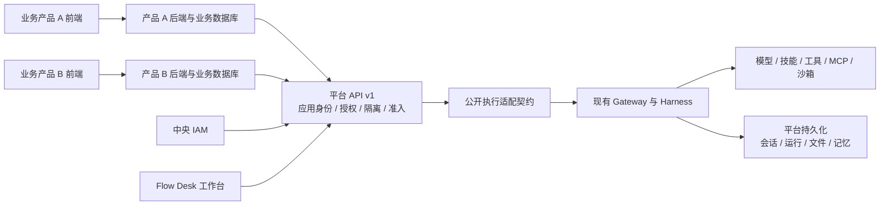

# DeerFlow 多产品 AI 底座方案

| 项目 | 内容 |
| --- | --- |
| 日期 | 2026-10-13（北京时间） |
| 已确认场景 | 自己的多个产品，统一管理 AI 底座 |
| 状态 | 架构建议与实施计划，尚未实施或验收 |
| 阅读基线 | 当前未提交工作区、模块指南、产品 PRD、IAM/产品数据边界和交接记录；不代表生产运行状态 |
| 首期目标 | 同一套 AI 服务接入两个自有业务产品，各自有身份、权限、数据范围和资源上限 |

## 1. 推荐方向

把当前仓库发展为共享 AI 服务：各业务产品保留自己的前端、后端和业务数据库，通过版本化 HTTP API 调用底座。底座统一负责模型接入、Agent 执行、工具与技能、AI 会话、AI 文件产物、任务状态、用量和运维。

Flow Desk 保留现有工作台能力，作为底座的第一个应用；逐步增加仅平台管理员可见的应用管理、能力发布、运行诊断和用量页面。平台管理员权限与查看用户正文的权限分别设计。

首期采用同一部署中的模块化服务，继续复用 Gateway 与 Harness；各产品部署独立。先形成统一契约和完整应用隔离，再依据容量实测拆出执行 worker。共享实例多客户 SaaS、支付、套餐和组织共享维持另行立项。



图中平台 API 与公开执行适配契约是新增设计。现有 Flow Desk 可以分阶段迁移，原会话协议需保持兼容。

## 2. 当前内容能复用到什么程度

| 当前内容 | 可以复用 | 服务化时需要补齐 |
| --- | --- | --- |
| Gateway + RunManager + Agent runtime | 运行创建、状态、流式消息、取消、历史 | 面向业务产品的稳定 API、应用身份和运行准入 |
| LangGraph 兼容接口 | 作为底座内部运行协议和现有工作台协议 | 适配层将内部事件和 DTO 转成平台 v1 契约 |
| Projects 与资料架 | 应用内部的资料/会话空间 | 独立的接入应用实体；现有 `project_id` 不表示一个业务产品 |
| 用户 owner、OIDC、中央 IAM、token vault | 用户认证、路由授权、data scope、后台权限重验 | 应用服务身份、应用代表用户的委托授权、应用策略 |
| PAT | 当前用户权限下的程序化访问 | 按应用发放和撤销的服务凭据；PAT 不能替代应用身份与用户委托 |
| 上传、产物、工作区、文件目录 | AI 运行文件与文件发现 | 应用范围、受控下载、保留策略与完整覆盖评估 |
| 定时任务、MCP task runtime | 已有持久化排队、租约和恢复机制 | 普通平台任务的应用准入与公平调度；不能推断所有运行已共享同一队列 |
| 模型授权与 usage outbox | 调用前授权、已落库事件的重试 | 应用归属、真实 Provider/数据库/故障链路验收；现有额度强制执行保持关闭 |
| 公开 Extension API、Flow Desk 扩展 | 产品表、路由、服务及观察器的独立边界 | 执行能力公开契约与应用上下文传播 |

代码核对入口：`backend/app/gateway/routers/thread_runs.py`、`backend/app/gateway/auth/pat.py`、`backend/packages/extension-api/deerflow_extension_api/auth.py`、`backend/packages/extension-api/deerflow_extension_api/contracts.py`、`backend/packages/harness/deerflow/persistence/projects/model.py`。

`ExtensionPrincipal` 当前投影用户、角色、权限和 internal 标记，并未提供本方案的应用身份。OwnerDataReader/Deleter/Authorizer 主要按 `user_id` 工作，也不等于任意创建 Agent 运行的公开服务接口。当前有权限闭环和测试收尾工作，已有实现与上线验收必须分开记录。

## 3. 平台与业务的职责

| 放在共享底座 | 放在各业务项目 |
| --- | --- |
| 模型 Provider、档案、路由和调用授权 | 订单、客户、简历、合同、商品等领域数据 |
| Agent、子任务、技能、MCP、沙箱执行 | 业务状态机、审批、支付与业务角色 |
| AI 会话、任务结果、输入附件和生成产物 | 业务记录与 AI 任务的关联关系 |
| 应用凭据、能力版本、执行权限、资源上限 | 自己的 UI、产品登录入口与用户操作确认 |
| AI 运行审计、用量、排队和故障诊断 | 最终业务写入校验与事务 |

AI 返回提案或结构化结果后，业务后端验证并写入自己的数据库。需要执行业务动作时，由业务系统提供受控 API/MCP 工具，平台工具授权同时检查应用、用户和动作。工具凭据只在服务端保管，运行只获得有范围、有时限的能力。

## 4. 四个独立概念

- `app_id`：一个接入产品，例如产品 A、产品 B、Flow Desk；由验证后的应用凭据解析。
- `subject_id`：实际用户或明确登记的服务主体；用户以经验证的 issuer + subject 映射，不用邮箱推断身份。
- `project_id`：某应用内的资料空间，复用现有 Projects 概念并增加应用归属。
- `resource_id`：会话、任务、文件、产物、Agent 等资源 ID，访问时检查应用和主体范围。

首期按单组织自有产品设计；中央 IAM 现有租户声明继续由其可信身份链处理，不能把它与应用 ID 混用。未来客户租户另增加独立 `tenant_id` 和迁移/隔离设计。

新增平台解析上下文包含应用 actor、用户/服务 subject、owner、能力版本和授权范围。继续保留用户 IAM 权限与本地 owner 求交；新增应用策略也参与求交，不能因为来源为自有产品就放行用户原本无权使用的模型或工具。

## 5. 应用身份与用户委托

首选通过现有中央 IAM 扩展应用客户端和短期、限定 audience/scope 的服务 token；其是否支持服务凭据与 token exchange 需实际联调确认，本仓库的 OIDC/vault 实现不能证明对端已有这些能力。

有用户操作的调用必须同时表达“哪个应用在调用”和“代表哪个用户”。优先采用 IAM 验证的委托 token；RFC 8693 可作为设计依据。若 IAM 暂不支持，可先限于登记的服务主体任务完成后端试点；用户态开放前需实现并审查委托机制。不要使用一个管理员 PAT 加请求体 `user_id` 模拟所有用户。

临时应用 API key 仅适用于已登记服务主体，需只保存摘要、限定能力、支持到期/轮换/撤销并通过 TLS 使用。它本身不证明任意最终用户身份。浏览器调用自己的业务后端，由业务后端持有应用凭据并转发 SSE。

客户端不能决定管理员、internal、owner、应用归属、IAM 凭据或授权范围。允许在路由中携带应用 ID 时，也必须与凭据解析结果一致。现有 `non_interactive` 等内部标记由受信任平台执行入口设置，不能开放为任意客户端配置。

## 6. 应用隔离是完整链路

默认同一用户在不同产品内的数据互不可见。共享模型和审核发布的技能代码可以复用；用户记忆、凭据、会话、检索索引和私有资料按应用隔离，跨应用共享另设显式授权。

实施时为资源增加可信的应用归属，授权与仓储查询使用应用 + owner/subject；仅在 metadata 中放 `app_id` 或只过滤列表不能构成安全边界。应用维度必须贯穿：

1. 会话、运行、历史、SSE 续接、取消和批量操作。
2. 附件、生成文件、工作区、回收站、目录快照和下载链接。
3. 自建 Agent、用户提示、记忆读取/写入、摘要后台任务和检索索引。
4. 用户集成凭据、MCP 连接、工具授权、模型调用和用量。
5. 调度、任务队列、worker、导出/删除、审计与缓存。

采用显式应用范围的存储路径与缓存键；不把拼接一个假 `user_id` 当作完成。若宿主某项能力仍只接受全局用户 ID，则增加公开应用范围契约，或先关闭该能力；全局记忆在隔离完成前不能对多个应用共享开放。

既有数据迁移到 `flowdesk` 默认应用，新增入口拒绝缺失应用范围；旧工作台由可信宿主绑定默认应用。先盘点全部 owner 数据路径，在副本迁移验证后切换。强隔离或高风险执行需求出现时，可以把应用路由至独立 runtime、数据库/卷和密钥；逻辑应用隔离不宣称等同独立运行环境隔离。

## 7. 面向业务项目的 API

以下全部为建议的新接口，当前仓库并未实现此套契约。统一前缀 `/api/platform/v1`，Flow Desk 自有设置保留 `/api/product/v1`，现有 LangGraph 工作台协议保持兼容。

| 接口 | 目的 | 首期范围 |
| --- | --- | --- |
| `GET /capabilities` | 返回当前应用可调用的能力和版本 | 是 |
| `POST /sessions`、`GET /sessions/{id}` | 建立/查看受应用与用户限制的 AI 会话 | 是 |
| `POST /files`、`GET /files/{id}` | 上传附件和受控下载 | 是 |
| `POST /executions`、`GET /executions/{id}` | 提交执行、读取状态与结构化结果 | 是 |
| `GET /executions/{id}/events` | SSE 进度、消息、结果通知 | 是 |
| `POST /executions/{id}/cancel` | 幂等取消 | 是 |
| `GET /executions/{id}/artifacts` | 查询可访问产物 | 是 |
| `GET /usage` | 应用授权范围内的用量汇总 | 是，先观测后校准 |
| `POST /schedules` | 应用范围的定时执行 | 后续 |
| 应用配置中的 webhook 订阅 | 后台任务完成通知 | 后续 |

调用方提交 `capability` 和受校验 `input`，例如：

```json
{
  "capability": "document.summarize",
  "version": "1",
  "session_id": "sess_example",
  "input": {
    "file_ids": ["file_example"],
    "language": "zh-CN"
  },
  "business_ref": "record_example"
}
```

应用与用户来自认证上下文，`business_ref` 只用于关联，不能用于授权。响应返回 `execution_id`、状态、事件地址和 request ID，不返回内部 checkpoint、宿主路径、凭据、原始异常或可执行配置。

发布的 capability 是有版本的执行规格：输入/输出 schema、执行方式、Agent/模型档案、允许的工具与技能、时限、数据保留和授权要求。运行固定使用不可变规格版本，避免运行期间管理员改配置改变语义。输出 schema 校验失败使用明确的失败状态。

短文本提取/总结优先用受授权的一次模型调用；多步骤研究、工具任务或文件生成使用 Agent runtime。两类都走相同的应用准入、权限、用量与审计，只有执行方式不同，避免所有请求都承担沙箱和子 Agent 开销。

## 8. 幂等、流式和执行生命周期

`POST /executions` 接受 `Idempotency-Key`，按应用 + 主体 + 操作限定作用域，保存输入摘要和受控结果引用。相同键、相同请求返回同一个执行；同键不同输入返回冲突。明确保留窗口，不能承诺永久去重。

异步接口先返回 `202`，业务项目通过查询/SSE 获取结果。SSE 使用独立事件序号与有界持久化回放；断线后重连不会重新创建执行，超出回放窗口则返回可恢复的当前状态。网络断开默认不取消任务，取消通过独立接口。事件字段保持平台版本化，内部 LangGraph 事件由适配层映射。

状态至少包含 queued、running、succeeded、failed、cancelled；claim/launch lease 等保持内部语义。无人值守任务关闭交互澄清；涉及业务审批由业务后端编排，未来支持 `needs_input` 时再定义恢复与撤权协议。

现有 scheduled queued/launching 租约、取消围栏和重验语义保持。平台准入表与宿主运行之间不是一个天然原子事务：需持久化提交状态、稳定幂等标识和恢复对账，处理“平台提交完成但还未创建 run”以及“已创建 run 但平台尚未记录 ID”的窗口。不能复制一份 RunManager 或假定 exactly-once 执行。

webhook 留到第二阶段，采用事务 outbox、有界重试和死信状态；签名涵盖事件 ID、时间戳与正文，接收方按事件 ID 去重。回调地址仅接受应用管理员登记/验证的目标，限制网络范围和跳转，避免任意请求 URL 成为外呼入口。

## 9. 资源、公平性与运维

每应用配置允许的 capability、模型档案、工具、文件限制、任务最长时间、运行并发和排队上限；全局另有最大执行预算。用户权限、应用允许项和运行能力求交，prompt 说明不能代替运行时工具过滤与授权。

按应用轮转或权重领取 durable queued 任务，限制单应用占用；排队行不计入运行并发。多实例准入必须使用数据库事务/共享锁与租约围栏，继续复用并核验现有 PostgreSQL 机制。

模型用量先按应用/用户/capability/run 归集可核对记录；已有 outbox 只能重试本地已提交事件，Provider 完成到落库间的崩溃窗口仍需保留未决 reservation 并对账。强制 token/费用额度待真实 IAM、Provider、重启和并发链路验收后启用。

首期生产基线采用已规划的 PostgreSQL、单个 Gateway runtime 和受控持久文件卷，依据当前发布闸门完成验收。对象存储、独立 worker、Redis、新队列或 Kubernetes 根据多节点文件访问、吞吐和运维需求引入，不作为两个产品接入的前置条件。沙箱权限与网络出口单独核验，应用间逻辑数据隔离不能抵御具有宿主权限的插件代码。

监控按应用统计排队等待、成功率、运行时间、并发、模型用量、SSE 恢复、未决 outbox 与备份状态。控制台诊断默认展示元数据，访问用户正文另设权限及审计；备份盘点 SQL、checkpoint、run events、文件/记忆、配置和加密材料，并在隔离副本实测恢复。

## 10. 代码组织和升级

建议新增 `product/platform-extension/` 放应用管理、capability 版本和平台路由/自有表，拥有独立迁移链；保留 `product/backend-extension/` 的 Flow Desk 偏好、品牌、文件目录和数据任务。新增 `contracts/platform/v1/` 保存跨语言 DTO、错误码与事件约定，首个业务产品实际联调后再提炼 TypeScript/Python SDK。

执行适配有明确的宿主边界：先为 Extension API 增加最小、可选、受认证上下文约束的执行服务契约，由 Gateway 调用现有 runtime。平台扩展只依赖 `deerflow_extension_api`，不导入 `app.*`、`deerflow.*` 或读私有表；缺能力时失败关闭。应用范围也需由宿主公开支持，不能在扩展旁路查询/删除宿主数据。

公开 API 升级按根指南同步项目/runtime 版本、Harness exact pin、`backend/uv.lock`、现有产品扩展下界/marker 和边界测试。新平台扩展增加同类边界门禁，并同步其安装快照。通用运行与隔离接缝是宿主补丁，登记上游补丁台账；各业务领域代码留在业务仓库。

后续上游升级只影响执行适配层及经登记的宿主补丁，业务项目继续按平台 API v1 合同测试。平台 API 稳定后，各业务项目与底座独立发布；内部底座升级不能无公告改变对外事件、错误码或 capability 的固定版本。

## 11. 实施顺序和验收

| 阶段 | 工作 | 交付与门槛 |
| --- | --- | --- |
| MP00 现状收尾与设计冻结 | 延续 R03/R04/R02，确认 IAM 客户端/委托能力；盘点应用隔离路径与首个能力 | 当前失败归因、鉴权矩阵、首个接入流程与迁移清单；全面门禁依照当前交接安排执行 |
| MP01 应用身份和隔离 | 应用注册/停用、服务认证、用户委托；可信应用上下文贯穿宿主存储与后台执行 | 同用户跨应用、同应用跨用户双重越权矩阵；未覆盖能力关闭；旧 Flow Desk 副本迁移通过 |
| MP02 API v1 和第一个产品 | 发布一个能力，打通附件→执行→SSE/查询→结果/产物；公开执行契约与幂等恢复 | 一个真实业务后端完整联调；拒绝发生在模型外呼前；重试不重复执行，断流/取消/重启可恢复 |
| MP03 第二个产品和运营 | 第二应用接入、应用用量、准入公平性、能力灰度；抽取 SDK | 两应用同时运行、资源抢占受限、凭据撤销及 worker 续验、真实数据库/IAM/Provider 与备份恢复验收 |
| MP04 需求驱动扩展 | 定时 API、webhook、共享知识显式授权、对象存储或 worker 拆分 | 分别立验收目标；完整多客户 SaaS 与收费仍单独立项 |

MP01 与 MP02 可在隔离开发环境迭代；开放多产品生产流量前，两者的安全与恢复门槛都必须达标。现有 LA 发布闸门仍适用，不以“新增几个接口”代替当前质量、迁移与恢复验收。

最少验收场景：应用 A 凭据访问 B 的会话/文件/产物/SSE 被拒；同一用户的 A/B 记忆不可串用；管理员停用应用后排队与后台任务重验；用户撤权后调用/续接/取消遵守新权限；相同幂等键只创建一次执行；claim 崩溃、重复投递和运行重启不产生未登记任务；业务结果 schema 有校验；用量按应用可核对；旧 Flow Desk 历史迁移不丢失。

排期需按当前失败数量、IAM 对端能力和首个产品范围估算。先完成 MP00 输出再给工期，当前不承诺固定周数或未经压测的容量。

## 12. 依据与本轮验证

仓库依据：[交接计划](../改造进度与后续计划.md)、[整体产品化 PRD](产品化需求与实施记录.md)、[自有改造指南](../自有项目改造指南.md)、[中央 IAM 边界](../../backend/docs/中央IAM边界.md)、[Gateway 产品数据边界](../../backend/docs/产品数据边界.md)。

外部依据：[RFC 8693 用户委托与 token exchange](https://www.rfc-editor.org/rfc/rfc8693.html)、[OWASP API1 资源级授权](https://api-security.owasp.org/editions/2023/en/0xa1-broken-object-level-authorization/)、[OWASP API4 资源消耗限制](https://api-security.owasp.org/editions/2023/en/0xa4-unrestricted-resource-consumption/)。这些规范支持身份/授权与资源限制设计，不证明当前仓库已实现本方案。

本轮仅阅读仓库文档、当前源码与工作区差异，并编写方案；没有执行应用测试、真实 IAM/Provider 联调、数据库迁移、构建、部署或上游版本检查。方案接口、应用隔离、公开执行服务与新目录均为待实施项。当前源码继续存在未提交改造与尚未完成的整体质量/上线验收，历史通过结果不能带到新功能上。
