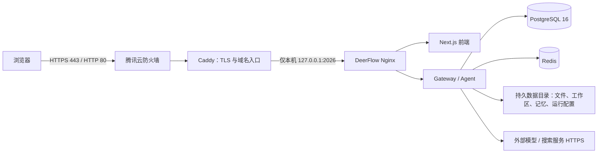

# Flow Desk / DeerFlow 腾讯云轻量应用服务器部署方案

| 项目     | 方案                                                                                                      |
| -------- | --------------------------------------------------------------------------------------------------------- |
| 服务器   | 腾讯云轻量应用服务器；截图显示 Ubuntu、4 vCPU、4 GB 内存、40 GB 系统盘、广州；Ubuntu 发行版与版本尚未确认 |
| 部署目标 | 首期私有试运行；单实例、单 Gateway worker、外部模型 API、低并发                                           |
| 部署方式 | Docker Compose + PostgreSQL + 主机 Caddy HTTPS 入口                                                       |
| 对外域名 | 建议准备一个自有域名；本方案不记录截图里的公网 IP                                                         |
| 执行状态 | 方案文档；没有连接或改动服务器，部署、容量与恢复验收仍待执行                                              |

## 1. 结论与适用边界

这台机器可以作为 Flow Desk 的**首期私有试运行服务器**，验证登录、会话、Agent 任务、文件上传和历史持久化。模型推理由外部模型服务承担，数据库和工作区都要持久化，网站只通过 HTTPS 暴露。DeerFlow 官方部署指南给 Gateway 与 Agent 运行时列出的最低配置是 2 vCPU / 4 GB，推荐配置是 4 vCPU / 8 GB；你的 CPU 达到推荐档、内存只达到最低档，而且还要给前端、Nginx、Redis 和 PostgreSQL 留内存，所以应按低并发试运行规划，不承诺多人并发容量。[官方部署指南](https://github.com/bytedance/deer-flow/blob/main/frontend/src/content/en/application/deployment-guide.mdx)

4 GB 内存比较紧，镜像构建、文件解析和 Agent 任务同时发生时可能出现内存压力；40 GB 系统盘也不适合长期保存持续增长的附件、工作区和备份。首次构建时不要同时运行其他重任务；如果构建或解析触发 OOM，应先加内存或升套餐，再继续上线。开始存放真实用户数据或扩大并发前，建议把内存升到 **8 GB 以上**，并准备 **100 GB 以上独立持久数据盘**。这是容量建议，不是对当前机器做过压测后的承诺。

当前项目 PRD 仍有上线前工作：自有 Git 与 DeerFlow 上游基线尚未建立可重复的合并关系，多租户账号管理、完整数据导出/删除、PostgreSQL 迁移和恢复演练也未全部验收。因此本方案适合个人或受控小范围试点，不代表可以直接作为对外开放的多租户 SaaS。

## 2. 推荐架构



DeerFlow 自带 Nginx 继续做同源路由和 SSE 转发；Caddy 在主机上负责证书与 HTTPS。Compose 只把入口绑定到 127.0.0.1:2026，数据库、Redis、Gateway 和前端端口都留在 Docker 网络内。Caddy 的反向代理支持 WebSocket；DeerFlow Nginx 已按项目配置处理流式响应。

## 3. 服务器资源规划

| 资源   | 当前                 | 首期建议                                                                           |
| ------ | -------------------- | ---------------------------------------------------------------------------------- |
| CPU    | 4 vCPU               | 低并发编排可试运行；文档解析、压缩、同时多任务会增加负载                           |
| 内存   | 4 GB                 | 官方建议中仅达到 Gateway/Agent 的最低档；全套同机运行需低并发观察，遇到 OOM 先扩容 |
| 系统盘 | 40 GB                | 只存系统、镜像和少量测试数据；部署前至少保留 10 GB 空闲，优先把用户数据移至独立盘  |
| 数据盘 | 截图未显示独立数据盘 | 尽量新增独立持久盘并挂载到 /data；扩大试点前建议 100 GB 以上                       |
| 模型   | 服务器本地运行       | 不建议在这台机器上部署本地大模型；使用外部模型服务并单独管理 API 密钥              |

若暂时不能扩容，先用合成内容做验收，控制上传和任务数量，将备份放到服务器以外。可以先把 `GATEWAY_WORKERS` 保持为 `1`（Compose 默认值），且不要在这台主机部署本地大模型或额外沙箱容器。上传接口默认每个请求总量上限为 100 MiB；它不是服务器总存储配额，Agent 产物和工作区仍可能持续增长。官方配置的最低/推荐资源说明针对 Gateway + Agent 运行时，不等同于整台机器上所有组件的压测承诺。

## 4. 网络入口与腾讯云防火墙

先在腾讯云轻量应用服务器控制台检查实例防火墙规则，再配置主机防火墙。腾讯云防火墙控制入站流量，来源地址可以按 IPv4/IPv6 网段分别限制；建议只放必要端口并按最小授权设置。[腾讯云轻量应用服务器防火墙说明](https://cloud.tencent.com/document/product/1207/44577)

| 入站端口                           | 来源                                                                             | 用途                                           |
| ---------------------------------- | -------------------------------------------------------------------------------- | ---------------------------------------------- |
| TCP 22                             | 仅管理员固定出口 IP；暂时无法固定时加强 SSH 密钥与登录限制                       | SSH 管理                                       |
| TCP 80                             | 公网                                                                             | HTTP 跳转 HTTPS，并供证书签发校验              |
| TCP 443                            | 首次初始化时先限制为管理员来源；管理员账号建立并关闭开放注册后，再按业务需要开放 | HTTPS 网站                                     |
| 2026、3000、8001、8002、5432、6379 | 不开放公网                                                                       | 应用内部端口、数据库、Redis 和可选 provisioner |

首次启用主机防火墙前，先确认 SSH 密钥登录有效，并保留一个已登录会话；新规则生效后用第二个终端测试 SSH，再关闭旧会话，避免把自己锁在服务器外。确认腾讯云模板没有额外放通业务端口；删除旧规则前先核对它们是否被其他服务使用。

项目 Nginx 的 Docker 发布端口必须继续绑定 `127.0.0.1:2026`，由主机 Caddy 代理公网请求。Docker 发布的容器端口可能绕过 UFW/firewalld 的常规过滤路径，因此不能依靠主机防火墙补救误绑定到 `0.0.0.0` 的端口；数据库、Redis、Gateway 和前端都不应发布公网端口。[Docker 的防火墙说明](https://docs.docker.com/engine/install/ubuntu/#firewall-limitations)

截图显示有 IPv6 地址，不代表 IPv6 入站和 DNS 已经配置好。先按[腾讯云 IPv6 指引](https://cloud.tencent.com/document/product/1207/104187)确认实例、系统和防火墙都支持并已启用，再测试 IPv6 的 SSH/HTTPS；验证前不要发布 AAAA 记录。IPv4 和 IPv6 的防火墙规则需要分别检查。

## 5. 部署步骤

### 5.1 准备域名与服务器

1. 选择稳定的 DeerFlow/Flow Desk 发布版本或经过验收的 Git commit；不要在服务器上直接跟随上游 main。当前上游基线问题见[产品化指南](../自有项目改造指南.md)。
2. 这台实例位于广州中国内地地域。若使用它向公网提供网站或 APP 服务，先完成适用的 ICP 备案并取得备案号，再开放域名访问；备案所需实例时长、主体和域名条件以腾讯云当前备案规则为准。[腾讯云轻量应用服务器 ICP 备案说明](https://cloud.tencent.com/document/product/1207/45756)
3. 在域名 DNS 中添加 A 记录指向服务器公网 IPv4。IPv6 完成验证后再决定是否添加 AAAA。
4. 按上表设置云端防火墙，并检查 Ubuntu 版本、磁盘和内存：执行 `lsb_release -a`、`df -h`、`free -h`。先确认系统是 Docker 官方支持的 64 位 Ubuntu 发行版，再按 Docker 官方 apt 仓库流程安装 Engine 与 Compose 插件；不要用只适合临时测试的一键安装脚本作为生产基线。[Docker 官方 Ubuntu 安装说明](https://docs.docker.com/engine/install/ubuntu/)
5. 按官方说明安装 Docker Engine 与 Compose 插件；Caddy 使用官方 Ubuntu 包。不要在服务器上安装整套前端/后端开发工具链。[Docker Ubuntu 安装文档](https://docs.docker.com/engine/install/ubuntu/)、[Caddy 安装文档](https://caddyserver.com/docs/install)

### 5.2 准备代码与持久目录

生产代码放在 /srv/flowdesk，运行数据放在 /data/flowdesk。如果新增了数据盘，先确认它确实挂载到 /data；不要在系统盘上先写入数据、之后再挂载空数据盘覆盖这个目录。

在有权限的部署账号下克隆自有仓库，切换到已经验收的产品发布版本：

```bash
git clone <自有仓库地址> /srv/flowdesk
cd /srv/flowdesk
git checkout <已验收的产品版本或 commit>
sudo mkdir -p /data/flowdesk
```

不要把开发者电脑里的 .env、config.yaml、真实用户数据或 API 密钥复制到服务器。首次配置可从仓库模板开始：

```bash
cp config.example.yaml config.yaml
cp extensions_config.example.json extensions_config.json
cp frontend/.env.example frontend/.env
cp .env.example .env
```

将 product/deploy/config.postgres.fragment.yaml 合并进 config.yaml，保留当前版本模板中的 config_version，不要覆盖成旧版本。该片段会把应用数据、LangGraph checkpoint、run events 和自定义 Agent 定义切换到 PostgreSQL；单改配置仍**不会迁移旧 SQLite 数据**。仓库现提供只读预检、默认不写入的 `product/deploy/migrate_sqlite_to_postgres.py`，用于把统一 `deerflow.db` 中可兼容的数据行复制到已初始化且业务表为空的 PostgreSQL。它不搬文件、记忆、配置/密钥、JSONL 运行事件或独立 checkpointer 文件；上线前必须按 [Flow Desk 部署手册](../../product/deploy/README.md#已有-sqlite-环境迁移) 在授权副本演练登录、历史、checkpoint 恢复和产品扩展数据，并继续使用文件式 Custom Agent 专用导入脚本处理 Agent 定义。

### 5.3 配置环境变量和账号

在根目录 .env 中设置部署路径、密钥和 PostgreSQL 密码。路径必须是服务器绝对路径，示例：

```dotenv
BIND_HOST=127.0.0.1
PORT=2026
DEER_FLOW_CONFIG_PATH=/srv/flowdesk/config.yaml
DEER_FLOW_EXTENSIONS_CONFIG_PATH=/srv/flowdesk/extensions_config.json
DEER_FLOW_HOME=/data/flowdesk
UV_EXTRAS=postgres
POSTGRES_PASSWORD=<openssl rand -hex 32 的输出>
BETTER_AUTH_SECRET=<openssl rand -hex 32 的另一份输出>
DEER_FLOW_INTERNAL_AUTH_TOKEN=<openssl rand -hex 32 的另一份输出>
```

先分别运行 openssl rand -hex 32 生成三份不同值，再粘贴到 .env；不要把尖括号占位符原样保留。UV_EXTRAS=postgres 是直接执行 Compose 构建时安装 PostgreSQL 驱动所需的构建参数。若 config.yaml 使用其他可选后端扩展，按配置补充相应 extras。限制 .env 只有部署账号可读，并从 Git 中排除。

```bash
chmod 600 .env
```

在 config.yaml 的现有 auth.local 节点设置 allow_registration: false，不要另建第二个同名 YAML 节点。首次管理员仍使用项目的初始化流程建立。根目录 .env 放模型/API 密钥；frontend/.env 只放前端所需设置，不要把服务端模型密钥复制进去。

### 5.4 首次启动前先完成管理员初始化

此仓库默认部署让 Nginx 仅监听服务器本机。可以在首次开放网站前，通过 SSH 本地端口转发访问初始化页面：

```bash
ssh -L 2026:127.0.0.1:2026 <Linux 登录用户名>@<服务器公网 IPv4>
```

保持该 SSH 会话打开，在管理员电脑浏览器访问 http://127.0.0.1:2026，完成首个管理员初始化并验证登录。若本机 2026 端口已占用，可把 SSH 命令左侧端口改成 2027，并访问 http://127.0.0.1:2027。allow_registration: false 必须已生效；确认应用初始化完成后才开放公网 HTTPS。SSH 端口转发只建立当前会话，不会更改管理员电脑的系统配置。

### 5.5 启动 PostgreSQL 部署组合

从 /srv/flowdesk 执行下列命令。项目名固定为 deer-flow，以便后续命令使用同一个 PostgreSQL 持久卷。显式列出所需服务可跳过 Compose 文件里仅供 Kubernetes 模式使用的 provisioner：

```bash
cd /srv/flowdesk
docker compose --env-file .env --project-name deer-flow \
  -f docker/docker-compose.yaml \
  -f product/deploy/docker-compose.postgres.yaml \
  up --build -d postgres redis frontend gateway nginx
```

启动后检查服务和 Gateway 健康状态：

```bash
docker compose --env-file .env --project-name deer-flow \
  -f docker/docker-compose.yaml \
  -f product/deploy/docker-compose.postgres.yaml \
  ps

docker compose --env-file .env --project-name deer-flow \
  -f docker/docker-compose.yaml \
  -f product/deploy/docker-compose.postgres.yaml \
  logs --tail=100 gateway
```

健康检查通过后，重新用 SSH 隧道检查管理员登录、创建会话、运行一次 Agent、刷新并查看历史、上传和下载测试文件。数据库卷叫 product-postgres-data（Compose 会按项目名加前缀）；运行目录由 DEER_FLOW_HOME 指向。升级/停止时不要附加 -v，不要对 Docker 执行带卷清除的全局 prune。

### 5.6 配置 Caddy 与 HTTPS

确认 DNS A 记录已经指向该服务器，然后在主机 Caddy 配置（通常为 /etc/caddy/Caddyfile）加入：

```caddyfile
flowdesk.example.com {
    reverse_proxy 127.0.0.1:2026
}
```

将域名替换为自己的域名，校验配置并重载 Caddy。Caddy 在主机上申请、续期 TLS 证书并把 HTTP 跳转 HTTPS；它需要外部可达的 80/443。可用 caddy validate 检查 Caddyfile，再用 systemctl reload caddy 重载。Caddy 反向代理能够承载 WebSocket 流量，SSE 仍由 DeerFlow 内部 Nginx 按现有流式配置转发。[Caddy Automatic HTTPS](https://caddyserver.com/docs/automatic-https)、[reverse_proxy](https://caddyserver.com/docs/caddyfile/directives/reverse_proxy)

先让 443 只允许管理员来源，通过域名检查证书、登录和一条真实 Agent 任务；确认开放注册已关闭、管理员账号可用后，再按试点需要开放 443。访问入口为 https://flowdesk.example.com。

## 6. 数据、备份和恢复

| 数据                                                       | 位置                                                                   | 备份要求                                  |
| ---------------------------------------------------------- | ---------------------------------------------------------------------- | ----------------------------------------- |
| 用户、会话、checkpoint、run events、Agent 定义、产品扩展表 | PostgreSQL 命名卷                                                      | 使用 pg_dump 做数据库逻辑备份             |
| 上传、Agent 工作区、记忆及运行态文件                       | DEER_FLOW_HOME，本方案为 /data/flowdesk                                | 与数据库在同一维护窗口做目录快照          |
| 配置和密钥                                                 | /srv/flowdesk/config.yaml、extensions_config.json、.env、frontend/.env | 加密后放入异机备份/密钥管理；不要提交 Git |
| Caddy 配置、Git commit、版本记录                           | 主机系统与发布清单                                                     | 记录配置和版本；证书可由 Caddy 重新申请   |

首期建议每日做一次加密的异机备份，初始保留 7 个日备份；数据重要性提高后再按业务要求增加周/月备份。备份目标不能只放在这台 40 GB 系统盘。建议目标值先设为 RPO 24 小时、RTO 4 小时，实际值要通过恢复演练验证后才能承诺。

一致性备份时暂停 Gateway 写入，再导出 PostgreSQL 并同步复制整个 /data/flowdesk。备份命令和隔离恢复步骤见[发布、备份与恢复操作手册](../../product/deploy/OPERATIONS.md)；同机恢复需使用带唯一容器名前缀的 `docker-compose.isolated-recovery.yaml`，并确认数据库卷、运行目录和 loopback 端口独立。命令和静态配置已补齐，但尚未在目标服务器实际运行。上线验收仍需将授权副本恢复到隔离栈，验证用户、会话历史、checkpoint、上传文件、工作区和产品迁移；不要在生产库上试跑清空或覆盖型恢复命令。

## 7. 升级与回退

1. 发布清单记录产品版本、Git commit、DeerFlow 上游基线、配置版本、迁移版本、镜像和备份编号。
2. 先在隔离环境升级同版本数据副本，测试 Gateway 健康、登录、会话/SSE、文件访问和产品扩展迁移。
3. 维护窗口暂停新任务，备份 PostgreSQL 与 /data/flowdesk，再切换到目标产品发布版本。
4. 执行已验收的配置调整后，使用与首次启动完全相同的 Compose 文件、项目名和服务列表重新构建启动。
5. 验证主页、登录、Agent 流式响应、历史和文件；失败时停止写入，按隔离演练过的方式恢复数据库与配套文件快照。
6. 保留已知可用的 Git commit、.env/配置备份及数据快照。只切回旧镜像不足以回退不可逆数据库迁移。

当前自有 Git 副本的上游祖先关系未确认，不能在服务器上盲目执行 git pull 或用新上游文件覆盖产品版本。先按[产品化指南](../自有项目改造指南.md)建立可重复升级基线，再把同步结果打包成产品发布版本。

Flow Desk 的 bootstrap、偏好、审计、文件目录和数据任务都依赖 `product/backend-extension/`；该 Python 插件拥有 Gateway 进程权限，不会因为目录存在就自动安装。必须在受控构建环境审查源码和依赖、执行安装快照、固定锁文件并把快照一起打入镜像；运行配置中的插件记录要设 `enabled: true`、`required: true` 和 `table_prefix: flowdesk_`，以免缺少扩展时把半成品误当作完整 Flow Desk 服务。管理页仅在需要时将 `features.administration` 打开；后台数据任务须显式设 `data_jobs.enabled: true`，支持偏好、定时任务定义、自建 Agent、本人会话历史、项目空间、个人记忆和受限文件七种窄范围删除，文件范围永久删除本人线程上传并把项目资料移入回收站；另支持七种单范围部分导出和带覆盖清单的组合 ZIP。账号全量擦除和完整备份仍未支持。数据范围兼容约定见[产品数据契约](../../contracts/product/data-management.v1.md)。不要在运行中的生产 Gateway 上加载未审查的 Python 插件。[部署扩展步骤](../../product/deploy/README.md#首次构建前准备-flow-desk-扩展)、[产品扩展说明](../../product/backend-extension/README.md)

## 8. 日常检查与扩容触发

- 每周检查容器健康、Gateway 日志、备份任务结果和备份可读性。
- 监控腾讯云 CPU、内存和磁盘；系统盘剩余低于 10 GB、磁盘使用超过 80%、内存持续超过 85% 或容器反复重启时，先暂停新增数据/任务并排查。
- 不要把完整对话、API 密钥或用户上传内容写入运维日志。
- 扩大用户范围、提高并发或开始留存真实业务数据前，先增加内存与持久数据盘，并完成一次升级回退和恢复演练。
- 若要让不可信用户自由使用 Agent 工具，不应把当前单机 Gateway 当作安全隔离边界；先设计独立沙箱和服务端权限方案，再开放注册或共享实例。

### 上线分阶段

| 阶段          | 做什么                                                                                         | 进入下一阶段的条件                           |
| ------------- | ---------------------------------------------------------------------------------------------- | -------------------------------------------- |
| 0. 试运行准备 | 固定已验收的 Flow Desk 发布版本；确认模型 API 可从广州服务器访问；准备域名、备案和异机备份位置 | 发布来源、域名备案状态、密钥保管方式明确     |
| 1. 私有验收   | 管理员通过 SSH 隧道首次初始化；限制公网来源；验证登录、Agent 流式任务、历史、附件和重启持久化  | 关键路径通过，注册已关闭，至少有一份异机备份 |
| 2. 小范围开放 | 配置 HTTPS；只邀请可信用户；观察内存、磁盘、API 调用和失败日志                                 | 连续运行稳定，恢复演练通过，容量留有余量     |
| 3. 扩大使用   | 增加到 8 GB 以上内存和独立持久数据盘；确认容器沙箱隔离、多租户权限、完整导出/删除等产品能力    | 对应产品化 PRD 的上线门槛逐项验收            |

在阶段 2 前，先将真实用户数据和恢复流程验证到隔离环境；不要把“容器显示 healthy”当作整套服务已完成上线验收。

## 9. 官方资料与仓库内手册

- [腾讯云轻量应用服务器防火墙](https://cloud.tencent.com/document/product/1207/44577)
- [腾讯云轻量应用服务器使用限制](https://cloud.tencent.com/document/product/1207/44376)
- [腾讯云轻量应用服务器 IPv6](https://cloud.tencent.com/document/product/1207/104187)
- [腾讯云轻量应用服务器 ICP 备案](https://cloud.tencent.com/document/product/1207/45756)
- [DeerFlow 官方部署指南（资源建议、Compose 与数据库说明）](https://github.com/bytedance/deer-flow/blob/main/frontend/src/content/en/application/deployment-guide.mdx)
- [Docker Engine for Ubuntu](https://docs.docker.com/engine/install/ubuntu/)
- [Docker 与主机防火墙注意事项](https://docs.docker.com/engine/install/ubuntu/#firewall-limitations)
- [Caddy 安装](https://caddyserver.com/docs/install)
- [Caddy Automatic HTTPS](https://caddyserver.com/docs/automatic-https)
- [产品 PostgreSQL 部署配置](../../product/deploy/README.md)
- [整体产品化 PRD](产品化需求与实施记录.md)
- [首期 MVP 启动与上线 PRD](首期上线规划.md)
- [前端项目结构](../项目结构.md#source-1)
- [后端项目结构](../项目结构.md#source-2)
