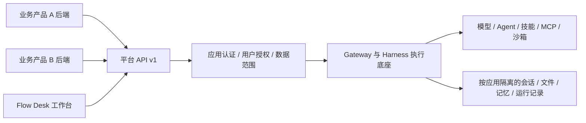

# Flow Desk 后期改造计划：多产品 AI 底座

| 项目 | 内容 |
| --- | --- |
| 更新日期 | 2026-10-14（北京时间） |
| 已确认方向 | 自己的多个产品，统一管理 AI 底座，通过接口为各业务项目提供能力 |
| 当前状态 | 规划文档已生成；MP00～MP04 功能改造均待开始 |
| 详细设计 | [多产品平台方案](plans/多产品平台方案.md) |
| 当前产品状态 | 以[改造进度与后续计划](改造进度与后续计划.md)的最新记录为准；本文件不替代现有质量与发布验收 |

## 1. 改造目标

将 DeerFlow / Flow Desk 发展为统一 AI 能力平台。多个自有业务产品各自保留前端、后端和业务数据库，通过版本化 API 调用共享底座；模型接入、Agent、技能、工具、沙箱、AI 任务和产物由底座统一维护。

Flow Desk 保留为第一个应用，并逐步增加应用管理、能力发布、执行诊断和用量页面。首期目标为两个自有业务产品接入同一套服务，各自具备身份、授权、数据范围和资源限制。共享实例多客户 SaaS、组织共享、收费与套餐按真实需求另行立项。

平台 API 与应用隔离为待改造能力。现有工作台可分阶段迁移，已有聊天、历史和 SSE 协议保持兼容。

## 2. 平台与业务边界

| 共享底座负责 | 各业务项目负责 |
| --- | --- |
| 模型接入、调用授权、AI 用量 | 产品登录入口、业务权限和用户交互 |
| Agent、技能、工具、MCP 与沙箱执行 | 订单、客户、简历等业务数据及状态机 |
| AI 会话、执行状态、输入附件和生成产物 | 业务记录与 AI 执行的关联 |
| 应用凭据、能力版本、准入限制和执行审计 | 审批、支付、最终业务校验及数据库事务 |

AI 返回结构化结果，由业务后端校验后写入自己的数据库。需要执行业务动作时，各产品提供受控 API/MCP 工具，底座检查应用、用户及动作授权。

统一账号下仍按产品隔离数据。现有 `Projects` 表示资料与会话空间；接入产品需新增独立的 `app_id`，不能复用 `project_id` 作为应用身份。

## 3. 必须补齐的能力

### 3.1 应用注册与认证

- 登记应用名称、状态、允许能力、资源上限和凭据；支持停用、轮换与撤销。
- 应用 ID 从验证后的服务凭据解析；请求体和普通请求头不能决定 owner、管理员、internal 或授权范围。
- 优先复用中央 IAM 的应用客户端与短期服务令牌；开工时核实 IAM 对端是否支持服务身份和用户委托，当前 OIDC 接入不代表这两项已具备。
- 用户态调用同时表达应用 actor 和用户 subject；服务任务使用明确登记的服务主体。个人 PAT 不替代应用凭据与用户委托。
- 浏览器通过自己的业务后端调用平台，应用凭据由业务后端保管。

### 3.2 应用数据隔离

- 会话、运行、历史、SSE 续接、文件、产物、资料空间和回收站按应用与 owner/subject 检查归属。
- 用户记忆、检索索引、自建 Agent、个人连接、工具凭据、缓存、后台摘要和导出/删除任务也带应用范围。
- 隔离贯穿宿主授权、仓储查询、文件路径、运行上下文和 worker；仅增加 metadata 字段或过滤列表不足以完成隔离。
- 旧 Flow Desk 数据迁移至可信默认应用 `flowdesk`，在副本验证后切换；未覆盖隔离的能力保持关闭。
- 共享模型和审核发布的技能代码可以复用；跨应用用户资料或记忆共享另设显式授权。

### 3.3 版本化能力与接口

新增 `/api/platform/v1` 作为各业务后端的接入契约，底座内部继续适配现有 runtime。调用方选择能力名与版本，提供受校验输入；服务端控制模型档案、Agent、工具、技能和执行限制。

| 建议接口 | 用途 |
| --- | --- |
| `GET /capabilities` | 查询当前应用允许的能力和版本 |
| `POST /sessions`、`GET /sessions/{id}` | 创建与读取 AI 会话 |
| `POST /files`、`GET /files/{id}` | 上传输入附件与受控下载 |
| `POST /executions`、`GET /executions/{id}` | 提交执行、查询状态与结构化结果 |
| `GET /executions/{id}/events` | SSE 进度与结果事件 |
| `POST /executions/{id}/cancel` | 幂等取消 |
| `GET /executions/{id}/artifacts` | 查询生成产物 |
| `GET /usage` | 应用授权范围内的用量汇总 |

以上接口均为待实施设计。能力规格固定输入/输出 schema、执行方式、允许工具和版本；简单任务可采用受授权的单次模型调用，多步骤任务走 Agent，两者共享认证、用量和审计规则。

### 3.4 执行可靠性与资源限制

- 提交接口支持按应用、主体和操作限定的 `Idempotency-Key`；相同请求重试返回同一执行，同键不同输入返回冲突，并定义保留窗口。
- 异步执行支持持久化状态、查询、SSE 有界回放及独立取消；断线默认不重新提交或取消任务。
- 处理平台准入与宿主创建 run 之间的崩溃窗口，通过稳定幂等标识和恢复对账关联运行。
- 各应用限制并发、排队数量、任务时限、文件大小及允许模型/工具；排队行不计入运行并发。
- 定时执行保留现有 durable queued/launching、租约围栏和授权续验规则；无人值守运行的内部标记由可信宿主设置。
- 模型用量按应用归集，真实 IAM/Provider、outbox、重启及并发链路验收后再启用强制额度。
- webhook、应用定时 API 和 SDK 在真实接入后继续完善；webhook 定义签名、去重、有界重试和受控回调目标。

## 4. 后期任务与执行顺序

| ID | 优先级 | 工作范围 | 状态 | 开工依赖 | 验收结果 |
| --- | --- | --- | --- | --- | --- |
| MP00 | P0 | 核实 IAM 服务客户端/用户委托，盘点应用隔离资源，选首个业务产品及一个 AI 能力，确定接口和迁移范围 | 待开始 | 用户后续启动实施；复用当前 R03/R04 的相关盘点 | 有身份契约、资源清单、越权矩阵、首个接入流程和迁移清单 |
| MP01 | P0 | 应用注册/停用、服务认证、用户委托、宿主应用范围和旧 Flow Desk 迁移 | 待开始 | MP00 | 同用户跨应用及同应用跨用户隔离通过；后台任务撤权续验；旧数据副本迁移通过 |
| MP02 | P0 | 平台 API v1、公开执行适配契约、首个能力及第一个业务后端接入 | 待开始 | MP00；生产开放前 MP01 必须验收 | 上传→执行→SSE/查询→结果/产物完整联调；幂等、取消、断流、重启恢复通过 |
| MP03 | P1 | 第二个业务产品接入、应用用量、公平准入、管理页面和 SDK | 待开始 | MP01/MP02 | 两应用同时运行且数据不串用、资源受限；真实 IAM/Provider/PostgreSQL 与备份恢复有证据 |
| MP04 | P2 | 定时 API、webhook、显式共享知识、对象存储或 worker 拆分 | 待开始 | 首批接入稳定且需求明确 | 每项单独定义实现范围与验收；多客户 SaaS 和收费另行立项 |

当前工作仍以主进度文件记录的首期收尾、用户暂停/恢复约束和发布闸门为准。本文件把后期目标登记为待办，不改变现有 R01～R15 状态。MP01/MP02 可以在隔离开发环境迭代，生产开放前必须同时满足隔离、可靠性和现有 LA 发布验收要求。

下一项后期任务为 **MP00**：先选定一个产品的一条真实流程，完成身份契约、资源隔离清单及接口约定，再安排实现和工期。

## 5. 代码位置与兼容要求

- 建议新增 `product/platform-extension/` 承载应用管理、能力版本和平台自有 API/表，使用独立迁移链；保留现有 Flow Desk 扩展职责。
- 建议新增 `contracts/platform/v1/` 保存跨语言 DTO、错误码和事件契约；上述目录本轮未创建。
- 为公开 Extension API 增加最小、可选且受认证上下文限制的执行服务与应用范围契约，由 Gateway 复用现有 runtime。
- 平台扩展只依赖 `deerflow_extension_api`，不导入 `app.*`、`deerflow.*` 或旁路操作宿主表/文件；缺少宿主能力时失败关闭。
- 公开 API 变更同步项目/runtime 版本、Harness exact pin、`backend/uv.lock`、扩展下界/marker 与边界测试；宿主补丁登记到[上游补丁台账](上游补丁台账.md)。
- 各业务项目依赖平台 v1 契约独立发布；上游升级验证执行适配、身份、事件、资源范围及迁移兼容。

## 6. 最低验收清单

- [ ] 应用 A 凭据无法读取、续接、下载或取消应用 B 的资源。
- [ ] 同一用户在 A/B 产品中的记忆、检索、文件和缓存不串用。
- [ ] 应用停用、用户撤权后，排队与后台执行按当前授权重新核验。
- [ ] 模型或工具拒绝发生在外部调用前，用户权与应用允许项同时生效。
- [ ] 相同幂等请求只创建一次执行；claim 崩溃和重复投递可恢复对账。
- [ ] SSE 断流恢复、主动取消、进程重启及输出 schema 校验有真实结果。
- [ ] 用量按应用可核对，并发与队列限制在并发/多实例条件下有效。
- [ ] 旧 Flow Desk 历史迁移、备份恢复和现有发布闸门通过。

## 7. 本轮记录

2026-10-14：将已讨论的多产品底座方向整理为独立后期改造文件，复用现有[详细平台方案](plans/多产品平台方案.md)，同步导航、产品 PRD 和主进度文件。Windows PowerShell 下，5 个关联文档的严格 UTF-8 解码、本地文件链接及尾随空白检查通过，MP00～MP04 共 5 条任务核对通过，关联 tracked 文档 `git diff --check` 通过。未执行应用测试、IAM/Provider 联调、代码改造、数据库迁移、构建或部署。计划完成不表示功能实现或上线验收。
